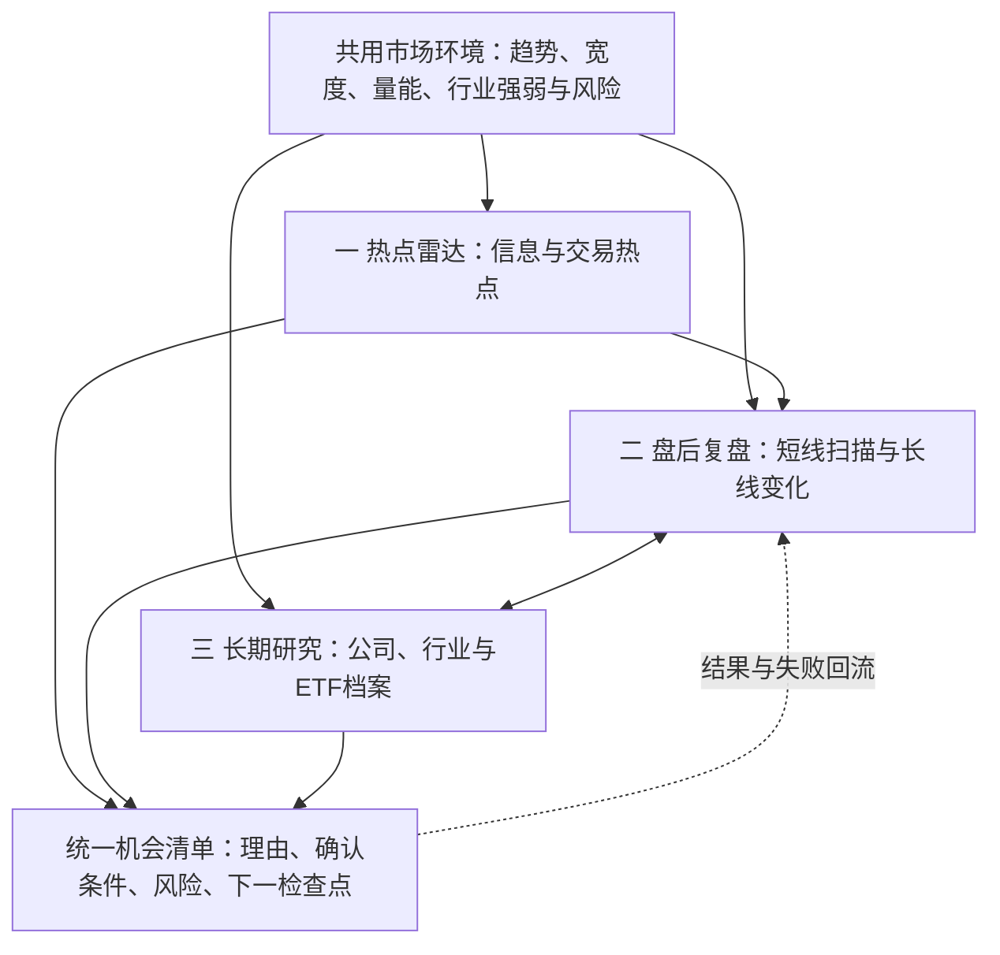

# 个人投研工作台重构方案

> 2026-11-09 · 按“热点雷达 / 盘后复盘 / 长期研究”重构业务方案。已有只读总览、研究跟踪两表/服务/只读 API、静态经验卡及短期结果回填；本轮修复完成批次准入、证据版本、交易日检查点及修订/重试，见 §8.2。**这是实现与离线验证进度，不代表 A1/A2/A3 父阶段或策略收益验收完成**；页面、事件/长期自动生产链及真实夜间全链仍待验。目标：结合当时市场环境，持续发现、跟踪并验证个股及 ETF 的交易机会，日常只读变化与待办。§1.1/§1.2 保留历史只读核对事实。
> 阶段定义唯一真源为[协同总纲 §12.2](./个人策略协同总纲.md#122-阶段推进)；本文只列 A0-a 等子工作包，不重新定义 A0~A4。[单票卡规格](./单票卡规格-v0.1.md)、[规则登记表](./单票卡规则登记表.md)、[数据约定](./数据与验证统一约定.md)及[策略收敛路线图](./策略收敛与回测路线图.md)继续各自负责计算、登记、数据及晋级标准，不在这里复制。

## 0. 先看这一页：三层找机会

1. **业务分三层：热点雷达发现驱动，盘后复盘检查反应，长期研究积累公司/行业/ETF认知。** 三层共用市场环境，分别产生研究机会，统一展示；事件研究不必等长期资料齐全，长期股息也不要求每天有催化。
2. **策略按方法并行，执行按现状分批。** 当前主工程、个人脚本、筛选预设与分析 skill 的复用见 §1/§2；保留守/攻/观察及共用输入，不因重新归类就启用冻结策略。父阶段只认总纲 §12.2。
3. **首交 A1-a 自动只读总览，零人工研究输入。** 先对象闸门再验必需源；三层有缺口也如实展示，不要求新增模型调用、人工催化清单或逐票填卡。RE01 无生产者时排除自动跟踪，见 §3.3。

新增策略、数据或功能先查 [§7.2~§7.4](#72-扩展边界业务入口稳定按类型接入)：沿现有入口增加实现或适配，共用总览、跟踪与验证；以第二个策略接入验收扩展性。首批新高/screening 的证据与批次约束已在总览适配中落地，其余公共扩展合同仍按接入补齐。

三层是用户工作方式；总纲六层继续约束事实、感知、经验、研究、决策、验证的职责，两者不竞争。市场环境是共用背景，机会清单是共用输出，不增加第四个工作台。技术合同与实施细节从 §3 起按需查，不要求每天读本文。

分类轴按问题使用，日常提示每句原则上最多展示两根轴；工程明细和审计保留全部独立字段，不据此删字段或合并状态。

| 正在回答的问题 | 使用的分类轴 |
| --- | --- |
| 今天先看哪里 | 热点雷达 / 盘后复盘 / 长期研究 |
| 为什么关注、看多长时间 | 策略方法 + 研究周期 |
| 能否参与、资金怎么安排 | 资金角色 + 对应资格；仓位另核总纲风险预算 |
| 资料足够支持哪种判断 | L0 / L1 / L2，逐任务核必要项 |
| 系统内部谁负责什么 | 总纲六层职责 |

## 1. 现状与重构边界

当前有两个断点：先要确定哪些来源仍有效、值得每天看；再解决产物按策略和日期分散、研究问题难以跨天关联。已有跨日催化计数、信号生命周期和结构化报告，应先用其自动产出总览，再按需要补连续跟踪。

| 已核对的现有能力 | 复用方式与缺口 |
| --- | --- |
| `DataFetcherManager`、`daily_market_context.py`、`market_hotspot_service.py`、`market_structure_service.py` | 共用行情/基本面及市场背景、行业/概念强弱；现有排名和候选解释不等于独立重大事件监控 |
| `ScreeningService`、`screening/`、现有选股页面 | 复用已整合 AlphaSift 的热点列表/详情、十个筛选 YAML、运行历史与来源健康；受现有开关控制，不能假定已启用或全部有效 |
| `collect_screening_snapshots.py`、既有信号评估/BacktestService | 已有严格 Top-N→screening__ 快照桥接和后验入口，继续复用；运行历史与信号投影不算两份独立样本 |
| `SearchService`（`src/search_service.py`）、`IntelligenceService`（`src/services/intelligence_service.py`）、`catalyst_digest_service.py` | 复用新闻/事件搜索、资讯及候选主题跨日计数；补事件版本与传导核验，候选摘要不能独自承担全市场雷达 |
| `run_fast_review_bundle.py`、`personal_strategy_matrix_service.py` | 第二层首批信号与聚合来源；区分证券/摘要，保留原信号、全部样本与规则版本 |
| `ResearchArtifact` | 复用观点、证据、失效条件和下一动作结构；当前主要对应单份报告，不能充当多天研究记录 |
| `DecisionSignalService`、outcome/feedback 服务 | 已有建议池、去重、状态、反馈和后验评估；保留为建议与结果索引，不再建另一套建议池 |
| `StockProfileService`、`GET /api/v1/stocks/{stock_code}/profile` | 已聚合行情、历史、研究、资讯、持仓和监控；Web 个股工作台尚未接完整入口 |
| `HomeStockWorkspace`、`useWatchlist`、现有任务队列/通知/调度 | 后续复用页面、任务及变化提醒；`STOCK_LIST` 不是多假设研究库，不另建调度器 |
| L0 卡、选举事件卡、规则登记 | 已有本地研究证据；尚不能当作已上线的自动持续跟踪能力 |

源代码入口见[个股聚合 API](../stock-profile-api.md)、[结构化研究产物](../research-artifact.md)、[决策信号](../decision-signals.md)和[总纲 §12.1](./个人策略协同总纲.md#121-已确认的现状与断点2026-11-07-只读核查)。接口和接线以实际代码为准，旧文档中的阶段说明可能滞后。

保留 Python/FastAPI、现有数据库及 Web/桌面边界，不引入第二套行情、模型配置、建议池或回测。业务覆盖个股与 ETF；首批自动证券接入仍限已核身份的 A 股个股，ETF 份额/基金/国家队资料先作证据。独立 ETF 机会后续补资产身份、基准、复权/分红、费用/溢折价及交易规则合同，再扩现有入口，不能仅凭六位代码塞进股票 API。

### 1.1 首批来源体检与取舍（本机只读快照）

| 2026-11-07 核查对象 | 已确认事实 | 接入处理 |
| --- | --- | --- |
| 当前默认信号 | profile 配置 earnings / hundred_day_high / trend_leader；全库信号快照 27,853 行，最新信号日 11-06；矩阵有 11-06 产物 | 总量含其他来源/实验/摘要，不能代表三个默认源都新鲜；须逐源校验对象、覆盖和时效 |
| `re01_watchlist.csv` | 2 行，均为 `retro_watch`，信号日 11-06；未在 scripts/src/tests 找到对应自动更新实现 | 可读回顾示例，不计正式统计；自动跟踪未实现，首批接入暂缓，见 §3.3 |
| 股息 / 短线圈 | 本机日期目录最新为 09-30 | 标低频旧资料/待体检，先核内容日期、覆盖与生成器，不由目录日期断言策略无效 |
| 报告 / 建议池 | `data/stock_analysis.db` 中 analysis_history 与 decision_signals 各 1 行，时间分别为 03-24 / 09-27 | 当前可选证据，不作为总览必需输入；行数只描述此库，不能证明其他运行库或策略无效 |

按信号类型拆开（2026-11-08 只读核查，`kline_signal_snapshot`）：

| 信号类型 | 行数 | 最新信号日 | 当前判断 |
| --- | --- | --- | --- |
| `hundred_day_high` | 5,889 | 2026-11-06 | 当日 36 行，身份/质量仍须逐条核验 |
| `trend_leader_unified` | 1,609 | 2026-11-06 | 当日仅 1 行 TL_SUMMARY，非证券；最近证券记录在 11-05，不能把摘要当新候选 |
| `earnings_surprise` | 1,335 | 2026-07-10 | 本库未见更新快照，待查零结果、运行失败、写入或其他库；不能仅据 max 日期断言生产者停机 |
| `screening__dual_low` / `__momentum_quality` / `__shrink_pullback` | 312 / 312 / 153 | 均 2026-11-06 | 每类当日 12 行，screening_runs 共 90 次，最新 created_at=2026-11-06 10:18:11.406095 UTC，即北京时间 18:18:11.406095；批次已结束，降级/覆盖另核 |
| `continuous_up_ratio` / `continuous_up_streak` | 5,146 / 3,246 | 2026-04-26 | 与冻结登记一致，非故障 |
| `daily_slow_rise` | 1,112 | 2026-09-25 | 与冻结登记一致，非故障 |
| `random_baseline__hundred_day_high` / `__earnings_surprise` | 3,714 / 1,302 | 2026-09-24 / 2026-07-10 | 随机基线，不是策略 |

近五个交易日全库单日原始行数 49~78（11-06 为 73）：11-06 默认源 37 行=新高 36+趋势摘要 1，另 36 行来自上述三个筛选预设。行数不是独立证券数、可交易候选数或前向样本量；业绩源缺新快照不等于所有观察研究无来源。

已核 `src/storage.py`：ScreeningRun.created_at 默认 utc_naive_now，按无时区标记的 UTC 存储；本机 cron 无 TZ/CRON_TZ 覆盖，宿主为 Asia/Shanghai，运行日志及采集审计 generated_at 为北京时间（UTC+08:00）。三份审计 run_id 与库记录对应，末批与 18:18:12 日志闭合。**结论仅限已核字段，不能推定所有表的 created_at 都为 UTC**；批次完成不证明行情/候选完整。剔除当日趋势摘要后的 72 条仍是原始条目，去重证券数与质量闸门后的数量待实算。

A0-a 四项初表（当前启用 / 输入健康 / 验证状态 / 展示去向，2026-11-08 只读）：

| 来源 | 启用 | 输入健康 | 验证状态 | 展示去向 |
| --- | --- | --- | --- | --- |
| `hundred_day_high` | 是 | 11-06 为 36 原始行 | 观察期至 2026Q4（差 5+6 条目） | 第二层候选；资金资格按既有环境/确认规则 |
| `trend_leader_unified` | 是 | 最新证券 11-05；11-06 仅摘要 | 观察期至 2026Q4（随机分位 82.4） | 第二层；摘要只作诊断，不回填成当日证券 |
| `earnings_surprise` | 是 | 本库最新 07-10，原因待查 | 样本不足 | 第二层观察，标待体检 |
| screening 三预设 | cron 进程显式启用；常驻 API 开关未核 | 11-06 三批采集成功，各 written=12；含降级、缓存回退，质量另核 | 未据此取得个人策略资格 | 第二层候选，首版第二类适配优先核验 |
| 股息线 | 是 | 目录停于 09-30 | 既有点时研究见股息专题；旧评分结论不冒充当前精简B排序的验证 | 守线池（低频） |
| 短线圈 | 是 | 目录停于 09-30 | 未验证 | 攻线（低频） |
| RE01 | 规则已登记 | 2 行 `retro_watch` | 未验证 | 回顾阅读，不自动跟踪 |
| 报告 / 建议池 | — | 各 1 行 | — | 可选证据 |

该表是 A0-a 的起点而非完成物：“最近成功批次、覆盖范围、失败原因”优先读取 §1.2 的既有日志、审计和摘要，再按标的交易日历判断时效；适配尚未实现，不能仅凭调度存在或 done exit=0 勾选完成。

A0-a 按现有目录/profile/冻结登记形成接入清单，记录“当前启用、输入健康、验证状态、展示去向”四项；来源陈旧只暂停其当前确认用途并显示缺口，策略冻结仍走既有判据。股息与短线圈先各做一次受控体检，可先只读核日期/覆盖并登记失败或缺口；它们作为可选源，恢复产出不作为 A1-a 的前置。是否需运行生成器、是否在线取数在实施时明确，本轮没有运行它们。

### 1.2 现有生产编排登记（2026-11-08 本机只读核对）

已核当前用户 crontab、五个包装脚本及 11-06 日志；下表时间均为 Asia/Shanghai，北京时间。日历与跳过行为沿原实现，周一至五触发不等于一定开市；这里登记现状，不新增或修改任务。

| 任务 / 包装脚本 | cron 触发 | 产物 | 日志 | 失败/受限如何辨认 | A1-a 是否必需 |
| --- | --- | --- | --- | --- | --- |
| 筛选 `data/runtime/screening_daily.sh` | 周一至五 18:10 | 三预设 strict Top-20 上限；`data/screening_snapshots/<日期>/*.json`、screening_runs 与信号快照 | `data/run_logs/screening_snapshots.log` | 核采集成功/失败数、done exit、run_id 与候选数；warnings/degradation、来源日期另判 | 是，首批第二类来源；读已完成产物 |
| 补数/预热 `data/runtime/warm_daily.sh` | 周一至五 18:40 | 历史缓存、`data/runtime/cache_prewarm/<日期>/summary.json` | `data/run_logs/warm_daily.log` | 前置补数可重试，done exit 只记录末步预热；摘要/各步失败仍需透传 | 输入依赖，不能充第二份机会来源 |
| 结构扫描 `data/runtime/structure_scan_daily.sh` | 周一至五 19:00 | 000300 指数补数、`data/strategy_review/screen_updays_structure_YYYYMMDD.*`、stock_profiles_YYYYMMDD | `data/run_logs/structure_scan_daily.log` | **2026-11-09 已补：done 行写 `exit=<rc>`（首个失败步骤）且 cron 按该值返回**；指数补数失败仍只 warn；2026-11-06 及以前的历史批次无退出码，总览继续按降级显示，不回溯改日志 | 结构候选可选；用到基准时核对应数据 |
| 矩阵 `data/runtime/matrix_daily.sh` | 周一至五 19:05 | `data/manual_runs/personal_strategy_matrix/<日期>/` 的运行摘要/review；后处理含行情同步、股息T、复盘、scoreboard/作战计划 | `data/run_logs/matrix_daily.log` | flock 跳过/日历跳过不等于新批次成功；done exit 只保存矩阵主命令 RC，不汇总后处理 | 是，提供首批百日新高；旧文案/AI 审核不必接入 |
| ETF `scripts/run_etf_flow_weekly.sh` | 周五 17:30 | `data/strategy_review/etf_flow/etf_flow_YYYYMMDD.csv` 等 | `data/strategy_review/etf_flow/run-YYYY-MM-DD.log` | 结束 rc 取 Python 管道退出码；核实际数据日，非脚本执行日 | 可选低频证据，不阻塞每日总览 |

筛选包装器仅对采集命令设置 SCREENING_ENABLED=true，解释了“配置默认关闭但 cron 有产出”；不能据此断言常驻 Web/API 已启用，也不需 A1-a 改开关。cron 的先后时间不是可靠依赖屏障：warm 供缓存，structure 与 matrix 可重叠；只等待实际订阅产物，不强等所有五条任务或重造调度/健康服务。

11-06 完成证据：screening 18:18:12（成功3/失败0，各 written=12）、warm 18:45:23、structure 19:00:39、matrix 19:52:08；ETF 17:30:03 rc=0，实际输出数据日为 11-05。原日志、审计、数据库 run_id 与运行摘要联合构成只读健康投影，A0-a 负责映射，不另建一套生产者或持久健康表。

**仍有已核质量缺口。** matrix 虽 done exit=0，后续行情重建为 85/174 失败（48.9%），19:35:44 已明确记录失败后继续；screening 三批均含降级信息，shrink_pullback 使用 last_good_cache，日线来源含 stale/partial_history，LLM 排序均回退 factor。须逐项核实际截至日、覆盖与允许的计算模式，不能把这些批次直接称为两类健康源；非必需模型回退也不直接等于全部数据失败。A0-a 登记时未改包装脚本；2026-11-09 已单独修结构扫描的完成证据（补 `exit=<rc>` 与退出码传递），其余包装器仍未重跑或改造。

## 2. 三层工作方式、策略归类与执行

| 业务层 | 研究内容 | 输出与使用节奏 |
| --- | --- | --- |
| 一 · 热点雷达 | 信息热点：政策/海外/公告/订单/行业价格；交易热点：行业强弱、量能、扩散和持续性 | 新变化→传导机制→相关行业/标的→已反应程度→下一验证点；盘前读隔夜、盘后核反应，重大更新再提示 |
| 二 · 盘后复盘 | 短线扫描趋势/图形/量价/业绩事件；长线变化检查财报、持仓、分红与行业证据；同时回看旧判断 | 新候选、待确认、失效/到期及长期变化；短期沿用 1~20 交易日默认窗，中期只作评价窗，机会与结果复盘分别标注 |
| 三 · 长期研究 | 公司业务、股东/机构/国家队披露、财务、行业供需、估值、周月年线与 ETF 产品资料 | 稳定资产档案与多个独立假设；披露/事件驱动更新，周度看变化、月季复核，条件触发才回到今日清单 |

三层均可独立产生研究机会；事件与配置资格仍分别按卡规格，不能要求全部命中“业绩+图形+催化”。热点强弱不证明明日涨跌；盈利水平、预期差、价格反应分开，无法取得事前预期时不称“已证实超预期”。

长期按股息现金回报、稳定经营与估值、成长、周期拐点分别研究。中远海控需同时核航运周期与可持续分红；电力区分水/火电等经营驱动，家电核需求/出口/竞争。月年线提供价格位置，不替代现金流与逻辑验证。ETF 是可承载事件、轮动、红利或指数配置的工具，按实际敞口归类，不统一当防守。

市场环境共用指数趋势、市场宽度、量能/波动、行业相对强弱和近期信号延续/失败情况，影响研究排序与原有风险纪律。当前 profile 的 defensive 是运行配置，技术开关也只代表登记的价格条件；完整环境指标和策略适配仍需验证，不据配置宣称今日牛熊。

### 2.1 资金角色、打法与研究周期的对应

| 总纲 §3 归属 | 对应打法/输入 | 研究周期 | 资格与融合边界 |
| --- | --- | --- | --- |
| 守线 | 股息、现金回报与风险管理 | 通常长期，周/季检查 | 复用股息专题；池资格不等于单票卡配置资格，两者各按原标准核验 |
| 攻线 | 图形∩催化；满足独立条件后研究的 RE01 | 通常短期 | 涉及公司事件时核事件分支；RE01 按独立分支，R4b 不归为可参与的攻线候选；生产者未就绪不自动跟踪 |
| 观察线 | earnings_surprise、待确认图形/反弹、股东户数等 | 短期或长期研究，0 仓位 | 业绩仍在默认三信号配置中，本库时效待查；先归观察，待确认、R4b 或证据不足只观察，转守/攻须核目标角色条件 |
| 共用研究输入 | 国家队/基金/ETF、市场环境、事件及财务资料 | 可跨周期，无交易仓位 | 给守/攻/观察提供证据，不按输入标签授资格；ETF 若成为实际投资标的，再按敞口和目的判定角色 |

三条资金线和共用输入的定义以[总纲 §3](./个人策略协同总纲.md#3-三条资金线职责表执行视角)为准。业务层、周期、打法、资金角色、资格分别分类，不把新分类硬塞进 catalog.line；L0/L1/L2 是资料层级。[精简方案](./个人策略精简方案.md)是存档，不能恢复旧启停；跨层展示同一原始信号不重复计样本。

新发现采用以下默认路由，既有持仓、策略启停和已核角色不因展示迁移而重置：

- 热点雷达发现的标的默认进观察线，0 仓位；确认与对应资格通过后，才可提交目标资金线复核。
- 盘后新筛选结果默认进观察线；来源已有有效资格时引用原结果，不由总览重新授予。
- 长期新观点默认观察，按股息/现金回报、成长/周期等方法标明目标守线或攻线；长期研究不直接获得守线仓位。国家队/ETF 代理等资料保持共用研究输入。
- 实际参与须同时满足适用环境、对应资格、预算和退出纪律，并按既有流程人工决定；热点强、长期看好或多策略命中都不能单独解禁。

### 2.2 个人策略与专题的去向

| 策略/工具家族 | 三层归属与用途 | 当前执行边界 |
| --- | --- | --- |
| `hundred_day_high` / `trend_leader_unified` | 二：突破/趋势扫描；一：交易热点旁证 | profile 默认运行，仍在验证观察期；弱市单一新高降权等原纪律不变，摘要排除 |
| `earnings_surprise` | 二：业绩事件观察；三：财务证据 | profile 默认启用，本库新快照不足；先查生产/零结果/持久化，不删配置或冒称数据新鲜 |
| `earnings_observation` / `scan_earnings_lowbase_watch.py` | 二跟踪业绩后的市场反应，三积累经营认识 | 前者备用池、非默认三信号；后者纸面研究，不进默认快复盘/cron |
| `run_short_term_watch.py` / `run_catalyst_digest.py` | 一/二：图形∩催化、候选主题及跨日变化 | 已有脚本；旧产物须核时效，人工催化清单可补充，不能成为首版总览必填 |
| RE01 | 二：独立超跌反弹假设 | 规则已登记、未验证；生产者未实现，R4b 仅弱确认观察，按 §3.3 暂缓 |
| 吃股息 / `dividend_t_watch.py` | 三：现金回报与持仓管理，二：变化提醒 | 保留现有股息池/排序/纪律；T 提示是独立增量风险研究，不自动提高底仓配置资格 |
| 股东户数 / `fetch_fund_holdings.py` | 三：筹码与机构证据，二：披露变化 | 股东户数方法已有、固定生产脚本待固化；基金前十不是全持仓，披露缺失不当减仓/清仓 |
| ETF 份额流 / 国家队专题 / 基金定投 | 一：行业/市场背景；三：长期资金与产品档案 | 周/月/季按来源更新；ETF 申赎不证明持有人身份，独立 ETF 机会待资产合同 |
| `screen_updays_structure.py` / `screen_t_friendly.py` / `screen_active_pool.py` | 二：图形、交易活性与位置的补充研究 | 已有按需工具，不因命中或重新归类就成为独立获准策略；参数沿原脚本 |
| `strong_stocks_stats.py` / `cap_bucket_stats.py` | 一/二共用：强势结构、市值分层和扩散 | 市场描述工具，不是买入名单 |
| 次新观察 / `screen_deep_recovery.py` | 二：次新、深跌修复观察 | 保留 `scan_sub_new_watchlist.py` / `watch_newstock_deadwater.py` 等原边界；先观察，不与 RE01 合并样本 |
| `daily_slow_rise` / `long_base_release` / `monthly_slow_rise` / `continuous_up_ratio` / `continuous_up_streak` | 方法归二；月/长周期结构可供三参考 | 全部维持冻结；看月线不等于恢复 monthly_slow_rise，历史产物只读，恢复走既有流程 |
| `dragon_head_candidate` / `board_cycle_scan` / `theme_core_mapper` / `commodity_price_pass_through` | 方法归一/二，涨价机制可供三参考 | 旧候选策略与脚本仍冻结；新雷达复用现行服务，不能借新名字偷偷恢复旧生产链 |
| `shortline_hub` 与旧短线 bundle | 历史方法参考 | 已被短线圈替代，不重新接入每日链路 |

状态以运行 profile、catalog 和[冻结登记](./策略与脚本冻结登记.md)为准；本表只给工作台归属，完整资产入口仍在[个人策略目录](./个人策略目录.md)。

### 2.3 主工程的筛选预设与分析 skill

主工程已有十个筛选预设，走 ScreeningService/现有选股页面与 `/api/v1/screening`；全局开关默认关闭，本次未读取私密 .env 或修改开关。预设文件 enabled 不代表本机服务已开启，也不等于通过个人策略验证。

本机采集 cron 已按 §1.2 仅为子进程显式开启筛选；总览读取其历史产物，无需开启常驻服务或重跑筛选。

| 筛选预设（`src/services/screening/strategies/`） | 归属与接法 |
| --- | --- |
| `volume_breakout` / `shrink_pullback` / `momentum_quality` | 二：突破/回踩/趋势质量候选；和个人趋势信号关联证据，独立保留来源/版本 |
| `capital_heat` | 一/二：交易活跃候选，不将资金热度当机构身份或持续净买入 |
| `oversold_reversal` | 二：通用反转候选；不等于 RE01，不能继承其确认、退出或样本状态 |
| `dual_low` / `quality_value` | 二发现、三复核估值与经营，快照便宜不等于长期低估 |
| `low_volatility_quality` / `blue_chip_income` | 二发现、三复核稳定性/现金回报；blue_chip_income 当前主要按快照估值/稳定性筛选，没有股息可持续性硬闸门，不能替代吃股息池 |
| `balanced_alpha` | 二：通用候选发现，作为对照/按需来源；不把多个内部评分合成获利概率 |

`strategies/*.yaml` 则是单股分析 skill：hot_theme/event_driven/theme_core_mapper/commodity_price_pass_through/dragon_head 用于机制解释，bull_trend/bottom_volume 用于图形研究，expectation_repricing/growth_quality 用于预期与经营研究。它们由 SkillManager 加载，和筛选 YAML 的 Schema、loader、用途不同；分析文字不产生确定性信号或新的验证分母，同名 skill 不恢复被冻结的个人策略。沿现有 analysis_skills/分析任务接线与启用配置，不另建注册器，详见[选股引擎](../screening-engine.md#两类策略的边界)。

### 2.4 怎么执行：沿现有入口，先读产物

计划接入顺序：对象核验→来源健康→读取已完成批次→原规则筛选/资格引用→统一机会投影→按原权限人工决策→定窗复盘。不同策略分别成立，不要求全部条件相交；同股多策略合并展示、保留原来源样本，风险按实际总敞口计算。

以下是已存在的生产/研究入口，供维护者按需调用；可在仓库根用 `./.venv-linux/bin/python` 执行 Python 脚本，日期与代码替换为实际值。它们可能联网或写缓存/产物，**A1-a 只读聚合不自动启动这些生成器，不要求用户每天逐条运行**；本轮仅静态核对参数，未执行。

| 任务 | 建议查看/更新频率（不新增调度） | 已有入口与依赖 |
| --- | --- | --- |
| 盘后默认信号与矩阵 | 交易日盘后 | `scripts/run_personal_strategy_matrix.py --snapshot-date YYYY-MM-DD`，先用同命令加 `--dry-run` 看计划；内部复用预热/fast-review，勿再重复启动另一份 bundle |
| 图形∩催化 / 主题摘要 | 交易日盘后；实质事件按需 | `scripts/run_short_term_watch.py --snapshot-date YYYY-MM-DD` / `scripts/run_catalyst_digest.py --snapshot-date YYYY-MM-DD`，依赖对应矩阵/历史产物 |
| 热点榜/题材详情、通用筛选 | 日；刷新/深查按需 | 现有选股页面及 `/api/v1/screening`；GET hotspots/strategies/history，刷新/消息搜索和 POST screen/tasks 可能联网、落库，沿原开关/鉴权，不算只读 A1-a |
| 筛选信号前向积累 | 启用后的交易日，按登记时点 | `scripts/collect_screening_snapshots.py --strategies momentum_quality,shrink_pullback,dual_low`，沿现有开启条件和严格 Top-N 模式；同日替换语义不变，引用时另存来源版本/哈希，不反向补成历史实时筛选 |
| 市场结构补充 | 日/周；专题按需 | `scripts/strong_stocks_stats.py --date YYYY-MM-DD` / `scripts/cap_bucket_stats.py --date YYYY-MM-DD`；后者日期只用于输出命名，不能当历史取数截止。`main.py --market-review` 可能调用模型/通知，不列总览前置 |
| 长期股息池 / 个股资料 | 股息周/季；披露或个股研究按需 | `scripts/select_dividend_income_candidates.py --snapshot-date YYYY-MM-DD`；`scripts/analyze_stock_profile.py --codes 300274 --offline` 离线仅技术面，不能据此宣称新闻/财务资料完整 |
| ETF 周报 / 历史代理序列 | 周；历史月度/按需 | `scripts/etf_flow_weekly.py --date YYYYMMDD`；`scripts/etf_flow_history.py --start YYYYMMDD --end YYYYMMDD` 后由 `scripts/analyze_etf_national_team.py --csv <序列CSV>` 分析；两种日期格式不可混用 |
| 基金披露核验 | 季/半年；披露更新后 | `scripts/fetch_fund_holdings.py <基金代码> --year YYYY --quarters N`；quarters 是同一年最近 N 期，不把它当指定季度号或跨年全持仓 |

三层目标是统一入口自动取现有材料；上表不是新任务表。沿既有编排逐源接入，输入未就绪就显示缺口，新增扫描/频率需单独验收。统一机会项保留标的类型/周期、策略理由、变化与确认条件、失效/退出依据、下一检查点及来源能力边界；计算公式/资格仍引用卡规格，首版可为空并注明原因，不靠模型补齐。

## 3. 核心对象：研究跟踪记录

一只股票可以关联多条研究记录：例如长期经营改善、政策事件和 RE01 反弹，分别保存。研究周期沿用总纲；中期继续只作评价窗。不同周期、不同机制的观点不自动合并成总分，也不互相覆盖。

| 字段组 | 最小内容 |
| --- | --- |
| 身份 | `track_id`、已确认的 `market + canonical_code`、`hypothesis_key`、标题 |
| 分类 | 短期/长期、研究分支、资金角色；分别记录，不复用现有 `line` 强塞分类 |
| 原始假设 | 为什么关注、适用市场条件、预期传导、反例与失效条件 |
| 证据关联 | 报告/资讯/信号/卡片/人工资料的类型、ID、版本或哈希、可定位来源 |
| 时间与更新 | `created_at`、`updated_at`、`last_checked_at`、`next_review_at`、最新有效证据时间 |
| 当前研究状态 | 描述状态、短期驱动、资料能力边界、下一验证点；沿用卡规格的 verdict 语义 |
| 版本与结果 | `revision`、规则快照引用、生命周期状态、关闭原因、关联结果及人工备注 |

`track_id` 跨日报告稳定。A2-a 仅对已就绪信号来源自动创建/更新记录，人工录入用于补充、纠错和关键解释。`hypothesis_key` 优先取来源事件/样本 ID；RE01 的预留键取市场、代码、研究分支 RE01、D0 日期、入池规则版本，不包含可变的 R4a/R4b 或 status，须待 §3.3 解除暂缓再启用。其他有明确披露 ID 的资料按事件关联；无共同事件身份时不按股票或标题相似度强并，每个原始样本 ID 独立可追溯。

**分清三种生命周期。** 研究记录拟用“待研究 → 跟踪中 → 已失效/已结束”；“待复核”作为可并存的任务状态，数据缺失也单独标记。现有 DecisionSignal 生命周期不变；RE01 全量样本仍按规格 §7 的固定状态机执行，不能用这套研究状态替代。

旧报告可挂到新记录作为历史证据；创建时间使用实际导入时间，原始报告时间另存。事后导入不回填成事前研究，不自动进入收益验证分母。

### 3.1 与现有建议池的关系

研究跟踪回答“这条逻辑还成立吗”，DecisionSignal 继续保存“某次分析给了什么建议”。一个研究记录可引用多条历史建议；自动写入新建议仍走既有提取、guardrail、去重和持久化服务，不能直接旁路写表。

特别注意：`DecisionSignalService._invalidate_opposing_active_signals` 目前按股票、市场、风格及相反动作处理，没有独立研究假设分组。不能直接把长短期研究都塞入其 active 状态来实现跟踪，否则可能把不同研究问题误当替代意见。首期只关联现有建议，不改其失效语义；若后期需要改变，必须覆盖全部写入、懒回填、reassess、API、UI 和后验路径并独立验收。

`confidence` 或模型情绪分不能展示成获利概率。财务状态维持描述性；配置、事件、RE01 三种研究资格按规格分别核验，未验证规则不新增交易权限。

### 3.2 合并展示的权威范围与冲突处理

| 信息维度 | 写入/判断真源 | 总览与 track 的权限 |
| --- | --- | --- |
| 计算数值、分支资格 | 匹配判断时点、数据版本和冻结规则的计算/卡快照；登记规则本身不是已计算结果 | 只引用；缺计算、过期或版本不匹配则标待核，不从叙述推导通过 |
| RE01 样本状态、退出和样本分母 | 当前 CSV 是样本快照，日更生产者未实现 | 当前只读回顾展示；待 §3.3 解除暂缓后才自动关联全部类型，track 不改原始状态和统计身份 |
| AI 建议及其 active/终态 | 现有 DecisionSignal 服务 | 展示来源与状态，失效建议不显示成当前有效；不自动关闭不同周期的研究记录 |
| 原始研究假设、解释与复核任务 | track 追加事件 | 可标待复核/冲突、增加解释；不能提升计算资格或改写原始样本 |

同屏保留 `sample_status / eligibility / signal_status / track_status / review_status`，不设一个覆盖所有维度的总状态。例如“RE01=weak_confirmed、track=跟踪中”表示仍在研究、仅弱确认；若卡显示不通过而 track 仍写“已确认”，资格按有效计算结果限制并显示冲突，人工文字不能解禁。不同 as_of 的结论先区分历史与当前；只有同一命题/口径的矛盾才标“冲突未裁决”。

RE01 CSV 目前保留原有写入职责，不能直接降为新库导出视图；这不表示已有自动更新器。track 仅保存引用和研究投影；A2-a 对已就绪信号的关联不依赖人工挑选，RE01 首批排除，也不反向写 CSV。未来迁移须另行定义唯一写入切换、全量核对及回退。

### 3.3 RE01 自动跟踪接入暂缓

选择“生产者就绪前暂缓自动跟踪”，不在本期新增 RE01 日更生产者。接入清单明示 `implementation_status=unimplemented`、`automation_scope=excluded`；这不改变候选规则或策略启停，也不影响 A1-a/A2-a 对其他就绪来源验收。

RE01 的日更、到期关闭、收益与自动 track 关联均不承诺已实现；两条 retro_watch 只作回顾阅读，不能据其通过自动更新或前向样本验收。后续生产者须独立立项，覆盖本地缓存重放、事前入池、rejected/失败保留、固定检查点、到期关闭及幂等，沿用 CSV 单一写入边界。

解除暂缓的接入验收归 **A2-a 实现者**负责：先确认生产者与规则/数据版本、原始样本完整性及重跑结果，再开启自动关联。生产者未立项/未通过时保持单列未实现，不能以“未来会有更新器”勾选完成，也不能将 RE01 自动化算入 A2 的完成范围。

## 4. 融合数据：先关联证据，再比较变化

| 输入 | 接入原则 |
| --- | --- |
| 行情与技术信号 | 复用已有取数和快照；保存复权口径、交易日、基准及规则版本 |
| 财报、经营与机构资料 | 保存报告期、实际可得时间、比较口径；披露更新才重算相关块 |
| 国家队、主动基金、ETF | 分开直接披露、产品持仓子集和 ETF 代理推断；不合成一个“机构看好”标签 |
| 政策与国际事件 | 复用资讯采集，补事件身份、阶段、影响范围和传导；重复报道关联同一事件，不重置催化时钟 |
| 专题文档与人工研究 | 登记文档路径/段落、版本、适用条件及关联假设；模型提议关联，由人工确认关键机制与业务暴露 |

接入合同由 **A1-a 适配/总览实现者**负责落到每条输出及证据：至少保留 `source_ref / available_at / observed_at / quality 或 limitation`，包括可读旧资料与回顾项。`source_ref` 可定位 ID 或文件版本/哈希；无法证明的 available_at 允许为空，但必须附 limitation，不能拿 observed_at 或生成时间代填。其余 report_period/published_at 随来源附带；不把元数据责任推迟给 A2。

这是目标接入合同，不代表现有 ResearchArtifact 或 IntelligenceItem 已有全部字段。内部沿用 UTC 规范，展示转换为用户时区；交易日按标的市场日历。

`available_at` 表示该版本可核查的公开可得时间，`observed_at` 表示系统实际收录时间。无法证明公开时点时标未知；前向系统表现使用实际收录/入池时点，不用较早报道日期美化提前量。后续修订另存版本，禁止覆盖旧证据来重算原判断。

**变化分为三类：** 数值/事实改变、研究结论改变、复核任务到期。只有文案改写而证据和规则不变，不算新机会。反向证据即时提示；数据源失败显示“未完成检查”，不显示“无变化”。

同一股票同日出现新闻利好与财报反证时，分别保存来源、命题、口径与时点；同命题证据相反则标 `conflict_unresolved` 并生成复核任务，不按最新报道或模型分数选赢家。不同周期/命题可并存，但须显示对各自假设的影响。

## 5. 每日总览：管理注意力

目标总览按“热点雷达 / 盘后复盘（短线与长线变化）/ 长期跟踪提醒”分区，共用页头市场环境、来源健康和跨区重要风险；区内按下表安排优先级。同股可展开多个研究理由，不把它们计成多份实际持仓。A1-a 先读取已有就绪来源，热点事件或长期指标缺失就标未接入，不能把候选题材摘要包装成完整雷达。

首版保留三层入口；尚无有效材料的分区折叠为一行能力/缺口提示，不制造热点或长期观点。首版完成度按实际接入能力标明，不称三层全部上线。

| 顺序 | 内容 | 必须解释 |
| --- | --- | --- |
| 1 风险与失效 | 持仓相关反证、规则触发、必要数据失效 | 影响哪条原假设、触发什么、需做什么复核 |
| 2 重要变化 | 新财报、事件推进、机构披露、行业数据 | 较上次判断变了什么，支持还是削弱 |
| 3 新研究候选 | 新触发或首次取得相应研究资格 | 为什么今天出现、哪些条件仍未满足 |
| 4 到期复核 | 已登记的价格/事件检查点与长期复核 | 截止时间、检查项目、继续或结束依据 |

每行固定包含“标的/周期、变化前→后、证据时间与质量、下一步、下次检查、详情入口”。页头保留市场条件及数据健康摘要；长期项没有实质变化就不重复铺陈，未解决的重要风险仍保留。

**全量样本与展示清单分离。** 策略按事前规则产生的全部样本固定留档，包含拒绝、失败、过期及无法计算项；人工关注、排序或页面折叠不改变样本分母。每日页面可限制可见条数，但必须显示总数和未展示数，并能查询全部；默认展示上限建议 20 条（可按可用性调整），排序同本节四段顺序；关键风险不因 Top-N 被隐藏。

**A1-a 必须零人工输入也能产出当日总览。** 首版至少接通两个不同生产链的来源适配，优先为百日新高与已完成的 screening 批次；只读已有产物，不自动启用筛选服务或启动生成器。RE01 回顾/报告/股息/短线圈仍可选，各自按健康与时点限制接入，不要求用户填记录、补催化清单或运行模型。人工触发命令与手工填写研究内容是两回事，不能靠手写两条记录通过自动化验收。

两类来源均须有匹配目标时点、可定位版本和可解释覆盖的成功批次，成功零项也可通过；失败、陈旧、只有摘要或无法确认批次完整性均不计通过。三个 screening 预设合计只算一个生产链，其运行历史与信号投影也只算一个；两类接入不证明数据或投资信号统计独立。不足两类仍可输出受限总览，但 A1-a 不验收通过。盘中批次不得冒充当日盘后检查，周末以最近交易日及对应完成时点验收。

**读取以完成证据为准。** 首版按 §1.2 核 screening 与 matrix 的目标批次及产物版本；matrix 首版保守等待外层结束，若以后消费更早独立完成的子产物，须单独登记其完成合同。11-06 matrix 于 19:52:08 结束，人工试读可参考约 19:55，不能把它写成固定成功时刻或新增 cron。未到触发/仍在运行时标“批次未完成”，不计失败或通过、不推进水位；超过登记等待窗口仍无完成证据则标超时/未就绪。只读已完成版本，避免读取正在覆盖的文件，不等待未订阅的可选任务。

**时区先规范，再判交易日。** 按来源字段合同给无时区时间补正确时区，内部统一 UTC 比较先后；展示及与目标交易日/完成窗口比较时转至标的市场时区，本地 A 股为 Asia/Shanghai。screening_runs.created_at 按 UTC，当前包装日志及采集审计 generated_at 按北京时间；不能统一对所有 created_at 加8小时。as_of/signal_date 是数据交易日，不能当时间戳平移，批次完成日也不能代替数据日；未知时间口径保留限制。

每源记录目标交易日/报告期、实际截至日、覆盖、最近成功批次及健康状态；周/季来源按登记频率判断，不能全按日频过期；**非交易日以最近交易日为目标日，不按自然日判过期**，节假日日历以标的市场为准。首次无比较基线标“首次收录”；新鲜且成功返回零项才能说“无合格候选”。必要源全部失败时仍输出缺口与可读历史，但整体标受限，不能伪装完成有效筛选。

验收须接受“健康检查完成但主候选为0”。11-06 旧作战计划为 main=0/watch=12、ai_reviewed=80(ok=80)；这是原生成器的分类结果，提供阅读预期，不要求新总览照抄人数，也不授交易权限。其 degraded=0 和 AI 审核成功都不能抵消 §1.2 的数据缺口或证明策略有效；健康零项与数据受限必须分别展示，不为让页面有内容凑机会。

先由同一业务入口产出结构化总览，再生成总纲已规划的 `data/strategy_review/today_board.md`；A1-a 比较带版本的来源快照，不建研究表/API/Web。跨日快照必须可定位，`latest` 只作指针；A2-a 后接持久跟踪，Web 再读同一结果。旧每日入口渐进接入共用实现，投影产物不承担第二份状态写入。

## 6. 更新、复盘与经验回流

| 对象 | 更新节奏 | 人需要做什么 |
| --- | --- | --- |
| 短期事件/反弹 | 每交易日收盘后、事件实质推进时；检查点取登记规则 | 处理确认、反证、到期；不要求逐票盯盘 |
| 长期经营/持仓、股息与基金/ETF | 披露或行业资料更新时；份额周报、月度代理与季度资料各按登记节奏 | 周度看变化，月/季度核逻辑和缺口；无触发不每天重写全档案 |
| 全量策略样本 | 就绪来源按既有固定窗更新；RE01 日更未实现，按 §3.3 暂缓 | 周/月看分组汇总，失败保留；不将回顾 CSV 当作机械跟踪已完成 |
| 历史经验 | A1-b 先编目已有案例，假设结束后追加新案例 | 看机制、条件、失败原因及下一次检查清单 |

上表为目标消费/复核节奏，现有生产者按 §1.2 的五条 cron 运行，本轮不变。首次实现先人工启动只读总览、自动取已完成输入并核验；之后再接已有编排的就绪环节，不创建第二套定时器，也不重复启动已有生成器。无需每天重跑所有模型，只有证据或复核任务需要时才做增量研究；模型归纳不代替取数、计算或确定性条件检查。经验首批仍是总纲 A1 的交付，后续 A3 负责检验效用，不把经验建设推迟至 A3。

复盘分开记录：事实/机制是否实现、预测方向是否正确、信号研究收益、可执行模拟结果、实际账户结果。前向结果优先复用既有信号评估和 DecisionSignal outcome；不能因研究页需要就另造收益引擎。无对应信号的假设先记机制结果，涉及收益时先核现有评估器能否表达锚点/基准/交易条件，再按原版本化方式扩展。

经验记录保留市场条件、传导链、最早证据、反证、结果与适用边界；类似案例只是研究参照，不直接生成胜率。长期效用仍需 PIT 全市场面板与足够历史，少量个股持续跟踪不能替代验证。

## 7. 工程落点与存储选择

以下名称为拟新增或扩展的落点，尚未创建代码；实施前复核同名模块及接口契约。A1-a 仅做来源适配与总览公共逻辑；跟踪存储到 A2-a，API/页面到 A2-b，禁止为首个总览预建全套模块。

| 落点 | 最小职责 |
| --- | --- |
| `src/schemas/research_tracking.py`（A2-a 拟新增） | 跟踪记录、版本事件和证据关联的类型合同；复用已有研究/建议字段类型 |
| `src/repositories/research_tracking_repo.py`（A2-a 拟新增） | 在现有数据库读写跟踪记录与追加事件；复用 DatabaseManager/迁移模式 |
| `scripts/daily_action_plan.py` 与现有聚合服务（A1-a 扩展） | 首期只复用取数与聚合，新增独立渲染生成总览，**不调用 `build_markdown`**（其固定文案由 A0-b2 修复）；不触发模型或配置回写，不强耦合固定建议；旧入口保持原行为，后续再变薄包装 |
| `src/services/research_tracking_service.py`（A2-a 拟新增） | 关联来源、版本事件、状态/复核；复用 A1-a 总览逻辑，不另建第二份实现 |
| `src/services/stock_profile_service.py`（A2-b 扩展） | 在现有聚合端点追加可选 tracking 块；旧六块及失败隔离不变 |
| `api/v1/endpoints/`（A2-b 小范围扩展） | 拟提供跟踪列表、创建/修订、每日总览；继承现有鉴权，接线前更新 API 契约 |
| `apps/dsa-web/src/components/watchlist/` 与 `pages/`（A2-b 接入） | 接入现有今日入口及个股详情；按块展示缺失，不在浏览器拼另一套聚合 |

持久化拟仅增加两张职责不同的表：`research_tracks` 保存身份和当前投影，`research_track_events` 追加初始快照、证据变化、状态、复核及关闭记录。事件内引用现有报告/资讯/信号 ID，并冻结解释当时结论所需的低敏字段、版本/哈希；不复制整套建议、行情或资讯库。

这两张表到 A2-a 再建。`analysis_history` 表达单次报告，DecisionSignal 表达一次建议且有既有去重/失效语义；扩成跨日多假设会改变其消费者契约。新增的理由是稳定假设身份、追加修订和复核并发控制，不能以现有表行数少作为建表理由；原始报告/建议仍引用原表。

按已核身份与 hypothesis_key 建唯一约束，防止并发首次导入生成两个 track。写入须在同一事务更新事件与当前投影；用 `expected_revision` 防止后台更新覆盖人工判断。事件导入幂等键至少包括跟踪 ID、来源类型/ID/版本和事件类型，人工写操作使用请求 ID。历史事件不原地改写；错误通过新修订纠正。新增证据可触发待复核，不能静默改写人工假设或自动延长观察窗。

总览变化基于已完成批次和已处理来源版本比较，不靠 `latest.md` 修改时间。来源分别推进水位：某源失败不推进其版本，也不阻断其他成功源；批次记录完整/部分失败状态，重跑不重复入池。旧快照可读但标时效，成功重试仍覆盖失败期未处理版本；自动任务接入前须验跨进程互斥和重试。

RE01 的本地 CSV、旧六列决策记录和 `STOCK_LIST` 不迁入这两张表。先以来源关联和兼容读取接入，保持各自写入真源；以后确需迁移时单独设计映射、校验和回滚，不能双写后长期维护两份状态。

### 7.1 外部开源与业内做法用到哪里

下表基于 2026-11-08 对公开 README/官方文档的只读核查，以及本仓库实际实现；“借鉴”不是已安装/集成或收益有效。本轮不新增依赖，已有[融合规划](./开源工具融合规划（investment_data-qlib-TradingAgents）.md)/[候选档位](./开源参考候选调研（第二轮）.md)继续约束选型。

| 参考 | 能用到本方案哪里 | 接法与边界 |
| --- | --- | --- |
| [AlphaSift](https://github.com/ZhuLinsen/alphasift) | 热点、筛选预设、快照/评分/风险流程 | 已按固定 revision 整合进主工程，直接复用 ScreeningService；不再拉另一套 CLI/server/store，来源与许可证见[选股引擎](../screening-engine.md) |
| [OpenBB](https://github.com/openbq-org/OpenBB) | 数据接一次，供三层与多种界面消费 | 只借统一数据合同与服务边界，落在现有 DataFetcherManager/服务层；开源 ODP 与企业 Workspace 区分，不宣称其 UI/数据全部免费可用 |
| [ZVT](https://github.com/zvtvz/zvt) | 证券/事件→数据→因子结果→筛选 | 只借模块组织，落在现有来源适配、筛选与信号快照，不引框架或改变冻结策略 |
| [LEAN 官方框架](https://www.quantconnect.com/docs/v2/writing-algorithms/algorithm-framework/overview) | 发现标的、信号、组合、风险、执行分责 | 只读设计参考；技术信号的退出需要独立规则，不照搬默认充分投资的再平衡模型，不接第二套交易引擎 |
| [Qlib](https://github.com/microsoft/qlib) / investment_data | A3 的深历史、因子/分层与样本外互验 | 按原规划数据闸门后再评估，核 PIT/复权/历史股票池/版本；不作为三层首版前置，不替换既有评估器 |
| [ARK 公开投研流程](https://assets.arkinvest.com/media-8e522a83-1b23-4d58-a202-792712f8d2d3/bc469134-0a12-4048-b379-176d113dd6b1/ARK%20Invest_12312024_Handout_Investment%20Process%206%20Pager.pdf) | 行业主题研究与公司研究互补，定期复核持有假设 | 借到热点→公司暴露→长期假设→周度复核的工作方式，不采纳其投资偏好或用其组织流程证明本地策略有效 |

现有 docs/architecture 的源码调研继续作历史参考，其中“四条主策略”等旧描述不恢复 monthly_slow_rise。首期工程直接用主项目已有能力，外部项目先帮助设计与验证，禁止为三个入口再安装三套平台。

### 7.2 扩展边界：业务入口稳定，按类型接入

扩展目标是让新增方法共享已有材料、总览、跟踪和复盘。当前存在多种原生入口，尚无统一工作台适配层；以下为实施约束，不承诺“新增任意 YAML 即可运行”，不预建通用插件平台或动态工作流引擎。

迁移出口：A1-a 首个公共适配合同落地时，将 §7.2~§7.4 细节迁至 `docs/architecture/research-workbench-extension.md`（拟），本文保留三个原锚点、合计约10行摘要及指针；同次更新全部导航，迁出前仍以本文为真源，不长期维护两份同义规格。

| 扩展类型 | 接入位置与必须补的内容 | 共用能力与边界 |
| --- | --- | --- |
| 已支持指标的新筛选组合 | `src/services/screening/strategies/*.yaml`，沿 `strategy.py` 的 Schema/loader；复用已有筛选配置 | 支持范围内可只改配置；新指标须扩原指标/筛选实现，未知键不能直接塞入 YAML。快照沿现有桥接，不另建引擎 |
| 新量化算法/个人策略 | `src/services/` 实现、`scripts/` 薄入口，复用 PERSONAL_STRATEGY_CATALOG/profile 与冻结流程 | 算法自行计算，适配结果进入共用总览；不得按策略各建一套行情、数据库、评估器或定时器 |
| 新分析技能 | `strategies/*.yaml` 与 SkillManager，沿现有分析任务及启用机制 | 增加研究解释；保留模型/提示版本和引用证据，不把同一分析文字再转成一份独立量化信号样本 |
| 新数据/行业指标 | 行情/基本面按现有 `data_provider/` 和 DataFetcherManager；事件/披露按现有资讯与业务服务边界接入 | 补来源、单位/口径、可得时间、覆盖、权限、更新频率与失败处理，供三层复用；机构或国家队身份须有相应披露证据 |
| 新提醒、周报、比较或研究展示 | `src/services/` / `src/reports/`；需要交互时扩现有 API/Web | 消费同一结构化结果，页面不取第二份行情或重算资格；重大变化与到期才提醒，原通知权限保持 |
| 新市场/ETF等资产 | 先扩现有证券身份、市场日历、基准、复权/分红、费用及交易规则合同 | 属于共享能力扩展，单独验收；资产未支持时只能保留证据/研究，不调用错误股票接口或继承个股资格 |

新增同类策略允许增加原生配置/实现、必要适配和测试；共用总览/跟踪/调度不得增长按策略名分支。资产或算法需求超出已有合同，先明确扩共享能力的范围和兼容方案，再接策略，不以“插件化”跳过设计。

### 7.3 接入合同：公共字段稳定，专属指标可选

仅对实际接入的来源补说明：**首批只需百日新高与 screening 两类**，screening 三预设共用生产说明并保留分支参数/版本；其余预设、skill 和脚本随接入补齐，不要求首版编写全部清单。内容包括原生 ID/类型与版本、生产者及原写入位置、必需/可选输入、资产/市场范围、适用环境、更新/失效频率、目标分区和维护责任；优先引用 §1.2 现有编排。说明附在原类型配置/元数据或专题中，由适配读取；不新建另一份策略注册表，不让用户每日维护。三类入口同名时以“入口类型 + 原生 ID”区分；启停、实现、健康和验证状态分别读取原真源。

下面是拟定的公共接入字段分组，先对应现有字段再补类型，**不是当前已存在的 API/Schema**。A1-a 只做批次与条目的只读投影；A2 再关联 §3 的持久跟踪，字段语义与 §4 和单票卡规格一致。

| 合同分组 | 最小内容与处理方式 |
| --- | --- |
| 合同/来源版本 | `schema_version`、入口类型/原生 ID、来源版本/内容哈希、适用的规则快照；读旧记录缺字段标未知，不填当前规则冒充历史版本 |
| 批次及输入 | `batch_ref`、目标时点、实际数据截至日/报告期、覆盖范围、必需/可选输入可用性；输入不足只限制依赖它的能力，不能默认通过 |
| 运行与新鲜度 | 未到触发/运行中/成功/部分失败/失败/未知及条目数，与新鲜/陈旧/未知分别表达；先核实际完成证据及子步骤，成功零项有批次证据，缺文件不推断成零项 |
| 对象与原始身份 | 结果类型（量化信号/分析观点/证据/事件/诊断）、原始条目 ID；证券须有 market/canonical_code/asset_type；行业事件可无证券，TL_SUMMARY 只作诊断 |
| 证据与时点 | 每条 `source_ref / available_at / observed_at / quality 或 limitation`；保留源版本，未知公开时间不得代填，沿 §4 的前向时点规则 |
| 研究输出 | 周期、建议分区、目标资金角色、理由/变化、触发与失效条件、下一验证点；引用来源已计算资格，缺项显式待核，不能由适配推导授予 |
| 可选扩展 | 专属指标放按来源区分的扩展块，逐项带单位/口径/截至时间和质量；基础总览不依赖其键名，旧客户端可忽略，新详情按需展示 |
| 关联与幂等 | 来源原始 ID + 版本定位证据；A2 按 §3 的稳定 hypothesis_key 关联假设，证据修订不重置入池时间，同股不同机制不强并 |

公共服务负责合同校验、身份闸门、变化比较和展示限制；确定性计算与样本生产仍由各原生产者负责。必要字段无效时隔离并报告原因，可选字段缺失时保留受限结果；模型不能补造数字、规则或披露。各源批次须保留读到的版本，避免原快照“同日替换”后历史判断失去依据。

向公共合同追加可选字段须验旧记录/API/Web/桌面兼容；改变字段含义、资格或身份键则升版并明确迁移，不覆盖历史。排序先沿 §5 的风险/变化/候选/复核分组；不同策略分数保留各自含义，不能直接横比或加权成总分。需要统一排序模型时另行登记并验证。

### 7.4 新增策略或功能的实施流程与验收

1. **确定归属与复用。** 说明用户要解决的问题，选择 §7.2 的原生入口、业务分区与周期；先查现有同类能力、冻结登记和资格真源。
2. **核数据与规则。** 小样本确认权限、覆盖、时点/复权和必需输入；计算/阈值在原专题或规则登记中事前冻结版本，不能看结果后改口径。新配置正式落地时同步 `.env.example` 与相关文档。
3. **只读适配验收。** 先用可定位的本地完成批次适配 §7.3，覆盖正常、零项、缺失、陈旧与失败；不为接入自动运行生产者或开启冻结策略。
4. **接公共消费方。** A1-a 先进入同一总览；A2 再关联跟踪、到期复核及详情，API/Web 只读公共结果。首版用百日新高和 screening 两种原生来源验证，避免两个相近配置掩盖耦合。
5. **增量运行与隔离。** 按源登记频率、依赖、超时/重试、并发及 API/模型预算，复用既有队列/调度；披露、实质证据或到期才触发相应研究。同源版本重复不重复提醒，来源失败不推进水位；共享依赖失败时所有受影响能力显式受限。
6. **验证、启停与回退。** 沿既有规则做前向积累/评估，交易权限独立核验。关闭新增接线即可停止新产出，原始样本、证据、研究历史和既有风险/到期任务仍保留；恢复后按水位补处理，不重造样本或回写旧成绩。

扩展性采用具体反例验收，由对应子包实现者负责：**A1-a** 接第二个不同类型来源，支持范围内只增加原实现/配置与适配绑定，不重写总览、不建新表、不改调度；新增可选指标不修改基础行渲染。**A2-a/A2-b** 再接第二种研究假设时复用两表、跟踪服务与通用页面，不新增策略专表，且同股长短期能并存。新资产/新指标若确需扩合同，须单列变更理由及兼容验收，不能伪称零成本。

第二个来源失败或关闭后，第一个仍能输出；首版不足两类必需源时整体按 §5 标受限，后续可选源失败只限制相关能力。历史可追溯、关键风险不丢。上述验收未通过前只能称“具备扩展设计”，不能宣称统一插件系统已完成；不得为未来所有策略提前建设基础设施。

## 8. 分阶段实施与验收

父阶段名称和完成条件完全取自总纲 §12.2，以下仅细化子工作包。完成一个包不等于父阶段完成，未覆盖的经验卡、数据闸门和量化验证不能随页面上线勾选完成。下列后续实施包含代码工作，本次文档修改没有执行这些工作。

| 子工作包（父阶段） | 交付与范围 | 通过标准 |
| --- | --- | --- |
| A0-a（校准依据与分类） | 读取 §1.2 五条现有编排的日志/审计/摘要，映射两类首批来源与依赖；核时区、覆盖和降级，其他来源另记缺口，不重建生产者 | 来源区分启用/完成性/健康/验证；两类不同生产链均有匹配目标时点的成功批次与覆盖证据，零项有效；done exit=0 不代验子步骤/质量，未达两类受限 |
| A0-b1（校准依据与分类） | 硬前置：首批输入及总览中的对象类型/身份闸门，TL_SUMMARY 等运行摘要不得当证券；涉及入口代码及反例验证 | 已核证券身份后才入候选；摘要保留为诊断，坏对象不进入总览候选或后续证券分析池；不靠改选股阈值消除问题 |
| A0-b2（校准依据与分类） | 后续修复：旧作战计划固定文案改可追溯统计、旧榜单口径收敛；涉及生成器代码与测试 | 不阻塞未引用这些文案/统计的 A1-a；未核旧数字不进入总览，无法核实则显示缺失；原 A0 待办不因后置消失 |
| A1-a（市场雷达与经验首批） | 三层分区的自动只读总览、共用环境/健康/变化及 §4 字段；按 §7.3 做两类适配，公共合同落地时迁出扩展细节，不建表/API/Web | 零人工研究输入；按 §5 等订阅批次完成并规范时区，早读标未完成；至少两类健康批次，允许主候选0；逐条四项元数据，缺区提示；第二类接入不重写核心、重跑不重复计样本 |
| A1-b（市场雷达与经验首批） | 从已有研究编目事件台账和经验卡，目标仍承接总纲 10~20 张；人工决策记录入口后置 | 阳光电源案/L0五票/RE01回顾保留方法及失败边界，不冒充独立成功样本；不足数量如实记缺口；不要求用户逐日填写，人工入口未做仍记父阶段未全完成 |
| A2-a（双周期连续跟踪） | 对已就绪信号源建两表/服务、自动关联与追加修订；RE01 自动跟踪排除，解除暂缓另验；保留 L0→纵向事件链→L1→20只合同校验→逐步 L2 数据任务 | 就绪来源无需逐票填记录；按 §7.4 接第二种假设不建策略专表，同股不同周期不覆盖；各状态按职责展示，原样本与失败可追溯；RE01 未实现单列，不以回顾两行代验 |
| A2-b（双周期连续跟踪） | 接线跟踪 API、profile 可选块及现有页面；逐批加入机构/基金/ETF证据，独立ETF标的另验资产合同 | 缺字段兼容、按块隔离失败，展示三层/周期与冲突；ETF尚未接入明确标注，页面不代替 20只合同或数据闸门 |
| A3-a（分层量化验证） | 关联既有 outcome/评估器；执行维度、事件/信号及 PIT 全市场长期增量验证 | 按总纲/路线图预登记覆盖、样本、成本、时点与基准；机制/信号/模拟/账户分开，不足维持未验证 |
| A4-a（决策联动与持续迭代） | 合格规则接现有决策/持仓，回看执行偏差；稳定后收敛旧报表重复逻辑 | 单一写入/计算真源，旧入口兼容或明确迁移，失败可回退，交易权限无隐式提升 |

**A1-a 硬前置为 A0-b1 对象闸门与 A0-a 首批必需源体检，顺序为先 A0-b1 再判 A0-a。** 因为 A0-a 的“新鲜可解释”以对象合法性为前提，顺序反了会先过一次假验收。股息/短线圈可只读体检后标陈旧或缺口，不必先恢复；A0-b2 不阻塞未引用其内容的总览，但不得把未核统计搬进新入口。首个可用版本仍是 A1-a，不等于整个 A1 完成，也不以建库或手工录入为前置。

试用至少两个完整周度周期，各含交易日更新、到期检查和周末汇总，检查漏检、重复提醒及阅读负担；无新候选仍须可用。A2-a 对已就绪信号源再验“自动登记 → 新证据 → 到期/失败 → 复盘”，覆盖长短期与未成立样本；RE01 自动化不借此过关。回顾材料不计正式成绩；上述均为产品验收，不能替代收益验证。

总纲 A1 的人工决策记录交付保持后置未完成，不成为 A1-a/A1-b 使用前提。已有产物只是经验编目原料；同一事件的多个窗口或五张方法卡不自动折成独立成功案例，不为凑 10~20 张编造记录。

每个包交付时按总纲 §12.4 与 AGENTS.md 同步目录、必要基线/专题、修改记录、CHANGELOG，记录实现/验证/权限三个状态、执行证据、未通过项和回退；只在父阶段全部交付满足时更新总纲完成状态。

### 8.1 必须覆盖的反例

1. 同一股长期改善、短期转弱，两条假设及历史建议均能解释，不互相删除。
2. 同一来源同版本重跑不新增样本；同标题不同事件不被错误合并。
3. 行情/资讯失败时，旧结论保留并标检查失败；风险和到期任务仍可见。
4. 新证据可用时间晚于判断时点，不能进入该次快照；事后研究不进入前向统计。
5. 人工关注隐藏某股后，其失败样本和后续结果仍在全量统计。
6. 复权事件、行业代理、前十持仓和一致预期缺失等限制继续透传，不能由总览默认补齐。
7. 并发人工/后台修订发生版本冲突时明确返回冲突；批次中断后重跑结果一致。
8. 同股同日新闻与财报对同一命题冲突时，双来源保留并待裁决；不按时间新旧或模型分数静默选边。
9. 有效计算卡不通过而 track 写已确认时，显示冲突并限制资格；track 跟踪中不把 RE01 弱确认变成资格。
10. 无手写记录、无报告、只有回顾 RE01 时，仍由健康信号输出；全源失败则输出受限而非“无机会”，不生成虚构假设。
11. 无 RE01 生产者时，自动化能力显示未实现且排除验收；回顾项逐条有来源/时点限制，不从两条 CSV 推导日更、关闭或前向成绩已完成。
12. screening 候选不继承个人策略资格；oversold_reversal 不冒充 RE01，blue_chip_income 不冒充股息池；冻结策略不因三层归类恢复。
13. 同股被多个预设/个人策略选中时保留各来源版本与原样本，跨层重复展示不增加独立样本或分摊实际风险；事后导入筛选历史不算前向成绩。
14. 只有趋势摘要、业绩无新快照或 ETF 仅份额代理时，分别显示诊断/来源待查/身份未知，不生成证券候选、确认超预期或国家队减仓事实。
15. 新热点或长期观点即使描述积极也默认只研究；未经目标资格、预算及退出复核，不因模块归属转成可买入或获得仓位。
16. 用两个 screening 预设、一次运行的历史与信号投影充两类来源时验收失败；两类合法成功零项可以通过，只有记录日期新但无完成/覆盖证据则不能通过。
17. 在已支持范围内增加第二种来源或可选指标，无需修改总览核心分支/基础行；A2 增加同股新假设不建策略专表、不覆盖另一周期，也不横比不同策略分数。
18. 首版第二类必需来源失败/停用时保留第一类结果和全量历史，缺口明示、总览受限；后续可选源故障只限制相关能力，共享依赖失败须标全体受影响项，水位不越过失败版本，重试不重复提醒。
19. 旧来源缺新增可选字段仍可受限阅读；同名但不同入口的策略可区分，规则/合同升版不重写旧判断；停用策略不抹去风险、到期任务或失败样本。
20. 19:00 提前读取、19:55 任务仍在运行或产物正在覆盖时，显示批次未完成且不推进水位；实际完成证据优先于钟点，不等未订阅的可选任务，超等待窗口另标超时/未就绪。
21. UTC 与北京时间跨午夜/周末时，批次时刻按字段合同转换、数据交易日保持原义；screening 18:18 的记录不误读为10:18，其他表未知时区不盲套UTC。
22. matrix done exit=0 但后处理补数失败、筛选有 stale 回退或 ETF 数据日早于执行日时，限制透传；健康零主候选可通过，AI审核成功或旧 degraded=0 不能掩盖数据质量。

验证复用 `test_stock_profile_api.py`、`test_research_artifact_service.py`、`test_decision_signal_service.py`、`test_decision_signal_contract_isolation.py`、`test_daily_action_plan.py` 等相关测试。新增测试聚焦上述真实风险与最终入口，不为文档或透传字段堆镜像测试。后端变更跑 CI gate；Web 变更跑现有 lint/build 并补页面证据；桌面复用页面时核构建影响。

### 8.2 当前实现合同与复审修复（2026-11-09）

- **批次准入**：`daily_board_service` 流式读取对应生产者 start/done，必须有退出码、完成时间、目标交易日及批次身份；`post done`/`workbench complete` 不覆盖主任务结果。读取前后批次变化、仍运行、失败或不可核实的行保留阅读与“批次未就绪”，`track_from_board.py` 不自动入池。screening 还须匹配审计的 run_id/as_of、Top-N 证券集合及时间区间；快照必须落在该次生产区间。已完成不等于数据质量完备，原降级/缺数标记继续保留。
- **证据时点与版本**：每条候选携带来源引用、内容版本哈希、batch_ref、收录时点与限制，报告折叠区可查；该版本公开可得时间未核实时 `available_at=null`，不固定填15:00。已核 KlineSignalSnapshot 时间字段按本地墙钟转 UTC；导入实际 observed_at 用 UTC，不套用 ScreeningRun 的 UTC 规则到所有旧表。原 run_id/快照身份进入 source_ref，bootstrap 标签只表示导入规则。数据限制不再写成投资假设失效条件。
- **同日来源修订**：稳定 track 身份不变；原假设与旧事件保留，新来源版本追加 evidence，payload 记录替代事件 ID、批次引用及当时读到的单条信号字段/规则快照，避免原表替换后只剩哈希。相同版本重跑不追加。旧错误时间不原地改写，本轮未批量修订生产历史。
- **固定窗口**：`evaluate_track_outcomes.py --as-of YYYY-MM-DD` 同时限制查询和最终计算；复用 `src/core/trading_calendar.py` 的严格日历查询确定 D0/T+1/T+3/T+5。缺 D0 不计，内部缺失/停牌未登记替代口径时留空，不拿下一根行情平移；任一窗口交易日缺失均不自动完成。日历不可用/越界计 calendar_unavailable，CLI 非零退出；普通未到期/缺数不伪造结果。
- **修订与重试**：按规则版本、交易日及实际价格指纹判同一测量。结果与自动关闭同一事务；旧版“已写结果、未关闭”可重试恢复。补数改价追加新版本并记录 supersedes_event_id，自动关闭样本也可修订；人工关闭/失效不纳入自动回填。较早 as_of 不替代已有较晚测量。单票写入异常（并发冲突/数据库锁）只计 `errors` 并继续，不再中断整批；`track_from_board` 同理，失败计 `失败=N` 并返回非零，已建记录保留可重试。默认 `--limit=500`，取样为“最久未检查优先”（`last_checked_at` 升序，含自动关闭样本），避免新样本把旧样本永久挤出；历史全量审计须显式扩大 limit，不把关注集当全市场统计。自动关闭前缀用 `AUTO_CLOSE_REASON_PREFIX` 常量，读写两侧不再各自拼中文文案。
- **价格闸门**：成交量缺失/量额单位异常仍拒写。跳变分三级，阈值与清单读写单一真源为 `src/services/quote_quality.py`：超复核线（主板 11.5%/创业板·科创板 21.5%/北交所 31.5%）→ 告警并**立即**登记可疑清单；超极端线（复核×2：主板 23%/创业板·科创板 43%/北交所 63%）且前一交易日紧邻（≤四自然日）、不在上市初期前五根 → 判为口径混写**拒写该票**（`--allow-extreme-jumps` 可显式放行）；停牌/缺行情/新股阶段只告警，不据跳变定罪（例：前五根内 +177.7% 的新股不再被当成污染）。清单原子替换并留 `rebuild_stock_daily_qfq_suspicious_events.jsonl` 审计流水，重建结束按扫描结果整体替换并记录新增/清除，不再等整批跑完才留痕。总览“行情异常”、回填 `skipped_suspicious` 与建 track 准入口径读同一份：`track_from_board` 不再让“行情异常”占名额。已知边界：收益评分/导出等离线分析脚本尚未统一读清单，复核前仍可能用到待核价格。
- **入池闸门（2026-11-09 新增）**：批次准入之外再叠三道——①环境不适配：`defensive/risk_off` 下按 `config/daily_plan_tuning.json` 的 `defensive_demote_single` 不收趋势类信号（与作战计划同一份配置）；②同票冷却期：同代码同来源 10 个交易日内只入池一条；③过热：距该批次首个信号涨幅 >30% 不再入池。`--allow-defensive` / `--no-cooldown` 可显式放行，运行输出打印三类跳过计数。依据：百日新高 2026-04/05 超额 +3.9%/+3.3%，06 月起转负（07 −7.3%、08 −5.2%、10 −1.6%）；冰山冷热 10 个交易日连触 7 次，前 5 次 T+5 +37%~+0.4%，后 3 次 −13.3%/−13.3%/−16.9%。
- **数据地基（2026-11-09 新增）**：`stock_daily` 全市场曾自 2026-09 起停更（4,829 只最后一根 K 线停在 09-30，仅信号票在更新），导致 10 月后横截面统计失真、选股（读缓存）与回填（读库）口径分叉。新增 `scripts/sync_cache_to_stock_daily.py` 从本地缓存增量回灌（重叠日收盘差异 >0.5% 跳过并告警），首次补齐 4,497 只、+97,179 行，并正确跳过 000852/000905 两条口径不一致的缓存。夜间链路的交易日判断同步改为本地日历优先（`scripts/is_trading_day.py`），取不到数据输出 `unknown` 并按交易日继续，不再把限流误判为休市（2026-11-09 事故）。
- **运行顺序与兼容**：沿原 cron 执行“输入生产 done → 导入/回填/经验卡 → 最终总览 → workbench complete”，最终报告能看到本轮更新。主任务和后处理分别保留退出状态；既有 API 路由/字段及数据库结构不变，无新环境配置或调度器，不启用冻结策略、RE01 或交易权限。
- **验证入口**：新增 `tests/test_workbench_regressions.py` 使用临时 SQLite 和最终入口覆盖本轮反例，`tests/test_quote_quality.py` 覆盖跳变三级/清单读写/取样轮转/单票异常隔离；`tests/conftest.py` 统一把行情质量清单重定向到临时目录，测试不再污染 `data/run_logs`。相关 API/日历/筛选测试及 backend gate 结果详见[修改记录](./个人策略修改记录.md)。未运行真实 cron、在线补数、模型或通知；三层目标中事件与长期链尚未打通，不能据此宣称策略有效。报告格式证据使用临时 Markdown 预览，非本轮仓库截图资产。

## 9. 文档组织与迁移方式

| 唯一入口 | 负责内容 | 维护方式 |
| --- | --- | --- |
| `docs/INDEX.md` | 工程使用与技术文档，指向个人研究入口 | 增加场景入口，不复制个人规则 |
| 本目录 `README.md` | 个人研究导航 | 先分日常入口、研究规则、专题和历史；日常入口未上线时明确标规划 |
| 协同总纲 | 六层职责、周期/角色、关键边界 | 架构变化才更新，不堆每轮执行细节 |
| 个人策略目录/基线 | 资产位置/当前运行口径 | 目录不继续承担新增日期日志；当前参数仍以运行实现为准 |
| 卡规格/规则登记/数据约定/收敛路线图 | 合同、候选参数、数据和晋级标准 | 各自真源，其他文档引用 |
| 本方案 | 三层业务流程、现有策略接法、§7.2~§7.4 扩展合同/流程与工作包验收 | 引用现行参数/资格/冻结真源，不另维护运行开关；父阶段仅引用总纲 §12.2，证据写修改记录 |
| 专题研究、修改记录、归档 | 方法与证据、过程与旧版本 | 维护现行/历史/候选标签，保留失败与原始时间 |

先整理逻辑入口和文档职责，旧文件路径保持可用。专题里的有效研究逐条关联到跟踪记录，保留原文链接；不把全部 Markdown 自动转换成当前观点。重复/过时内容在核对引用后再标归档，物理移动属于后续小批次任务。

## 10. 风险、回退与完成定义

主要风险是身份误关联、历史时点失真、不同周期相互覆盖、筛掉失败样本，以及新旧路径双写分叉；分别通过明确身份、版本快照、独立假设、全量留档与单一写入真源约束。接口追加字段需要检查 Web/桌面兼容，旧记录缺字段保持未知。

实施先做来源体检、人工启动的自动只读总览，再追加研究存储、逐来源接入、最后切默认入口。A1-a 回退恢复旧入口并保留快照；A2 后回退移除新接线、保留研究表供导出，不整库恢复或删旧产物。双向联动阶段独立定义回滚，不能假定删除新表即可。

重构完成的使用标准：热点能说明“什么变了、通过什么机制影响谁、还等什么”；盘后能筛出按原规则成立的研究机会并回看失败；长期档案能说明“为什么跟踪、经营/持仓/行业变了什么、何时值得复核”。每日只需处理变化、风险和到期事项，重要缺口可见；收益增量继续单独验证，允许当天没有机会。

扩展完成标准另按 §7.4：第二类来源、第二种假设和可选指标能沿公共接口接入，支持范围内不重写核心；新数据/资产按明确合同扩展。策略数量增长不应增加每日必读入口和重复提醒，未完成适配/兼容验收就保持规划或受限标签。

本次仅交付方案与导航，未创建新表、服务、接口、页面、产物或定时任务。英文产品文档和根 README 不同步：这是个人中文工作流规划，尚无通用产品行为变化。
