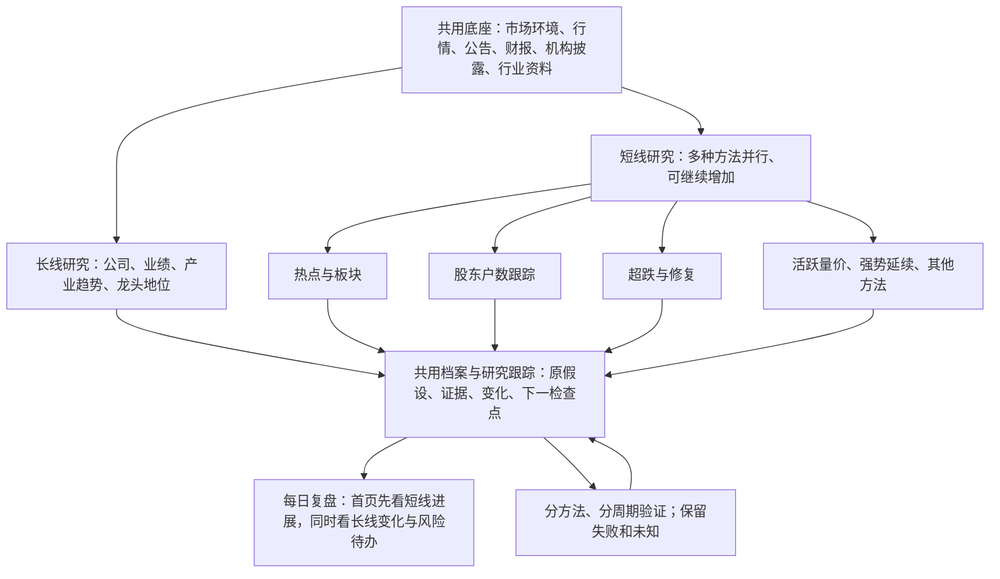

# 个人投研工作台重构方案

> 2026-11-10 · 按本轮需求重新校准：**长线研究＋可扩展的短线研究，是两条业务主线；每日复盘是日常使用入口。** 热点是短线方法之一，市场环境、资讯、行情、档案、跟踪和验证由两条线共用。
> 本次交付为文档重构，页面和运行链路尚未按本版改造。已有本地 HTML 原型、研究跟踪两表/服务/只读 API、经验卡和结果回填；各自的实现、数据合同、产品验收和策略有效性须分别判断，见 §8.2。历史过程与验证证据保留在[修改记录](./个人策略修改记录.md)。
> 阶段定义仍引用[协同总纲 §12.2](./个人策略协同总纲.md#122-阶段推进)；计算与资格、规则登记、数据、晋级/冻结分别由[卡规格](./单票卡规格-v0.1.md)、[规则登记表](./单票卡规则登记表.md)、[数据约定](./数据与验证统一约定.md)、[收敛路线图](./策略收敛与回测路线图.md)及[冻结登记](./策略与脚本冻结登记.md)负责。本文不修改现行参数、资金权限或策略启停。

## 0. 先看这一页：长线与短线

**长线研究公司和产业的持续价值，短线研究特定条件下的阶段性交易机会。** 两条线都需要从发现走到跟踪和复盘，不能只有每天换一批股票的筛选器。

| 主线 | 主要问题 | 方法与输出 |
| --- | --- | --- |
| 长线 | 哪家公司值得持续研究？业绩、竞争力和行业逻辑是否兑现？当前估值和价格位置是否合适？ | 产业趋势、行业龙头、经营改善、周期与现金回报；积累公司档案、长期假设、证据变化和复核计划 |
| 短线 | 最近有什么机会？哪种打法触发了？还等什么确认？昨天的判断今天怎样了？ | 热点/板块、股东户数跟踪、超跌、活跃量价、强势延续、业绩事件等并行方法；分别产生观察池、研究过程和失效记录 |

本人的“趋势、龙头”首先属于长线公司研究：产业趋势、竞争地位、业绩兑现和价格验证共同构成逻辑。现有 `trend_leader_unified` 等日更扫描是可复用工具，不能凭脚本运行频率替代长期论证；短线也可以引用其中的技术观测，另建自己的假设。



日常产品遵循四个方向：**市场和板块变化、昨天强股到今天的表现、个股量价与上涨原因、长线公司逻辑变化**。前三项主要服务每日短线阅读，第四项让长线持续积累；它们是功能，不另设三条研究主线。

首页建议导航为“每日复盘 / 短线研究 / 长线研究 / 个股档案 / 方法与验证”。后两项是共用工具。“多少只股票、多少条信号、多少种研究方法、多少个前向有效样本”分别标明；当前预览的七十多条候选不代表七十多种策略。

阅读顺序：§2 看长短线如何组织，§5 看页面要呈现什么，§8 看实施顺序；§3/§4/§7 供开发时查合同。不要求日常逐票填卡或通读技术规格。

## 0.1 本轮已确认决策（2026-11-10，用户拍板）

| # | 决策项 | 结论 | 落地含义 |
| --- | --- | --- | --- |
| 1 | 与上一轮比较草案冲突处 | **以本方案为准**：行业排除做成**方法级开关**，不做全站黑名单；趋势/龙头等旧策略只从默认每日下线，不凭草案停用 | 排除配置写在方法定义里；旧脚本、样本、冻结登记维持原状 |
| 2 | 固定信息卡字段 | 按本文 §2.1.1 落地：基本信息、业绩、股东户数、机构持股、板块强度五个维度 | 每项带 `as_of`、来源、`pending`；缺数不省略、不猜 |
| 3 | 短线首批接入方法 | **热点与板块**、**超跌与修复**两条；股东户数作为第三批扩展 | 先各打通一条"发现→跟踪→确认→失效→复盘"端到端 |
| 4 | 方法扩展与交集 | 短线按策略扩展；后期允许在**明确规则**下做方法交集 | 交集须单独登记规则版本并单独验证，不默认全站生效 |
| 5 | 旧信号目标状态 | **逐项见 §0.2 迁移表**：已冻结的 5 个原生 ID **保持冻结**（不解冻）；仍在默认每日的 3 个**本次不改开关**，只在工作台标「非默认展示」；要下线默认每日须在 P3 显式执行 | 不新增冻结、不静默解冻，状态以冻结登记为准 |
| 6 | 承载形态 | **集成进 dsa-web**：新增 `/workbench` 路由 + `/api/v1/workbench` API，随工程发布 | 可交互、可扩展、能导航与看历史日期；静态 HTML 原型降为过渡产物 |
| 7 | 行业过滤 | 允许过滤，先排除银行、保险、证券、多元金融、建筑工程、建筑装饰等金融与基建调节盘 | 默认在短线波段类方法开启，长线研究方法默认关闭；范围可配置 |

## 0.2 旧信号状态迁移表（2026-11-10，状态以冻结登记为准）

| 原生 ID | 当前生产 | 当前冻结/验证状态 | 目标生产 | 工作台展示 | 允许消费范围 | 执行批次 |
| --- | --- | --- | --- | --- | --- | --- |
| `earnings_surprise` | ✅ 默认每日 | 观察期（样本不足） | **保持不变** | 归集（非默认展示） | 只作业绩标签/事件线索 | P3 再评估 |
| `hundred_day_high` | ✅ 默认每日 | 观察期至 2026Q4 | **保持不变** | 归集（非默认展示） | 不默认入池 | P3 再评估 |
| `trend_leader_unified` | ✅ 默认每日 | 观察期至 2026Q4 | **保持不变** | 归集（非默认展示） | 不默认入池 | P3 再评估 |
| `daily_slow_rise` | ❌ 已停用默认每日 | **已冻结**（2026-09-27） | 保持停用 | 不展示（可手动单跑） | 仅手动研究 | 不解冻 |
| `long_base_release` | ❌ 已停用默认每日 | **已停用**（2026-09-26） | 保持停用 | 不展示（可手动单跑） | 仅手动研究 | 不解冻 |
| `monthly_slow_rise` | ❌ 非默认 | **已冻结**（2026-09-25） | 保持冻结 | 不展示 | 仅手动研究 | 不解冻 |
| `continuous_up_ratio` | ❌ 非默认 | **已冻结**（2026-09-25） | 保持冻结 | 不展示 | 仅手动研究 | 不解冻 |
| `continuous_up_streak` | ❌ 非默认 | **已冻结**（2026-09-25） | 保持冻结 | 不展示 | 仅手动研究 | 不解冻 |

规则：①「默认每日开关」与「工作台展示」是两件事，工作台归集不等于恢复生产；②冻结登记是唯一真源，本表不改其状态；③若后续要让 `hundred_day_high`/`trend_leader_unified` 下线默认每日，须在 P3 单独登记并同步 profile 与冻结登记。

## 1. 现状与重构边界

现有原型的主要偏差是：把信号来源当研究方法，把短窗统计放在阅读中心，把短线与长线混在同一候选清单中。用户看到很多名单和分数，却难以回答“为什么看这只、今天变了什么、明天继续看什么”。

| 已有基础 | 本版复用方式与缺口 |
| --- | --- |
| 百日新高、趋势龙头、业绩扫描与 screening 预设 | 保留原生产者和样本；按实际用途映射到长线价格观察或短线方法。当前五类候选来源不能代表全部短线方法已接入 |
| 市场热点/结构、资讯/搜索/催化摘要 | 补独立于现有候选池的行业与事件覆盖；候选的题材标签不能反推全市场热点 |
| 股东户数、超跌、活跃股、板块等历史专题与脚本 | 恢复方法语义和原数据边界，再逐条接入过程跟踪；文档存在不等于自动生产者已就绪 |
| 研究跟踪两表、追加事件、服务、只读 API 与 profile tracking 块 | 继续作为共用跟踪基础；须以长线公司假设和不同短线假设验证复用，当前主要积累短期信号 |
| 个股画像、历史行情、结构化研究产物与建议池 | 共用一份档案和证据；档案下保留多条独立假设，既有建议生命周期不替代研究生命周期 |
| HTML 预览、经验卡、结果回填、信号体检与统计 | 保留可复用展示和计算；先修合同，再调整阅读结构。静态经验卡不等于持续事件库，历史正超额不赋予交易权限 |
| 原 Web/桌面、任务、通知、行情和数据库 | 沿现有边界接入，不新增第二套行情、研究数据库、调度器、建议池或回测引擎 |

2026-11-09 数据截面的本地预览包含 77 条候选、72 只股票、5 类来源，日期和数量仅描述该次产物。集中出现银行、建筑，需要检查来源选择、方法归属和展示排序；不能据此直接断言这些行业永远不适用，也不能靠统一排除行业解决研究链缺失。

首批自动证券仍限已支持、核实身份的 A 股个股。ETF/基金可先提供证据；作为独立投资标的前，另验资产身份、日历、基准、复权/分红、费用与交易规则。研究界面按本版设计；实际启停、冻结、资金纪律仍按现行真源，不能通过改页面标签绕过。

下列 §1.1/§1.2 **保留 11 月 7~8 日的历史只读核对**，其中“第二层”“A1-a 尚未实现”等按当时方案理解；不作为本版分类或当前实现状态。现阶段状态集中看 §8.2，后续实施须重新读取实际配置、日志和产物，不能照抄旧日期验收。

### 1.1 首批来源体检与取舍（本机只读快照）

| 2026-11-07 核查对象 | 已确认事实 | 接入处理 |
| --- | --- | --- |
| 当前默认信号 | profile 配置 earnings / hundred_day_high / trend_leader；全库信号快照 27,853 行，最新信号日 11-06；矩阵有 11-06 产物 | 总量含其他来源/实验/摘要，不能代表三个默认源都新鲜；须逐源校验对象、覆盖和时效 |
| `re01_watchlist.csv` | 2 行，均为 `retro_watch`，信号日 11-06；未在 scripts/src/tests 找到对应自动更新实现 | 可读回顾示例，不计正式统计；自动跟踪未实现，首批接入暂缓，见 §3.3 |
| 股息 / 短线圈 | 本机日期目录最新为 09-30 | 标低频旧资料/待体检，先核内容日期、覆盖与生成器，不由目录日期断言策略无效 |
| 报告 / 建议池 | `data/stock_analysis.db` 中 analysis_history 与 decision_signals 各 1 行，时间分别为 03-24 / 09-27 | 当前可选证据，不作为总览必需输入；行数只描述此库，不能证明其他运行库或策略无效 |

按信号类型拆开（2026-11-08 只读核查，`kline_signal_snapshot`）：

| 信号类型 | 行数 | 最新信号日 | 当前判断 |
| --- | --- | --- | --- |
| `hundred_day_high` | 5,889 | 2026-11-06 | 当日 36 行，身份/质量仍须逐条核验 |
| `trend_leader_unified` | 1,609 | 2026-11-06 | 当日仅 1 行 TL_SUMMARY，非证券；最近证券记录在 11-05，不能把摘要当新候选 |
| `earnings_surprise` | 1,335 | 2026-07-10 | 本库未见更新快照，待查零结果、运行失败、写入或其他库；不能仅据 max 日期断言生产者停机 |
| `screening__dual_low` / `__momentum_quality` / `__shrink_pullback` | 312 / 312 / 153 | 均 2026-11-06 | 每类当日 12 行，screening_runs 共 90 次，最新 created_at=2026-11-06 10:18:11.406095 UTC，即北京时间 18:18:11.406095；批次已结束，降级/覆盖另核 |
| `continuous_up_ratio` / `continuous_up_streak` | 5,146 / 3,246 | 2026-04-26 | 与冻结登记一致，非故障 |
| `daily_slow_rise` | 1,112 | 2026-09-25 | 与冻结登记一致，非故障 |
| `random_baseline__hundred_day_high` / `__earnings_surprise` | 3,714 / 1,302 | 2026-09-24 / 2026-07-10 | 随机基线，不是策略 |

近五个交易日全库单日原始行数 49~78（11-06 为 73）：11-06 默认源 37 行=新高 36+趋势摘要 1，另 36 行来自上述三个筛选预设。行数不是独立证券数、可交易候选数或前向样本量；业绩源缺新快照不等于所有观察研究无来源。

已核 `src/storage.py`：ScreeningRun.created_at 默认 utc_naive_now，按无时区标记的 UTC 存储；本机 cron 无 TZ/CRON_TZ 覆盖，宿主为 Asia/Shanghai，运行日志及采集审计 generated_at 为北京时间（UTC+08:00）。三份审计 run_id 与库记录对应，末批与 18:18:12 日志闭合。**结论仅限已核字段，不能推定所有表的 created_at 都为 UTC**；批次完成不证明行情/候选完整。剔除当日趋势摘要后的 72 条仍是原始条目，去重证券数与质量闸门后的数量待实算。

A0-a 四项初表（当前启用 / 输入健康 / 验证状态 / 展示去向，2026-11-08 只读）：

| 来源 | 启用 | 输入健康 | 验证状态 | 展示去向 |
| --- | --- | --- | --- | --- |
| `hundred_day_high` | 是 | 11-06 为 36 原始行 | 观察期至 2026Q4（差 5+6 条目） | 第二层候选；资金资格按既有环境/确认规则 |
| `trend_leader_unified` | 是 | 最新证券 11-05；11-06 仅摘要 | 观察期至 2026Q4（随机分位 82.4） | 第二层；摘要只作诊断，不回填成当日证券 |
| `earnings_surprise` | 是 | 本库最新 07-10，原因待查 | 样本不足 | 第二层观察，标待体检 |
| screening 三预设 | cron 进程显式启用；常驻 API 开关未核 | 11-06 三批采集成功，各 written=12；含降级、缓存回退，质量另核 | 未据此取得个人策略资格 | 第二层候选，首版第二类适配优先核验 |
| 股息线 | 是 | 目录停于 09-30 | 既有点时研究见股息专题；旧评分结论不冒充当前精简B排序的验证 | 守线池（低频） |
| 短线圈 | 是 | 目录停于 09-30 | 未验证 | 攻线（低频） |
| RE01 | 规则已登记 | 2 行 `retro_watch` | 未验证 | 回顾阅读，不自动跟踪 |
| 报告 / 建议池 | — | 各 1 行 | — | 可选证据 |

该表是 A0-a 的起点而非完成物：“最近成功批次、覆盖范围、失败原因”优先读取 §1.2 的既有日志、审计和摘要，再按标的交易日历判断时效；适配尚未实现，不能仅凭调度存在或 done exit=0 勾选完成。

A0-a 按现有目录/profile/冻结登记形成接入清单，记录“当前启用、输入健康、验证状态、展示去向”四项；来源陈旧只暂停其当前确认用途并显示缺口，策略冻结仍走既有判据。股息与短线圈先各做一次受控体检，可先只读核日期/覆盖并登记失败或缺口；它们作为可选源，恢复产出不作为 A1-a 的前置。是否需运行生成器、是否在线取数在实施时明确，本轮没有运行它们。

### 1.2 现有生产编排登记（2026-11-08 本机只读核对）

已核当前用户 crontab、五个包装脚本及 11-06 日志；下表时间均为 Asia/Shanghai，北京时间。日历与跳过行为沿原实现，周一至五触发不等于一定开市；这里登记现状，不新增或修改任务。

| 任务 / 包装脚本 | cron 触发 | 产物 | 日志 | 失败/受限如何辨认 | A1-a 是否必需 |
| --- | --- | --- | --- | --- | --- |
| 筛选 `data/runtime/screening_daily.sh` | 周一至五 18:10 | 三预设 strict Top-20 上限；`data/screening_snapshots/<日期>/*.json`、screening_runs 与信号快照 | `data/run_logs/screening_snapshots.log` | 核采集成功/失败数、done exit、run_id 与候选数；warnings/degradation、来源日期另判 | 是，首批第二类来源；读已完成产物 |
| 补数/预热 `data/runtime/warm_daily.sh` | 周一至五 18:40 | 历史缓存、`data/runtime/cache_prewarm/<日期>/summary.json` | `data/run_logs/warm_daily.log` | 前置补数可重试，done exit 只记录末步预热；摘要/各步失败仍需透传 | 输入依赖，不能充第二份机会来源 |
| 结构扫描 `data/runtime/structure_scan_daily.sh` | 周一至五 19:00 | 000300 指数补数、`data/strategy_review/screen_updays_structure_YYYYMMDD.*`、stock_profiles_YYYYMMDD | `data/run_logs/structure_scan_daily.log` | **2026-11-09 已补：done 行写 `exit=<rc>`（首个失败步骤）且 cron 按该值返回**；指数补数失败仍只 warn；2026-11-06 及以前的历史批次无退出码，总览继续按降级显示，不回溯改日志 | 结构候选可选；用到基准时核对应数据 |
| 矩阵 `data/runtime/matrix_daily.sh` | 周一至五 19:05 | `data/manual_runs/personal_strategy_matrix/<日期>/` 的运行摘要/review；后处理含行情同步、股息T、复盘、scoreboard/作战计划 | `data/run_logs/matrix_daily.log` | flock 跳过/日历跳过不等于新批次成功；done exit 只保存矩阵主命令 RC，不汇总后处理 | 是，提供首批百日新高；旧文案/AI 审核不必接入 |
| ETF `scripts/run_etf_flow_weekly.sh` | 周五 17:30 | `data/strategy_review/etf_flow/etf_flow_YYYYMMDD.csv` 等 | `data/strategy_review/etf_flow/run-YYYY-MM-DD.log` | 结束 rc 取 Python 管道退出码；核实际数据日，非脚本执行日 | 可选低频证据，不阻塞每日总览 |

筛选包装器仅对采集命令设置 SCREENING_ENABLED=true，解释了“配置默认关闭但 cron 有产出”；不能据此断言常驻 Web/API 已启用，也不需 A1-a 改开关。cron 的先后时间不是可靠依赖屏障：warm 供缓存，structure 与 matrix 可重叠；只等待实际订阅产物，不强等所有五条任务或重造调度/健康服务。

11-06 完成证据：screening 18:18:12（成功3/失败0，各 written=12）、warm 18:45:23、structure 19:00:39、matrix 19:52:08；ETF 17:30:03 rc=0，实际输出数据日为 11-05。原日志、审计、数据库 run_id 与运行摘要联合构成只读健康投影，A0-a 负责映射，不另建一套生产者或持久健康表。

**仍有已核质量缺口。** matrix 虽 done exit=0，后续行情重建为 85/174 失败（48.9%），19:35:44 已明确记录失败后继续；screening 三批均含降级信息，shrink_pullback 使用 last_good_cache，日线来源含 stale/partial_history，LLM 排序均回退 factor。须逐项核实际截至日、覆盖与允许的计算模式，不能把这些批次直接称为两类健康源；非必需模型回退也不直接等于全部数据失败。A0-a 登记时未改包装脚本；2026-11-09 已单独修结构扫描的完成证据（补 `exit=<rc>` 与退出码传递），其余包装器仍未重跑或改造。

## 2. 两条研究主线与方法归属

### 2.1 长线：以公司、业绩和产业逻辑为核心

长线研究的主对象是公司及其行业，机构研究提供问题框架和可核查线索。目标包括成长、行业龙头、产业趋势、经营拐点、稳定现金回报；股息是其中一种方法。

| 研究环节 | 必须回答 | 主要证据与持续检查 |
| --- | --- | --- |
| 公司与产业 | 靠什么赚钱？竞争优势是什么？行业趋势如何传到公司？ | 主营/产品/客户、行业供需、竞争格局、市占率、订单和价格；“龙头”拆成产业地位与短线市场辨识度 |
| 业绩与质量 | 增长能否持续？是否靠一次性收益或低基数？ | 收入、利润与扣非、毛利率、现金流、资产负债、单季与多季变化；周期公司核周期位置 |
| 预期与估值 | 当前价格反映了什么？关键假设变动会怎样？ | 有日期的机构预测、公司指引、可比估值、情景假设和分红可持续性；没有事前预期就不称已证实超预期 |
| 机构参照 | 机构在研究什么？我们采纳了哪条依据？ | 研报原文/摘要、调研纪要、基金披露分别引用；区分事实、预测和分析观点，不用“机构看好”代替论证 |
| 价格与研究节奏 | 公司逻辑与市场反应是否一致？何时值得深入复核？ | 周/月/日线、相对强弱、百日新高、回撤与成交；价格用于位置和风险观察，不独自证明业绩或长期配置资格 |

每条长期假设保存：核心论点、关键经营变量、支持/反对证据、估值假设、下一披露节点、逻辑失效条件。每日首页只呈现实质变化与未解决风险，周/月/季复核完整档案。短期没有上涨不自动否定长期逻辑，短期上涨也不能补齐缺失的基本面证据。

机构资料须保存作者/机构、发表时间、报告期、预测所对应期间及引用出处；只能取合法可得内容。国家队直接持仓、主动基金披露和 ETF 份额代理分开：前十持仓消失不等于清仓，权重变化不等于主动加减仓，ETF 份额变化不能证明某类资金身份。缺来源时显示未接入，不生成机构共识。

#### 2.1.1 固定信息卡（长短线共用，量化展示）

一只票的档案首屏固定呈现下表五组字段，**与短线/长线归属无关**；每组都标数据日、来源与缺口。

| 维度 | 字段 | 口径/单位 | 主要来源 | 缺数处理 |
| --- | --- | --- | --- | --- |
| 基本信息 | 代码/名称、市场、上市日期、行业、所属板块 | 文本/日期 | `tushare_stock_basic` 本地快照 | 缺行业标未分类 |
| 规模与估值 | 总市值、流通市值、PE(TTM)、PB、换手率 | 亿元/倍/百分比 | `daily_basic` | 缺当日则用最近可得日并标日期 |
| 业绩 | 营收同比、扣非净利同比、ROE、毛利率、经营现金流 | 百分比/亿元 | `fina_indicator` + `income` | 报告期未披露标待披露 |
| 股东户数 | 户数绝对值、自身历史分位（近 12 期）、连续下降期数、披露日 | 户/百分位/期 | 定期披露 | 无披露标未接入，不做横比 |
| 机构持股 | 十大流通股东中基金/社保/QFII 家数、合计持股占比、环比变化 | 家/百分比 | `top10_floatholders` | 只用已披露报告期，权重变化≠主动加减仓 |
| 板块强度 | 所属行业 20 日收益中位数、全市场分位、距 120 日高 | 百分比/分位 | 本地日线 + 行业映射 | 行业样本不足标受限 |

字段口径以本表为准；页面和 API 都消费同一份计算结果，不在前端二次计算。

### 2.2 个人策略与专题的去向

短线按方法组织，每种方法有自己的候选来源、观察过程、确认/失效条件和结果评价。下表是**目标研究目录和接入方向**，不表示全部已自动化或获得交易资格，也不构成新的数值规则。

| 方法 | 要研究什么、怎样持续看 | 当前可复用基础与边界 |
| --- | --- | --- |
| 热点与板块 | 主题为何出现、是否扩散/持续、板块核心与跟随股怎样变化；跟踪昨日强股与新强股 | 市场热点/结构、资讯、`run_catalyst_digest.py`、`run_short_term_watch.py`、板块专题；候选摘要和半自动板块池不能充当完整全市场雷达 |
| 股东户数与筹码观察 | 户数少或持续下降是否伴随价格/成交变化？从披露后观察到启动、验证或失效 | [股东户数专题](./股东户数筹码集中筛选方法.md)有历史位置与质量口径，正式自动生产待补；“户数少”与“历史低位且下降”是不同假设，分版本验证 |
| 超跌与修复 | 为什么跌、下跌是否缓和、反弹有无承接、是否跑赢对应板块 | `screen_deep_recovery.py`、`oversold_reversal` 及 RE01 研究；三者不混同。RE01 的独立资格/状态和自动接入暂缓继续有效 |
| 活跃量价与反复波动 | 最近是否反复出现强势日，涨跌结构与成交是否支持阶段性研究 | `screen_active_pool.py`、`screen_t_friendly.py`、`screen_updays_structure.py`；按需/探索能力，不自动启用为日更策略，不从 K 线断言同一批资金操作 |
| 强势延续、突破与回踩 | 新高或趋势转强之后是否延续，突破失败、回踩承接如何变化 | 百日新高、趋势扫描、`momentum_quality`、`shrink_pullback`；只代表对应价格方法，不能冒充长期公司研究已完成 |
| 业绩与公告事件 | 有日期的业绩/公告是否改变预期，价格反应是否持续 | `earnings_surprise`、业绩低位观察、资讯；财报事件的短线反应与长期经营改善分别建假设 |
| 其他后续方法 | 先说明可检验问题、数据和过程，再接同一研究页 | 次新、商品传导等已有专题按需评估；候选想法保留研究状态，冻结方法沿原恢复流程 |

**首批接入（2026-11-10 确认）**：热点与板块、超跌与修复两条先打通端到端流程，各自产出候选、跟踪过程与失效记录；股东户数方法因缺少自动生产者，作为第三批扩展（先补采集，再登记规则）。后续新增短线方法直接加方法定义与适配，不改共用跟踪模型。

**交集规则**：允许在明确规则下组合（如"热点板块 ∩ 超跌修复"），但每次交集必须单独登记规则版本、独立验证与独立分母，不得默认套到全部方法；未登记确认规则的组合只能显示为观察。

方法之间可并行，也可在明确规则下组合。热点方法可重点看向上趋势；超跌方法按自身的企稳/修复条件研究；股东户数可以先低频观察再等待价格条件。**不把“热点∩新高∩业绩”设成所有短线方法的统一交集。**

共用的质量、身份、时点、可成交性与风险约束仍需检查；研究资格按方法核必要项，不要求所有方法都有财务或消息催化。具体交易用途仍受原资金纪律和已登记资格限制，新增研究方法不直接改变这些纪律。

#### 2.2.1 股东户数：从一次筛选改成披露后的跟踪过程

1. **发现**：分别保存绝对户数、相对自身历史位置、连续变化、股本/规模和可比范围。绝对户数小不能直接横比不同规模公司，更不能等同筹码集中或主力吸筹。
2. **建档**：冻结本次披露版本、统计截止日、实际公开时间和系统收录时间，保留前几期。原专题中的财务筛选和非金融过滤只属于该版方法，不扩成全站规则；若探索不带这些条件的短线分支，先另登记版本并对照验证。
3. **等待**：披露间隔期间日更的是价格、成交、换手、板块和事件，户数标记“截至某日、某日披露”。页面说明等待什么变化；不能把旧户数包装成每日新信号。
4. **复核**：出现预登记的量价变化后，检查是否取得该方法的研究确认；新披露反向、价格条件失效、到期或数据缺口分别记录，不混成一个“失败”。
5. **复盘**：从实际可用且已收录的观察起点评价后续表现，展示一直没启动和启动后失败的样本；不能倒挑后来上涨的低户数股票。

示例卡应读成：“最近一次披露的户数处于自身历史低位；收录后价格仍在整理，今天成交出现变化；继续等待某个已登记的确认，若出现反向披露或价格失效则复核。”这是一条可跨日更新的研究记录，不是“户数少＝可短炒”。此处为流程示例，不含真实个股结论。

#### 2.2.2 热点、强股与超跌：各自保留研究路径

热点：事件/交易变化 → 板块是否扩散 → 核心与跟随股 → 昨日队列今日延续/分歧 → 下一观察点。机器人、传媒等作为用户关注主题示例，是否当天活跃由当日证据决定，不写成永久白名单。

超跌：下跌原因与风险 → 超跌候选 → 底部/修复观测 → 对照板块与市场 → 确认、失效或到期。不能为了页面统一先要求突破百日高点。RE01 的 R4b 仍仅弱确认观察，通用反转信号也不能继承 RE01 身份。

活跃量价：固定窗口的涨跌/阳阴线/换手/成交结构 → 最近强弱变化 → 可观察条件 → 失效/复核。阳线比例、上涨日比例、收盘趋势是不同指标，分别定义；红色图形不自动代表资金持续流入。

### 2.3 主工程的筛选预设与分析 skill

区分三类资产，不能把文件数合计为策略数：

| 资产类型 | 在研究中的作用 | 使用边界 |
| --- | --- | --- |
| 个人方法与策略生产者 | 定义假设、产生样本及规则结果 | 复用目录/profile/冻结登记；策略、工具、摘要分别登记 |
| `src/services/screening/strategies/*.yaml` | 产生通用筛选线索，如趋势质量、回踩、反转、价值、低波等 | 只消费引擎支持的字段；`dual_low` 不代表适合短炒，`blue_chip_income` 不替代股息可持续性研究；三预设同属一条生产链 |
| `strategies/*.yaml` 分析 skill | 对个股/事件解释机制、业务暴露、风险与疑点 | 沿 SkillManager 与分析任务使用；生成文字不增加独立量化样本，同名技能不启用冻结策略 |

筛选结果要归到实际研究问题，并明确“线索 / 观察 / 已有何种确认”。同一来源可以支持长线和短线，但派生两份解释不增加原始信号样本。详细边界见[选股引擎](../screening-engine.md#两类策略的边界)。

### 2.4 怎么执行：沿现有入口，先读产物

保留 `run_personal_strategy_matrix.py`、`run_short_term_watch.py`、screening 的既有生产入口，接入完成批次。股东户数、活跃量价、超跌、板块等按方法逐项补适配；先核生产者/历史产物/数据权限，再决定是否补生产者或频率，不因为网页有一个空模块就自动跑全市场。

长线复用财务与资讯服务、`analyze_stock_profile.py`、股息池、基金持仓、ETF 周报和专题研究。离线画像仅有技术资料时明确能力不足，不能输出完整公司结论。日频、周频、季频来源分别校验时效。

既有调度和[本机运行说明](./个人本机Linux运行说明.md)、[基线](./个人策略基线.md)继续有效；§1.2 是历史编排登记。本次不运行在线取数、模型、生产导入、收益回填或 cron，也不启用新短线脚本。具体命令以脚本帮助和当前配置为准，不在方案再维护一份容易漂移的参数表。

## 3. 核心对象：档案下的独立研究跟踪

一只股票共用一个资料档案，档案下可以有“长期龙头业绩兑现”“股东户数变化后的短线启动”“本次板块热点”多条假设。长期和短线不能因代码相同自动合并；同一方法的不同事件也须按事件身份分清。

| 对象/字段组 | 最小语义 |
| --- | --- |
| 个股档案 | 已确认的市场、证券代码、资产类型；共用行情、财务、行业、资讯等证据 |
| 方法说明 | 原生方法 ID、规则版本、研究问题、必需输入、适用环境、生产/验证状态、确认/失效依据和评价窗口；附于原配置/专题，不另建平行注册表 |
| 跟踪身份 | 稳定 `track_id`、`hypothesis_key`、方法/事件身份、研究主线；明确规则冻结与实际创建时间 |
| 原始研究计划 | 为什么关注、支持/反对条件、待确认事项、下一检查点、最晚复核或退出依据 |
| 证据事件 | 原始条目及版本、来源引用、公开/收录时点、质量限制；修订追加并关联旧事件 |
| 当前投影 | 研究进度、已取得的具体资格、数据限制、待办与最近变化分别保存 |
| 结果 | 规则/测量版本、有效检查点、样本身份、结果与缺失原因；原始事件留档 |

只在现有两表/服务上验证必要扩展，以上是目标语义，不宣称现有 Schema 全部具备。新增方法优先复用公共字段与专属指标扩展块，避免一策略一张研究表。

### 3.1 研究阶段与资格分别展示

页面采用“新发现 → 观察中 → 待确认 → 已满足本方法的研究确认 → 已结束/失效”的阅读进度；这是业务映射，具体确认节点由方法定义。没有对应确认规则的方法可以只做观察，不能强填已确认；实现仍适配既有生命周期，不直接改枚举。

“数据受限、待复核、任务逾期”可与上述进度并存。研究确认、规则验证状态、资金角色和交易权限分别显示；`allow`、模型信心、历史正超额均不能翻译成“可以买”。研究中不意味着可以交易，样本没成熟也不意味着假设失效。

既有 DecisionSignal 仍存某次建议，track 存持续研究。现有相反建议失效逻辑没有独立假设分组，不能直接把多周期观点塞入同一 active 生命周期。首期只关联既有建议；若改失效语义，须覆盖所有写入、API、页面、重评与后验路径。

### 3.2 同一假设修订与不同假设重入

同一事件、同一方法的证据修订更新原 track 的有效投影，并保留旧事件、原判断和首次收录时间；相同版本重跑幂等。新事件、新一轮独立入池才按方法的重入/冷却规则判断，不能让冷却期阻断原假设补证据。

冷却判断使用最近符合条件的同类入池记录，不能取最早历史记录。不同主线或不同机制是否相关由明确身份/方法合同决定，不以“股票一样”互相拦截或覆盖。页面同股折叠展示，组合风险仍按实际总敞口核算。

### 3.3 RE01 自动跟踪接入暂缓

RE01 规则与 CSV 样本语义继续以卡规格/规则登记为准。当前回顾样本可读，日更、事前入池、到期关闭和自动关联未通过独立验收前，保持“未实现/排除自动化”，不计正式前向样本。本版没有新建生产者或解除暂缓。

解除暂缓时须核原始全量样本、规则/数据版本、被拒绝/失败项、固定检查点、重跑与单一写入职责；通用 oversold 方法不能改名绕过。冻结的 Shortline Hub 不因重用“短线研究”名称而恢复。

## 4. 共用证据、时点与变化

### 4.1 先记录当时知道什么

每条来源至少可定位 `source_ref`、内容版本/哈希、`available_at`（可核公开可得时间）、`observed_at`（系统实际收录时间）、质量/限制。按需另带报告期、统计截止日、发生时间和发布时间；生成报告的时间不能代替数据时间。

股东户数与机构持仓尤其要同时展示“统计截至哪天、何时披露、系统何时收到”。公开时间未知就留空并限制相关用途；生产批次生成时间只能证明该产物的生成，不能代替底层披露的公开时间。内部按字段合同统一 UTC，展示转用户时区，交易日仍按资产所属市场日历。

历史 `as_of` 查询同时限制行情、事件、规则/测量版本、体检和统计；不仅截最后一根 K 线，也不能使用后来修订的证据或后来算出的闸门结果。支持“当时视图”和“最新修订视图”，两者明确区分；后者不能冒充当时做出的判断。

### 4.2 跨日比较与恢复水位

比较同一对象/方法的上一个成功、可定位版本，列出：首次发现、条件变化、反向证据、失效/到期和数据恢复。只有措辞改变不算新机会。首次没有基线就标首次收录，来源失败则标未完成检查，不能写成无变化。

各源单独保存已成功消费的版本/水位；运行中、读取时换批或失败不推进。恢复后补比较遗漏的版本，按对象/证据/变更身份去重提醒。关键风险和到期待办不受每日 Top-N 隐藏，也不因停用新候选来源而消失。

同命题、同口径的相反证据双源保留并提示待裁决；长期改善与短期转弱可同时成立，分别解释。计算资格由匹配时点和版本的公共服务结果负责，人工文字和模型归纳不能解禁。

## 5. 页面重构：每天打开要得到什么

> **承载形态（2026-11-10 确认）**：本节页面按 **dsa-web 正式页面**实现——新增 `/workbench` 路由 + `/api/v1/workbench` 后端 API，随工程一起发布；现在的 `data/strategy_review/workbench_preview.html` 只作为过渡原型保留，不再扩展。


### 5.1 每日复盘首页

默认先服务每日短线阅读，同时保留长线变化。方法管理、战绩和大表进入二级详情，来源异常以简明提示及可展开诊断显示；严重数据限制和持仓相关风险必须醒目。

```text
每日复盘    短线研究    长线研究    个股档案    方法与验证
数据截至/生成时间｜市场环境及证据｜未完成检查｜重要风险/逾期待办

① 今天市场与板块变了什么
   新热点 / 延续 / 分歧 / 退潮；原因出处、覆盖与未知项
② 昨日强股 → 今日表现
   昨日固定队列：延续、走弱、失败、缺数；今日新强股另列
③ 我的短线研究（可按方法筛选）
   热点板块｜股东户数｜超跌修复｜活跃量价｜强势延续｜其他
   每种方法：新发现、跟踪变化、待确认、失效/到期；点开看完整过程
④ 长线公司有什么新变化
   财报/经营/行业/机构证据 → 影响哪条假设 → 下一复核
⑤ 今天待处理什么
   风险复核、到期检查、资料补齐；可从各模块直接定位原记录
```

这里的序号表示内容顺序，不新增独立应用。顶栏“市场弱势/修复/分化”等判断须附日期及依据；现有 `defensive` 是技术配置，不能当永久市场事实。弱市中的强板块仍展示研究信息，现有交易限制继续透传；不能把整类价格信号从研究界面消失，也不能默认放开入池。

### 5.2 短线方法工作区

每种方法使用同一套列表与详情布局，首屏说明“找什么、当前数据到哪天、自动化到哪里”。列表显示股票/板块、为何进入、当前进度、相对上次变化、缺口、下一观察条件与期限。详情保留首次发现以来的证据时间线、原计划、价格/成交图、反向证据和复盘结果。

默认按风险/反向变化、到期事项、实质进展、新发现组织注意力，不横比不同策略评分。首页可以只展示各方法的重要变化及总数，完整研究池通过筛选进入；无新增时已有跟踪仍可阅读。没有生产者显示未接入，健康返回零项显示无新增，两者不可混用。

行业偏好、显示数量和方法折叠属于阅读选择；仅改变页面可见内容，不改入池、资金权限或验证分母。若筛选会实质改变策略条件，必须登记新版本并单独验证。用“新发现/待确认/研究受限/已失效”等准确文字替代未经资格支持的“可以做/别碰”。

### 5.3 昨天强股与今天数据的对照

在 D 日收盘时按事前规则冻结队列与版本，D+1 按市场日历查询同一批股票。可按涨幅、首板/连板、反复强势和板块分组，但不同队列分别定义，不能事后换成今天仍上涨的股票。

| 对照项目 | 要呈现什么 |
| --- | --- |
| 昨日身份 | 昨日涨幅、强势/涨停口径、板块与当时已有原因；昨日是否已被系统收录 |
| 今日反应 | 开盘/收盘、最高/最低、成交/换手、相对板块与市场、位置变化，延续或转弱的可核事实 |
| 原因变化 | 新公告/新闻、板块变化、原催化是否推进；后来出现的解释标事后补充 |
| 留在分母中的异常项 | 跌幅较大、停牌、涨跌停不可成交、缺行情、退市等，分别显示原因，不从队列消失 |
| 下一观察 | 哪项条件已满足/失效、还等什么，何时再查 |

当日新强股另列，不能加入昨日队列抬高延续率。只有日线数据时，无法确认盘中封板、炸板和逐笔资金行为；近似涨停与已核涨停标签分开。浏览对照是描述性研究，涉及模拟入场另核可得时点、可成交性和成本。

### 5.4 个股详情：走势、为什么涨、研究过程放在一起

图表至少包括可切日/周/月的 OHLC K 线、成交量及必要价格参照，显示复权口径和数据截至日；收盘折线不能标作完整 K 线图。按需标注首次入池、披露、消息、确认、失效等事件，既能看最近一段，也能回到较长区间。

“红线多不多”落实为可解释指标：阳线比例按收盘与开盘比较，上涨日比例按收盘与前收比较；另看涨跌幅分布、长阴损失、回撤、量价和板块相对强弱，窗口带有效数和缺失。跳空高开低收可能收阴但相对前收仍上涨，不能混算。活跃或反复波动只能支持行为描述，不能证明“同一资金来回做”。

“为什么涨”分栏列已核事实、媒体/机构解释、系统推断和待验证项，并保留出处、发布时间、首次收录和与价格反应的先后。消息搜不到就写原因未确认；不从题材名称或今天涨幅反推唯一原因。模型可以整理证据，不能补造数字和因果。

详情下面分别展开该股的长线假设、各短线方法跟踪和共用风险。一个价格图服务多个研究问题，不把所有观点合成一条买卖结论。

### 5.5 长线工作区

以“公司/行业 → 核心假设 → 本期证据变化 → 关键风险 → 下次复核”为主要阅读结构，提供业绩兑现时间线、机构观点与事实对照、估值假设及日周月价格位置。可按产业趋势/龙头成长、经营改善/周期、现金回报等查看。

今日首页只摘要新变化；进入长线区仍能看到没有新变化的完整研究池。长期结论不由 T+5 胜率排序，也不要求公司每天有热点；缺资料明确停留在研究线索，不能为填满长线区自动生成配置结论。

## 6. 评价与复盘：按方法、按周期分别看

| 对象 | 核心评价问题 | 展示方式 |
| --- | --- | --- |
| 短线方法 | 触发后是否有延续？确认增加什么？失效时损失和机会成本怎样？ | 预登记窗口、绝对/相对收益、分布与尾部风险、确认/未确认/失败/缺数；按环境、日期批次和规则版本拆分 |
| 股东户数等慢数据触发的短线 | 从披露收录到启动等了多久？启动之后怎样？ | 等待过程与交易研究窗口分开；披露事件和每日观测不重复计成独立机会 |
| 长线假设 | 经营与产业假设是否兑现？估值与风险是否变化？ | 披露/季度复核、预登记长期窗口与匹配基准；T+1/3/5 只能作为价格旁证 |
| 事件经验 | 机制何时适用、哪些反例不可比？ | 独立事件簇、环境、当时证据、结果及失败；同事件多条报道/多个窗口不增加独立样本 |
| 实际执行 | 决策、成交、持仓与规则之间有哪些偏差？ | 信号、研究、模拟与真实账户分别呈现；没有成交记录不称实盘成绩 |

短/中/长期边界与默认评价窗仍引用总纲 §2.5，具体方法覆盖默认值须事前登记。不能把所有方法都强制按一个 T+5 窗口评优，也不能以短期无超额淘汰长期公司逻辑。

样本身份必须分为当时前向收录、历史回放和事后导入/身份不明，并保留审计依据。较早信号后来首次导入不能仅凭信号日期、命名前缀、`admission_rule` 或补录标签变成前向；还需证明在拟评价动作之前真实收录且规则已固定。补充审计只能追加证据，不能改写创建事件和历史身份。

每条研究样本、每个窗口和测量口径，在对应 `as_of` 仅选择一份有效测量；T+1→T+3→T+5 补齐或价格修订都不增加样本数。旧版本留档可审计，不能与新口径混算；同一队列对不同窗口分别报已成熟有效数、未到期、缺失、排除原因和独立批次/日期。`n=30` 来自一个日期不等于跨环境充分，T+1 成熟也不代表 T+5 充分。

收益统计对齐同一入场/退出时点、价格口径、基准与成本；缺开盘不能静默改用收盘并称模拟完整，MAE 要覆盖实际持有期间含入场日。原评估器与新回填口径不同须分别注明，不能混名。价格接缝近似相等不证明整段复权正确，未知口径数据保留限制。验证门槛沿原路线图，不能用少量回放正收益替代晋级。

经验卡接收研究结束后的机制、支持/失败与下一次检查清单；首批卡数、持续更新、证据质量与收益验证分别验收。方法统计、源健康和审计大表放“方法与验证”，首页只提示影响当日阅读的重要限制。

## 7. 工程复用与扩展合同

### 7.1 沿现有服务接入

复用 `DataFetcherManager`、ScreeningService、市场热点/结构、SearchService/IntelligenceService、催化摘要、ResearchArtifact、StockProfileService、研究跟踪和既有 outcome/评估器。`daily_board_service` 提供公共阅读结果，API/Markdown/预览和正式 Web 消费同一业务结果；最终名称和字段以实现兼容评估为准。

来源对象核验、批次完成、时点、价格质量、方法资格与限制由公共服务统一表达，页面只筛选阅读和展开详情。不能在 JavaScript 再写一套准入，不能把 `unknown`、缓存缺失或回放正超额当作新增资格。批次就绪与数据健康分别判断；可选资讯失败仅限制依赖它的结论，共享行情失败须标明所有受影响能力。

夜间目标顺序为：输入批次完成 → 同步并核验行情 → 更新已有样本的到期结果 → 生成截至本轮可知数据的体检/限制快照 → 本轮候选准入与跟踪 → 最终总览/页面。准入与展示绑定同一 `as_of`、规则、输入和体检版本；缓存须核时效与版本，缺失/过期明确受限，不在页面自行放行。步骤失败按依赖限制能力，最终完成标记不能掩盖主任务或必需后处理失败。这是待实施/复验的目标合同，不声明现有脚本顺序已满足。

OpenBB 的统一数据服务、ZVT 的数据/因子/筛选分层、LEAN 的研究与执行分责可继续作设计参考；Qlib/investment_data 的验证接入沿既有[融合规划](./开源工具融合规划（investment_data-qlib-TradingAgents）.md)。本版复用已有能力，不为两个研究入口引入新平台，也不用外部组织流程证明策略有效。

### 7.2 扩展边界：业务入口稳定，按类型接入

| 扩展类型 | 沿哪里接 | 必须补齐什么 |
| --- | --- | --- |
| 新短线/长线方法 | 现有策略目录/配置与专题；算法在 `src/services/`，CLI 在 `scripts/` | 问题、输入、流程、规则版本、确认/失效、评价窗与当前自动化范围；复用两表及通用页 |
| 已支持指标的新筛选组合 | screening 原 Schema/loader 与配置 | 必需字段及边界；超出指标支持范围才扩原实现，不承诺任意 YAML 自动可用 |
| 新分析 skill | 原 `strategies/`、SkillManager 和分析任务 | 提示/模型版本、证据和能力限制；不冒充新量化样本 |
| 新数据/行业指标 | 原 `data_provider/`、资讯/业务服务 | 单位、覆盖、时滞、公开/收录时间、权限、更新节奏、异常与失败隔离 |
| 新展示/提醒 | 同一结果的 reports/API/Web 与现有通知入口 | 消费同一变化和待办，版本去重，不增加平行计算或未经授权的通知 |
| ETF/其他市场 | 扩现有资产身份、日历、价格/基准、费用和交易合同 | 独立兼容验收；不能凭六位代码调用错误的股票接口 |

短线可扩展的验收重点是第二种不同过程的方法接入：例如热点按日变化，股东户数按披露触发并日更观察，二者复用同一研究列表、详情、事件和复盘；不能仅用两个相近筛选预设证明全部方法可扩展。

扩展细节仍以本节及 §7.3/§7.4 为真源。确需拆独立技术文档时，同次保留锚点、更新全部引用并删除重复规格；本次不增加插件平台、动态流程引擎或另一份策略注册表。

### 7.3 接入合同：公共字段稳定，专属指标可选

以下为目标合同；先映射现有字段，仅按已接入方法补必要扩展，不假定当前 API 已完整具备。

| 字段组 | 共用语义 |
| --- | --- |
| 来源/方法 | 入口类型＋原生 ID、规则/合同版本、生产者、原始写入职责、短线/长线用途；同名来源按入口类型区分 |
| 批次 | 可定位 batch_ref、目标交易日/报告期、实际数据日、完成证据、覆盖、最近成功版本；运行状态与新鲜度分开 |
| 对象 | 市场/代码/资产类型或无证券的行业/事件；摘要、基线、诊断不当证券候选 |
| 证据 | 原始条目 ID、内容及版本、source_ref、available_at、observed_at、质量/限制；源文件同日替换仍可还原读到的版本 |
| 研究过程 | 稳定假设身份、原理由、进度、变化前后、确认/失效依据、下一检查点及待办；分别标已计算、未知和不适用 |
| 能力与限制 | 可做何种观察、必需输入是否满足、已有何种研究资格、适用风险限制；不以一个总状态覆盖所有维度 |
| 专属指标 | 以来源区分的扩展块，带单位、口径、截至时间与有效数；基础渲染不依赖每个方法键名 |
| 验证 | 前向/回放/事后身份、有效测量及 supersedes 关系、评价窗、成熟数和缺失原因；与显示关注集分离 |

原生产者计算确定性结果，适配不擅自授予资格；公共服务校验、比较和投影，页面不计算研究权限。追加字段验旧记录/API/Web/桌面兼容，缺字段保留未知；改变身份、资格或字段含义需升版，不能回写旧判断。

### 7.4 新增策略或功能的实施流程与验收

1. 先定义研究问题与长短线归属，查已有能力、冻结登记和原规则，确认复用边界。
2. 在专题/原配置登记输入、可得时点、观察流程、确认/失效、评价窗及规则版本；未知参数标待验证，不从样本表现反推阈值。
3. 用可定位的完成批次接公共合同，覆盖正常、零项、陈旧、失败与修订。人工补充可用，但日常已有自动数据不要求逐票填卡；未实现生产者单列。
4. 接同一方法列表、个股档案与跟踪详情，再关联既有评估入口；不新增按策略名分支的首页、一套专表或第二套调度。
5. 验同股多假设、慢披露＋日观察、失败恢复、水位去重、冷却与修订、停止新候选后风险/到期任务保留。运行预算/频率沿原调度登记，不默默启用模型或全市场扫描。
6. 根据原晋级/冻结标准决定用途与启停；关闭适配可回退，原始样本和证据不删，恢复后从水位继续。正式新增配置时同步 `.env.example` 与相关文档。

同类新方法可以增加必要算法/适配/测试；支持范围内不改共用跟踪模型和基础行渲染。确需扩合同先列兼容与迁移边界。两类生产链的接入验收、两种研究过程的复用验收、策略有效性验收分别完成，不能互相代替。

## 8. 分阶段实施与验收

沿总纲 A0~A4，调整的是当前子任务的优先级，原任务保留。已有代码按可复用实现处理，不从零再造；本版没有执行下面的代码任务。

| 优先顺序 / 对应阶段 | 本轮之后要交付 | 用户可见的通过标准 |
| --- | --- | --- |
| 先修合同（A0，含原 A0-a/b） | 时点隔离、样本身份、测量去重、价格/基准、统一能力限制与缓存版本；核真实生产依赖与退出状态 | 同一反例在 CLI、统计、API 与最终页面结果一致；受限候选无“可以做”，历史截止不读未来，修订不加样本 |
| 再改阅读（A1-a、A2-b） | 每日首页按 §5；方法与验证下沉；昨日固定队列对照、跨日变化与待办；长线/短线入口清楚 | 打开能说明今天板块变化、旧强股今日结果、每种已接短线的进展、长线变化及下一步；无变化/缺数也解释清楚 |
| 跑通不同过程（A2-a/b） | 一条热点或强势跟踪、一条股东户数短线跟踪、一条业绩/行业龙头长期假设；复用两表和通用详情 | 每条均能走发现→新证据→确认/反证→到期/复盘；至少覆盖未启动、失败及缺数据，自动/手工边界明确；无股东户数生产者就不能称该方法自动化完成 |
| 补经验与数据（A1-b、A2） | 独立事件台账、经验卡持续更新，按原顺序补 L1/L2/20只合同校验及机构资料 | 原假设可追溯，失败案例保留；卡数和数据库条数不代替独立研究与数据闸门 |
| 试用与正式接入（A1/A2） | 两个完整周度周期，含交易日更新、到期和周末汇总；稳定后接正式 Web | 每日不用翻多个文件；没有重复提醒，失败恢复不漏变化；至少一条长期变化与多方法过程能连续阅读 |
| 分层验证与决策（A3/A4） | 预登记窗口/环境/基准/成本，分方法检验增量；合格后接原决策/持仓 | 前向与回放分列、成熟度按窗口、长期用相应窗口；产品可用与收益有效分别验收 |

原 A1-a 的首批生产链接入仍需百日新高与 screening 两类完成批次，三个预设不算三条链。两类健康成功零项可验接入；不足两类可输出受限总览，但不能勾选该验收。原 A2 的分层卡任务、人工决策入口和 RE01 暂缓不因调整页面而消失。

### 8.1 必须覆盖的反例

1. 长线龙头经营改善、短线热点退潮，同股两条记录并存且各自解释，不互相失效。
2. 股东户数统计日早于披露日，系统更晚收录：历史视图不前视，事后导入不冒充前向；旧披露不每天重建样本。
3. 热点、股东户数、超跌各自有输入/确认条件，不被统一“新高＋热点”交集过滤；未登记确认规则不显示已确认。
4. 昨日强股今日下跌、停牌或缺数仍在昨日队列；今日新强股不倒加分母，涨停近似不冒充已核事实。
5. 同源同版重跑幂等；同日新证据能修订，冷却按最近有效入池拦真正新事件，不拦原事件补证据。
6. 一条收益从 10% 修订到 20%，在匹配时点/口径只计一个有效样本；多个窗口逐步补齐不变成多条机会。
7. 查询截至 D 日时，后续行情、证据、统计或体检不能参与；入池与展示绑定同一有效闸门版本，缓存过期显式受限。
8. 仅有 T+1 成熟或一个日期 30 只时，T+3/T+5 不显示充分；回放正收益和 `unknown` 不自动授资格。
9. 信号晚间收录不能模拟当天收盘成交；缺入场开盘、入场日最低价或匹配基准则限制相应指标，不静默替换。
10. 缓存价格口径未知、复权混写或同码指数/股票混淆时隔离受影响结果；相近收盘价不证明整段可拼接。
11. 批次未完成/文件覆盖中/审计不匹配时只读受限；matrix 主任务成功但后处理失败仍显示缺口，另一来源可独立输出。
12. 源失败不推进水位、不显示无变化；恢复后补漏且不重复提醒，风险和到期待办不被 Top-N 或停用方法隐藏。
13. 普通价格反转不冒充 RE01，R4b 不授资格；冻结策略不因新页面归类而恢复，金融排除不从单个方法扩大到全站。
14. 只有收盘折线不能称 K 线；阳线与上涨日统计不同，资金推断与直接披露不同，“为什么涨”无来源保持未确认。
15. 新方法只补原实现与必要适配，复用共用页与存储；同名不同入口不混淆，新增可选指标不破坏旧客户端。

代码实施时测试应覆盖上述真实最终路径，并按 AGENTS.md 跑后端 gate/前端 lint/build、补受影响页面证据。文档列出反例不等于它们已通过。

### 8.2 当前实现与待验合同（2026-11-10）

| 项目 | 当前可确认的边界 | 本版之后仍需完成 |
| --- | --- | --- |
| 页面 | 已有 `data/strategy_review/workbench_preview.html` 本地原型，主要聚合技术/筛选候选、统计和短期跟踪 | 目标改为 **dsa-web `/workbench` 路由 + `/api/v1/workbench` API**（2026-11-10 确认）；§5 阅读结构、多短线过程与长线区尚未接入，静态原型不计完成 |
| 跟踪基础 | 两表、追加事件、事务/并发、自动导入及只读 API 已有实现 | 以真实不同方法与长期假设检验；现有短期信号记录数量不证明双线完成 |
| 经验与事件 | 已有 12 张静态经验卡及资讯接入基础 | 独立重大事件台账、持续更新和反例积累仍不完整 |
| 结果与统计 | 已有固定窗回填、体检/回放统计、样本标签及版本改造 | 全链核时点、实际收录身份、有效版本、成熟窗口、独立批次、价格和基准；历史修复说明不当作当前正确性担保 |
| 生产编排 | 有既有 cron、本机包装器及仓库后处理脚本 | 逐步核完成证据、依赖与最终产物版本；需使关键运行接线可版本管理，不能只留 Git 忽略目录；真实 cron 及两个周度周期尚未完成验收 |

当前本地评审还记录了时点/版本/统计与价格口径的反例；历史修改记录中“已修复”的条目仅代表当次实现和验证范围。本次是文档工作，没有关闭这些代码问题。后续应按 §8.1 从生产者、公共服务、CLI、统计一路复验到页面，不能只修被指出的一行或用测试总数宣告通过。

350 条跟踪记录的历史截面包含大量回放、事后导入和少量前向标签；标签和补录随后已有变化。这里只声明**总数不等于前向验证样本数**，不把任一旧分组数量当作本轮审计结论。正式统计必须重核实际收录时点、规则、窗口成熟度及有效测量版本。

### 8.3 实施批次（权威施工表，2026-11-10 确认）

> **本表为施工与验收的唯一权威来源**；§8 上表与协同总纲的阶段定义保留为阶段语义，冲突时以本表为准。旧 §8「A1-a 首批须含百日新高 + screening 两类完成批次」的硬性要求**被本表替代**为：P0 固定信息卡 + P1 两条首批方法（热点、超跌）+ 至少一条真实长期假设走通；百日新高/screening 只作为 producer 保留，不再作为页面验收前置。
>
> 阶段映射：A0（合同修复）＝ P0 的时点/状态合同 + 本表 §8.1 反例；A1-a（首批接入）＝ P1；A2-b（阅读结构）＝ P2；A1-b/A2（经验与数据）= P3；**两周试用发生在 P2 之后、正式发布之前**（试用载体就是 dsa-web `/workbench`，试用期不切默认每日、不改资金纪律）。


| 批次 | 交付物 | 验收标准 | 明确不做 |
| --- | --- | --- | --- |
| P0 固定信息卡 | `src/services/profile_card_service.py` + `scripts/fetch_profile_data.py` | 任意代码一条命令输出五维度量化卡；缺数显式 `pending`；同一份结果供 API/页面消费 | 不全市场刷 Tushare 配额，只按需抓入围/查询票 |
| P1 方法骨架 | `config/shortline_methods.json` + `src/services/shortline/` 注册表与适配器 | 热点、超跌两条方法各自走通发现→跟踪→确认→失效→复盘 | 不新建第二套行情/调度/回测；股东户数留待 P3 |
| P2 页面集成 | `/api/v1/workbench` + dsa-web `/workbench` 路由（首页 5 区块、方法工作区、个股档案 K 线） | 页面数据与 CLI/统计一致，可切日期、可下钻单票 | 不在前端写准入逻辑；不复制后端计算 |
| P3 方法扩展与收敛 | 股东户数方法（含生产者）、方法交集规则、旧 5 信号的生产者化改造 | 每新增方法只需加定义与适配；旧信号以 producer 身份留在链路 | 不删除旧脚本、不冻结未经验证的方法 |

批次之间可独立验收；P0/P1 不依赖页面，P2 依赖 P0 的字段合同。反例清单见 §8.1，实施时进测试。

## 9. 文档组织与本轮取舍

| 文档 | 本版负责范围 |
| --- | --- |
| 本方案 | 长线＋短线业务结构、页面阅读、多方法过程、公共合同与实施验收 |
| 协同总纲 | 内部六层职责、双周期/资金角色、父阶段与协同风险纪律 |
| 目录/基线 | 资产导航/实际运行参数；标明目标设计与当前实现的差异 |
| 每日复盘约定 | 旧 bundle 当前阅读语义与新工作台目标的边界 |
| 卡规格/规则登记/数据约定/收敛与冻结文档 | 计算资格、参数版本、数据和晋级/启停；本版引用，不另维护阈值 |
| 各专题及历史总纲 | 方法来源及研究证据；旧“主策略收敛”用于理解长线资产，不限制新增短线研究方法 |
| 修改记录/CHANGELOG/AI兼容入口 | 本次变更与验证/回滚、用户摘要、兼容指针，避免重复存一份完整日志 |

本版参考了历史[主策略总纲](../local_strategies/supporting/main_strategy_blueprint.md)、[趋势龙头](../local_strategies/core/trend_leader_unified.md)、[龙头研究](../local_strategies/topics/dragon_head_strategy.md)、[股东户数](./股东户数筹码集中筛选方法.md)、[每日复盘](./个人每日复盘约定.md)及活跃股/超跌/板块相关记录。保留其有效方法与原限制，明确日更脚本不等于长线逻辑已落地。

策略精简与组合比较中的候选选项须与本版双线、多方法方向核对，不能仅凭比较草案停用趋势/龙头、全站排除银行建筑或确定仓位。当前业务方向按本轮需求执行，实际启停仍按原真源处理。

## 10. 风险、回退与完成定义

主要风险是把慢披露当实时信号、把脚本标签当研究结论、把同股多假设合并、把回放当事前、把展示筛选当资格，以及新旧入口双算/双写。分别用可得时点、独立假设、版本与样本身份、公共能力限制和单一写入职责约束。

本次只改文档，可按本轮差异撤回，保留此前未提交修改；不需恢复数据库或调度。后续代码按方法逐步切换，保留旧入口和历史产物，关闭新增适配即可停止新候选；风险/到期任务与研究历史保留，不删库回退。字段变化另验 API/Web/桌面兼容。

完成标准是：**长线能持续回答公司逻辑是否兑现；短线能用多种方法分别发现并跟踪机会；每天能看出变化、旧判断结果和下一步。** 候选数量、策略数量、历史均值或页面美观均不能代替这些验收。允许当天没有新机会，必须能解释研究进展和数据缺口；策略收益有效性始终单独验证。

英文产品文档及根 README 不同步：本次为个人中文研究工作流设计，无通用产品行为、API、配置或页面实现变化。
