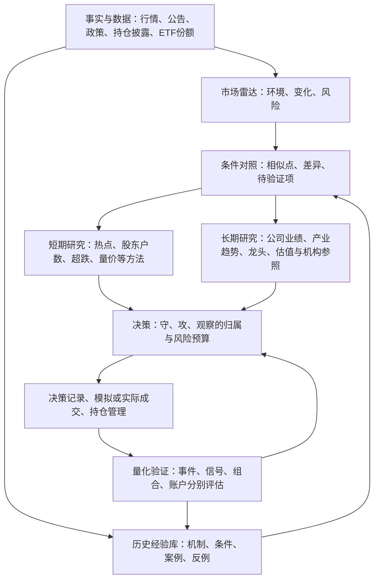

# 个人策略协同总纲（市场感知 · 双周期 · 历史经验 · 量化验证）

> 定位：个人投研与策略协同的**架构总纲**。先理解市场环境和变化，再结合历史经验，服务短期决策与长期配置，逐步形成可检验的量化体系。
> 优先级：个人投资决策 > 为决策服务的策略研究与验证 > 展示与工具扩展。
> 不承载：默认参数（→《个人策略基线》）、完整资产清单（→《个人策略目录》）、晋级/冻结标准（→《策略收敛与回测路线图》）、数据与价格口径（→《数据与验证统一约定》）。
> 建立：2026-11-07；最近修订：2026-11-10（校准长线＋短线主线与多方法过程，仅文档）。**本文区分现有实现与目标架构；此前五票行情修复及 L0 卡见 §12.3，本轮未改代码、行情、运行配置、交易规则或策略状态。** 描述现有行为时，以代码与脚本为准。

## 0. 一页速览

每天先回答五个问题：**现在是什么环境？今天什么变了？影响通过什么渠道传导？历史上有什么可比经验？短期和长期各要采取什么动作或继续等什么证据？**

业务以 **长线研究＋可扩展的短线研究** 为两条主线。长线围绕公司业绩、产业趋势、龙头地位和估值，参考可核查的机构研究；短线包括热点/板块、股东户数、超跌、活跃量价、强势延续等独立方法。每日复盘是共用日常入口，先看短线进展、再看长线变化与待办。具体流程与页面见[重构方案 §0~§2](./个人投研工作台重构方案.md#0-先看这一页长线与短线)。热点是方法和输入，复盘是工作节奏；下图与 §2.1 六层描述内部职责。已有只读原型，双线和多方法过程尚未完整接入。



上图是**目标架构，尚未完整实现**。短期 / 长期是研究周期，守 / 攻 / 观察是资金角色，两者分别分类：长期成长基金也可能属于进攻配置；短期观察也可以服务守线的持仓风险管理。

研究一只股票先看 **§2.8 分层单票卡与四象限**、[单票卡规格](./单票卡规格-v0.1.md)、[数据可行性矩阵](./单票卡数据可行性矩阵.md)，再过 §5 漏斗；§0 是阅读导航，全文是架构参考，不要求每天通读。

**现有阅读入口（过渡期，三份产物的限制见 §12.1）**

1. `data/strategy_review/daily_action_plan_latest.md` —— 现有技术环境与候选纪律提示，不能替代完整市场雷达。
2. `data/manual_runs/personal_strategy_matrix/<最新日期>/review/fast_review_summary.md` —— 当日候选及其证据，不代表全市场的事件与资金方向。
3. `data/strategy_review/strategy_scoreboard.md` —— 历史与近期信号表现参考；须核对版本、窗口和成本，不能直接解释为实际账户收益。

**目标入口（已有只读原型，待双线重构）**：`data/strategy_review/today_board.md` 及其页面消费同一公共结果，按重构方案 §5 呈现市场/板块变化、昨日强股今日表现、多种短线方法进展、长线变化与待办。复用已有产物，不在展示层重算资格或收益；数据缺失和没有合格新仓都应明确显示，原型存在不等于产品验收完成。

**一句话规则**

> 环境决定打法是否适用，历史经验提供有条件的参照，短期与长期分别形成判断；新仓经过完整漏斗，风险处理不受预设持有期限制。

## 1. 为什么"散"：架构缺口

| 表象 | 真因 | 对策 |
| --- | --- | --- |
| 先看趋势、业绩名单，再寻找市场解释 | 研究从已有选股条件出发，缺少独立于候选池的环境和重大事件输入 | 先做市场雷达，再选择适用的策略 |
| 国家队、基金、ETF 与短线信号混在一起 | 研究周期、证据来源、资金角色没有分别分类 | 双周期共用环境底座，按 §2.2 分类 |
| 历史经验停留在故事和印象 | 缺少适用条件、反例、可得时点和后续验证 | 建历史经验卡，再形成可检验假设 |
| 每天不知道先看哪份产物 | 没有节奏：日、周、月、季的动作混在一起 | 固定"日 10 分钟 / 周 30 分钟 / 季半天" |
| 多个名单、绩效结论并列 | 缺少统一决策出口，信号研究与真实账户混读 | 一个决策出口，四类验证分别呈现 |

三条结论：

- **保留可复用资产，控制同时运行和参与交易的策略数量。** 每个新增能力都要有架构归属、使用者和验证问题。
- **策略必须有适用环境。** 熊市、反弹、震荡和上行阶段分别检验；业绩好不自动构成短期买点，趋势信号也不默认适用于所有环境。
- **研究与交易分开推进。** 未通过验证的想法可以积累观察样本；一次性研究不自动加入 cron、首页或交易名单。

## 2. 全局架构与分类

### 2.1 六层职责与实现边界

长线与短线共用本节的六层分工：市场环境和证据提供输入，独立假设持续跟踪，每日复盘读取变化和待办，按方法与周期验证。决策和风险规则共同遵守，不新增一套运行参数或资格真源。

| 层 | 只负责什么 | 现有基础 | 待完善部分 |
| --- | --- | --- | --- |
| 事实与数据层 | 保存当时可获取的行情、事件、披露和资金观测 | `DataFetcherManager`、`stock_daily`、信号及基本面快照 | 事件时间、实际可得时间、来源与修订历史统一记录 |
| 市场感知层 | 判断环境、识别变化及风险传导 | `market_regime`、强势股/市值分层、ETF 周报 | 独立于选股名单的政策、海外事件、市场宽度与流动性雷达 |
| 历史经验层 | 对照机制、条件、历史案例及反例 | 各专题研究与验证报告 | 可追溯的经验卡、相似条件对照、证据强度分级 |
| 双周期研究层 | 短期按多种方法观察，长期跟踪公司与产业假设 | 图形/事件/股东户数等专题；业绩、龙头、基金体检、股息池 | 独立研究过程、证据变化、确认/失效及跨周期冲突说明 |
| 决策与执行层 | 记录采取什么动作、为什么、承担多少风险 | 作战计划、`decision_signals`、持仓服务、决策日志工具 | 研究结论与决策、模拟/实际成交、持仓之间的关联 |
| 量化验证层 | 检验历史经验、规则和实际执行的效果 | 统一信号评估器、leaderboard、组合分析、冻结标准 | 时点一致的事件研究、双周期指标和账户归因；修复现有展示口径断点 |

现有 `catalyst_digest_service` 从候选股票的题材标签聚合摘要，属于**候选解释能力**。它不能独自承担市场感知层，否则未被现有策略选中的行业和宏观事件会被漏掉。后续宏观事件输入复用工程新闻/情报服务，并独立于候选池覆盖。

### 2.2 分类规则（规划，暂不新增 API 字段）

每个能力、观察对象和研究任务至少登记以下维度；先在目录/研究记录中表达，代码字段复用既有契约后再确定，避免与现有 catalog 的 `line` 等字段冲突。

| 维度 | 分类 | 约束 |
| --- | --- | --- |
| 架构职责 | 事实 / 感知 / 经验 / 研究 / 决策 / 验证 | 每项能力一个主要归属，可供其他层复用 |
| 研究周期 | 短期 / 中期 / 长期 / 共用 | 短期和长期为两条研究主线，中期作为过渡窗口标签；默认边界见 §2.5，覆盖默认值须预登记 |
| 观察对象 | 市场 / 事件 / 机构 / 基金 / ETF / 行业 / 股票 | ETF 作为资金观测对象与作为投资标的分别说明 |
| 资金角色 | 守 / 攻 / 观察 / 不适用 | 研究不自动获得仓位；宏观情报不分配交易仓位 |
| 能力状态 | 已有 / 部分具备 / 规划中 | 能运行、已接每日、验证有效三件事分别记录 |
| 证据状态 | 事实 / 推断 / 待验证假设 / 已完成限定范围验证 | 每条结论带来源、截至时间、适用范围和反例 |

### 2.3 现有能力放到哪里

| 分类 | 可复用入口 | 当前边界 / 下一步 |
| --- | --- | --- |
| 共用 · 技术环境 | `scripts/daily_action_plan.py` 的指数均线判断 | 已有；只代表价格维度，不等同完整牛熊或宏观判断 |
| 共用 · 市场结构 | `scripts/strong_stocks_stats.py`、`scripts/cap_bucket_stats.py` | 已有工具；补覆盖范围、时效和持续性对照 |
| 共用 · 候选题材 | `scripts/run_catalyst_digest.py` | 已有；不能代替全市场事件雷达 |
| 短期 · 多方法观察 | `scripts/run_short_term_watch.py`、矩阵及股东户数/活跃股/超跌专题 | 部分已有；按方法分别接入过程跟踪，不能用矩阵候选代表所有短线 |
| 长期 · 趋势与龙头公司 | 趋势/龙头研究、业绩质量与行业资料、现有趋势扫描 | 公司逻辑归长线；日更扫描提供价格与研究线索，不能替代基本面论证 |
| 长期 · 国家队观察 | `scripts/etf_flow_history.py`、`scripts/analyze_etf_national_team.py` | 部分具备；现有是宽基 ETF 代理序列，直接持仓证据需接持有人披露 |
| 长期 / 共用 · ETF | `scripts/etf_flow_weekly.py` | 已有沪市份额周变动；补深市累积、异常调整和持续申赎观察 |
| 长期 · 基金 | `scripts/fetch_fund_holdings.py`、《基金定投候选与体检流程》 | 已有抓取和体检；连续配置变化、经理/风格漂移跟踪待补 |
| 长期 / 共用 · 个股基本面 | 财务/行业资料、股息池、股东户数专题、`scripts/analyze_stock_profile.py` | 已有部分能力；股东户数也可支持独立短线跟踪，按披露时间保存历史和用途 |
| 共用 · 结果验证 | `scripts/evaluate_signal_snapshot_performance.py`、`scripts/analyze_signal_portfolio.py`、`scripts/review_decision_log.py` | 已有；复用并补齐语义，不能把前向收益直接当实际账户收益 |
| 共用 · 宏观事件与历史经验 | 现有新闻/情报服务、专题研究文档、静态经验卡 | 部分基础可复用；独立事件台账与经验持续更新尚不完整 |

### 2.4 市场雷达：先确定环境和变化

目标是保留各维度证据，再形成有依据的环境判断；不急于加权成一个总分。现有 `defensive / balanced / offensive` 继续作为技术开关，新雷达在验证前不自动改写它或放宽交易限制。

| 维度 | 要观察什么 | 用于判断什么 |
| --- | --- | --- |
| 趋势与市场宽度 | 多类指数趋势/回撤、上涨下跌家数、站上均线占比 | 指数修复是否扩散到多数股票，是否只是局部反弹 |
| 流动性与风险偏好 | 成交、融资、利率/汇率、宽基及行业 ETF 申赎 | 是否具备持续承接，防御还是扩张 |
| 政策与外部冲击 | 政策原文、实际权限、生效时间、海外风险事件 | 影响哪个环节，哪些还只是预期 |
| 盈利与估值 | 盈利预期变化、估值位置、行业订单/价格 | 好公司是否已有好价格，利好是否被提前交易 |
| 价格对信息的反应 | 利好不涨、利空不跌、冲高回落、相对强弱持续性 | 预期是否兑现，市场是否认可当前推演 |

价格弱势时，趋势和业绩模块仍可用于研究与观察；能否交易要由适用环境、可成交性和风险约束共同决定。当前熊市判断不能永久写成默认事实，也不能只凭一天涨跌切换环境。

### 2.5 双周期研究：短期机会与长期变化分别跟踪

新增研究记录的默认周期：**短期 1~20 个交易日；中期超过 20 个交易日且不足 6 个日历月（通常约 1~6 月）；长期 6~36 个日历月，满 6 月归长期**。默认主要评价窗分别为 20 个交易日、3 个日历月、12 个日历月；其他窗口作为辅助或预登记覆盖。中期不另建一套研究系统，既有脚本默认参数不随本文改变。日历月到期取对应日，无对应日取月末，遇非交易日顺延至下一交易日，未到期记 pending。

| 项目 | 短期研究 | 长期研究 |
| --- | --- | --- |
| 核心问题 | 本方法为何关注、进展到哪一步、还等什么确认、何时失效 | 公司业绩、竞争力与产业逻辑是否兑现，估值和风险是否合适 |
| 主要输入 | 各方法所需事件/披露、价格成交、相对强弱、题材持续性 | 公司财报/经营与行业资料、估值、机构研究/披露及产品资料 |
| 评价窗口 | 默认 20 个交易日，辅助 1/3/5/10；起点与覆盖须预登记 | 默认 12 个日历月，辅助 6/24/36 月；月/季复核逻辑，中期默认 3 月 |
| 输出 | 受影响方向、待确认条件、可参与/观察/回避的原因 | 跟踪对象、配置条件、逻辑变化、再平衡或退出条件 |
| 失效检查 | 事件证伪、承接不足、价格反向、交易空间耗尽 | 盈利/分红逻辑变化、估值透支、经理或风格漂移、集中度过高 |

长期跟踪中三类证据必须分开：

1. **国家队直接证据**：持有人报告、上市公司或机构披露，带持有人身份、报告期和实际披露时间。没有直接披露时写“身份未确认”。
2. **ETF 代理观测**：份额变化及净申购估算。不能单凭它断言国家队买卖；份额差乘单位净值只能估算期间申赎，需处理折算、新发、清盘及样本覆盖差异。
3. **主动基金配置**：结合持股数量、权重、基金规模、经理与风格变化；权重变化可能来自价格和申赎，不能自动解释为主动加减仓。季报前十大持仓也不代表完整组合。

### 2.6 历史经验库：从经验到可检验假设

先整理少量与个人决策有关的经验卡，再补结构化数据。以下为**计划分类，不代表已建立案例库或证明规律**：政策/国家队托底、海外科技资本开支变化、关税与出口限制、利率汇率冲击、商品价格传导、熊市中的消息与价格背离。

| 每张卡要记录什么 | 要求 |
| --- | --- |
| 身份与问题 | 稳定编号、版本、经验类型、要帮助哪类决策 |
| 历史背景 | 市场趋势/宽度、流动性、估值、盈利与政策背景；包含失败案例 |
| 当时可知信息 | 原始来源、事件发生时间、公开时间、系统获取时间；事后复盘与当时证据分开 |
| 传导机制 | 事件 → 政策/供需/利率等变量 → 行业盈利或估值 → 资金与价格反应 |
| 适用条件与反例 | 什么条件成立才可参考，什么不同点会削弱可比性，什么事实会证伪 |
| 结果 | 按预设窗口记录指数/行业/标的的绝对与超额分布、回撤及修复时间 |
| 证据强度 | 机制判断、少量案例、限定样本统计、样本外检验分别标注；记录独立事件数量 |
| 本次对照 | 与当前的相似点、差异、未知项、下一验证点；保留原判断和事后结果 |

经验检索先匹配机制和环境，不只匹配“选举”“救市”等词。相似度不能解释成上涨概率；同一冲击连续出现多日应标记为同一事件簇，不能虚增独立样本。LLM 可整理来源、提出传导假设和总结差异，数值与统计须来自可复现计算。

### 2.7 贯穿示例：美国中期选举如何进入架构

**研究截面：2026-11-07；仅演示研究方法，不构成常设市场判断或买入规则。**

- **事实与报道**：财联社报道美国时间 11 月 4 日大盘上涨、部分数据中心链条承压；中央社报道 11 月 5 日美股大跌，市场担忧 AI 数据中心投资受阻。中国经济网报道 11 月 6 日 A 股算力硬件调整、银行及公用事业等相对走强。媒体的归因保留为解释，不能据此证明单一因果。
- **权限与阶段**：选举改变国会格局；截至该截面，部分 AI 监管内容仍是拟议法案，并存在总统等方面的阻力。按“政治表态 / 提案 / 通过 / 生效 / 企业经营变化”分别跟踪，不能提前认定实施。
- **短期假设**：海外需求敞口较大的算力供应商可能承受预期和估值压力，防御方向可能相对抗跌；要检验承接、相对收益与持续性。相对抗跌不等于绝对上涨。
- **长期验证**：跟踪客户资本开支、订单/交付、政策实际落地和国内投入；国产替代只是待验证路径，不能从海外受限直接推出国内公司受益。
- **历史参照**：中期选举后的美股统计只对应原研究的市场、样本与窗口；不能迁移成 A 股短期胜率。还需对齐利率、盈利、估值和产业暴露。

本次核对来源（后续研究保留获取截面，网页修订不回写成当时已知）：

- [财联社：11 月 4 日美股表现及行业分化](https://m.cls.cn/detail/2525646)
- [中央社：11 月 5 日 AI 投资疑虑与市场下跌](https://www.cna.com.tw/news/afe/202611060013.aspx)
- [中国经济网：11 月 6 日 A 股防御类资产相对走强](http://m.ce.cn/gj/gd/202611/t20261107_3286635.shtml)
- [中央社：拟议 AI 与数据中心法案及实施阻力](https://www.cna.com.tw/news/aopl/202611070086.aspx)
- [BlackRock：中期选举与美股历史表现的样本和窗口](https://www.blackrock.com/us/financial-professionals/insights/2026-midterm-elections-and-market-performance)

### 2.8 单票卡 v0.1：分层产出，三种资格独立核验

目标是先产出可核查观察，再按证据范围形成判断；中期只作评价窗，不单独产生动作。字段、公式、资格及四象限表以[《单票卡规格 v0.1》§5](./单票卡规格-v0.1.md)为唯一真源；具体阈值、覆盖率、暴露与复核窗放[规则登记表](./单票卡规则登记表.md)，取数与案例见[可行性矩阵](./单票卡数据可行性矩阵.md)。

| 层 | 输入与节奏 | 可输出的结论 |
| --- | --- | --- |
| L0 短期卡 | 13/14/16/17/18/22，日/事件更新；按任务检查15/暴露等依赖 | 技术观察、事件链核验、超跌反弹研究（RE01）；不评财务/多源状态 |
| L1 财务卡 | 01~06，季更新；10~12机构子卡另附 | 盈利/质量及财务单源状态（弱）；不冒充多源状态 |
| L2 多源合成卡 | 前两层加估值/机构/行业景气等任务依赖 | 至少两来源族后的多源描述状态与配置研究；19/20可选，21当前不可用 |

每层、每个任务独立准入，不等22槽全绿；卡头必填规则快照、capability与六行verdict，区分生成、数据准入、两种研究资格和交易权限。21个收盘观测点对应20个交易日收益。首批L0是本地只读产物，未接每日服务。

四块为盈利、质量、机构、行业景气；估值 07~09 只作约束、不投方向票。前两块只算一个财务族，另有持仓族、景气族，价格只旁证。至少两有效块、两来源族方可合成多源描述状态；相反票为分歧。**在长期效用验证前只称描述状态，不赋予6~36月回报/长期看空含义**；五票688个交易日不能验证36月前瞻效果。

**配置研究资格**要求多源改善/稳定及配置条件；**事件交易研究资格**另核，可接受盈利与质量两块均有效恶化的“财务单源恶化（弱）”，再加有利传导、达标暴露、按范围价格确认、最晚退出、专项预算及风险审查，**不必先等L2**。**超跌反弹研究资格（RE01）** 单独核验：不看财务块与业务暴露，要求超跌三项 + 曾经行业龙头 + 底部阳线次日确认 + 消息催化 + 相对行业不弱；相对行业为负只做 ETF/组合且需 ≥2 只龙头同步（合力）；D+3 不新高或跌破 D0 低点退出，最长 10 日、专项小额，人工决定。确认分市场：强/平市用 R4a；弱市（000300 收盘<MA20）用 R4b（不破 D0 低点、回吐≤2%、量≥50%、两日净≥0、站上 MA5、相对市场≥0），R4b 只记弱确认观察、不授资格。未知/分歧或单季利润下降不能代替弱状态，候选规则均不授予交易权限。

短期按登记范围确认：个股14>0且15>0，行业14>0且15≥0，市场14>0；15 基准按事件暴露映射，行业标签指数只作代理且只能否证；确认按 T+1/T+3/T+5，T+5 未确认即结束（20 日只是上限）；个股/行业缺15不改名市场级。暴露不因分层省略，行业落后可转研究ETF/组合。复权事件按规格回退，账本/含息基准不足则保留受限，后复权不自动视作TR。RE01 用 D0/D1 两日确认，不用本段 T+ 检查点。

“阳光电源×中期选举”首个纵向核验已完成，结果与缺口见矩阵§7；下一步补缺口和L1，再扩20只合同校验。单个回顾案例不验证策略。A3须有足够历史与PIT全市场面板；行情补深不能替代披露可得时间。现有六列决策CSV不变，人工卡先冻结证据与计划。

## 3. 三条资金线职责表（执行视角）

本节保留现有资金角色；§2 的市场感知、历史经验、短期/长期研究为它们提供输入。下表列当前主要执行用法，不限制长期研究的资金归属。**基金定投和 ETF 不统一归为防守资产**：按实际权益敞口、行业集中度与投资目的分别归守或攻，研究阶段归观察。

| 线 | 角色 | 回答什么问题 | 频率 | 持仓周期 | 主入口 | 产物 |
| --- | --- | --- | --- | --- | --- | --- |
| **守线** | 底仓与风险管理 | "现金回报是否持续、估值与风险是否允许持有或增配" | 周 / 季 | 季度~年级 | `scripts/select_dividend_income_candidates.py`、`scripts/dividend_t_watch.py` | `data/dividend_income/<日期>/`、`dividend_t_watch_<日期>.md` |
| **攻线** | 卫星，博取弹性 | "今天哪几只图形好、有人接" | 日 | 3~20 个交易日 | `scripts/run_personal_strategy_matrix.py`、`scripts/run_short_term_watch.py`、`scripts/daily_action_plan.py` | `fast_review_summary.md`、`short_term_watch_<日期>/`、`daily_action_plan_latest.md` |
| **观察线** | 0 仓位，只建池 | "哪些票值得等一个信号" | 日 / 周 / 季 | 不持仓 | `earnings_surprise`（观察区）、股东户数筛选、`watch_newstock_deadwater.py`、`screen_deep_recovery.py` | 各线 `data/strategy_review/*` |
| **共用研究输入** | 无交易仓位 | "现在是不是该缩手、观察到哪些变化" | 日 / 周 / 月 | — | `etf_flow_weekly.py`、`etf_flow_history.py`、`run_catalyst_digest.py` | `data/strategy_review/etf_flow/`、`data/catalyst_digest/<日期>/` |

三条边界（最容易破的）：

- **守线不追热点**：股息池里的票涨起来了，也不因此加仓到攻线的逻辑里。
- **攻线不接飞刀**：图形没确认、催化没落地，只能进观察线。
- **观察线不下单**：业绩超预期、股东户数、次新装死、深跌企稳先建研究池；要买需按目标资金角色重新确认，长期研究也要有配置条件和风险预算。

`earnings_surprise` 当前在默认每日里跑，但业绩票仍需过确认层；防守市的自动降权对象是「百日新高单信号」（移入观察区、不参与新开仓）。

## 4. 六种组合配方（这就是"结合用法"）

以下是已有能力的组合方式，属于双周期研究层的工具。**运行成功不等于验证有效**；先匹配环境，再检验组合是否相对基础规则提供增量。

| # | 配方 | 组成 | 什么时候用 | 现状 |
| --- | --- | --- | --- | --- |
| 1 | **守 + T** | 股息池 × 红利 T 回踩档（-3% / -5% / -7% + MA200 闸门 + MA60 减半） | 已有股息底仓，在明确资金与增量风险预算下研究成本管理 | 已跑提示（每日）；不能承诺不增加风险 |
| 2 | **双确认** | `earnings_surprise` × `hundred_day_high`（业绩 + 价格双确认） | 财报季、想要"业绩已兑现且市场认账"的票 | 已跑（`fast_review_summary` 的"双确认候选"分组） |
| 3 | **图形 × 催化** | 图形件（趋势龙头 / 百日新高）× 催化件（内置注册表 + `config/catalyst_watchlist.json`） | 想做短线，又怕买了没题材接力 | 已跑（`run_short_term_watch.py`） |
| 4 | **位置 × 业绩** | 股东户数 `pos ≤ 0.2` + 仍在下降 + 净利同比 > 0 + ROE > 5 | 找"筹码真集中、业绩不差"的中线底仓候选 | 方法定稿，脚本待固化（季报月手工跑） |
| 5 | **业绩 × 位置状态** | 业绩爆发（≥100% 或扭亏）× 位置分层（B 低位启动 / B- 刚转强 / 低位待动 / 破位 / 高位透支） | 观察业绩事件在不同位置与环境下的反应 | 纸面跟踪（`scan_earnings_lowbase_watch.py`，不进 cron）；既有样本研究支持 B 态，需保留区间/数据限制并前向复核 |
| 6 | **环境 × 仓位** | `market_regime`（000300 vs MA20/MA60）→ 提供攻线技术环境提示 | 收盘后生成，供下一交易日复核 | 已跑技术开关；完整环境与风险预算联动待完善 |

配方阅读优先级（沿用原协同建议，**尚未证明是最优收益排序**）：

1. 配方 2 双确认 > 配方 3 图形×催化 > 配方 1 守+T > 配方 4/5 观察类；仅为原配方阅读建议，不作为新短线方法的全站排序
2. 观察类命中只能"升级为关注"，不能直接升级为买入
3. 原配方视图可保留一个主标签；研究档案保留同股长短线及不同方法的独立假设，不能按主标签合并历史。组合风险按实际持仓合并计算，不能靠标签拆分降低账面集中度

## 5. 决策漏斗（目标：新仓必经 8 关）

下表面向新仓决策，为协同目标及沿用的提示口径，**不是已由代码强制执行的完整交易闸门**。多方法研究观察可按自身必要输入开展，不必先满足全部交易条件；观察不授予交易权限。现有作战计划只实现其中部分：按信号数量放宽乖离阈值，并对配置中的单信号做防守降权；驱动一致性、独立证据、完整仓位预算及自动风险处置待实现。既有数值不在本次文档改动中重新调参。

| 关 | 问题 | 规则 | 不通过怎么办 |
| --- | --- | --- | --- |
| 1 总闸 | 当前环境适合该打法吗 | 当前技术代理为 000300 vs MA20/MA60；目标还需检查事件冲击、流动性与策略适用环境；防守市双确认也不自动获得买入权限 | 只做持仓风险管理与研究观察；守线增配也需单独过闸 |
| 2 归属 | 这只票属于哪条线 | 一票一主标签（守 / 攻 / 观察） | 归不了类 → 不进任何名单 |
| 3 驱动一致性（人工复核，未自动化） | 描述状态 × 短期驱动意味着哪种研究动作 | 按规格§5分别核配置与事件研究资格；财务单源恶化仅可走事件分支，仍须核传导/暴露/范围确认/退出/专项预算；不作底仓依据 | 关键证据不足/分歧 → 观察；未验证规则不获交易权限；角色不符返回第 2 关 |
| 4 独立 | 证据是否重复 | 原协同建议为 ≥2 条独立证据；趋势与突破同属价格证据不能自动算两条，须验证增加该条件后的增量 | 数量足够但同源 → 仍观察；不声称已满足统计独立 |
| 5 确认 | 证据落在哪几类 | 五类：图形 / 催化 / 资金 / 业绩 / 位置，至少 2 类 | 只有 1 类 → 观察区 |
| 6 位置 | 还有参与空间吗 | 短期沿用 MA5 乖离 2%/5%（双信号 7%）及 60 日涨幅罚分提示；长期还要检查估值、盈利和配置逻辑，低乖离不单独构成买点 | 超标或依据不足 → 只记不买；长期配置另留估值/基本面条件 |
| 7 仓位 | 买多少 | 守线单票 ≤4%（执行约定 v1.0，30~50 只等权）；攻线目前仅有“可介入 / 小仓或回踩 / 严禁追高”纪律标签，尚无完整仓位分配 | 超过单票、行业或总风险预算 → 减量或不新开仓 |
| 8 纪律 | 什么情况下复核或退出 | 短期 T+5 / T+10 为复盘节点；事件交易预记最晚退出与兑现/衰减/证伪处理，长期按月/季及重大事件复核。止损、逻辑证伪与风险上限优先于持有期 | 触发风险条件及时复核/处置，不能以“未到持有期”推迟 |

> 仓位补充：目前只有守线的 4% 是定稿口径。攻线建议"单票 ≤10%、单板块 ≤2 只、总仓 ≤30%"，属**待拍板建议**（未回测）；`daily_action_plan` 的三档是纪律提示，不能替代资金和风险预算。

## 6. 冲突裁决矩阵

| 场景 | 裁决 | 依据 |
| --- | --- | --- |
| 股息池里的票又被趋势龙头选中 | 归守线持仓加强，**不加新仓**，避免双计 | 一票一主标签 |
| 业绩超预期但 regime = defensive | 只进观察区，新开仓需额外价格确认 | 熊市业绩驱动易「利好兑现」；`earnings-only` 需过 gate + 至少一项市场确认（复盘约定 §5） |
| 图形好、但没有催化 | 进 graph-only 名单，等题材，不追 | 短线圈口径 |
| 图形好 + 有催化，但 60 日涨幅 ≥40% | 沿用既有罚分、不进前排提示；历史样本中的负表现不外推为所有环境定律 | `extension_bucket_study_2026`，引用时带样本区间与口径 |
| 同一板块被多条线同时命中 | 视为板块共振，但板块内只取 1~2 只 | 集中度约束 |
| 已持仓出现反向信号 | 区分噪声与风险触发；触及止损、逻辑证伪或风险上限时优先处理，不等待固定评估日 | 风险条件优先于持有期 |
| 短期快照落后 >3 天 / 停牌 / 关键数据缺失 | 不进入可交易候选；缺失项明示 | 复盘约定 §4；长期季报按其披露周期判断时效，不能套 3 天剔除 |
| 海外事件指向利空，但长期产业逻辑仍在 | 分别保留短期风险与长期观察，列出订单/政策下一验证点；不能用长期叙事覆盖短期风险 | 双周期分别评估 |
| 综合长期状态恶化，但有可核对的个股短期利好和价格确认 | 仅列事件交易候选；无暴露证据、专项预算、失效条件或最晚退出则观察，不转底仓 | §2.8 来源族与四象限；单一盈利块或财务单源不能决定综合状态 |
| ETF 份额增加，被解读为国家队增持 | 记录申赎代理观测，持有人身份标为未确认；等直接披露再升级结论 | 代理观测与身份事实分开 |
| 当前环境与历史案例只在标题上相似 | 对照机制、利率/盈利/估值与制度差异，信息不足时只列待研究项 | 相似度不等于概率 |
| 策略结论与数据口径冲突 | 以《数据与验证统一约定》和代码为准 | 真源优先级 |

## 7. 时间节奏

| 频率 | 时间 | 动作 | 产物 | 耗时 |
| --- | --- | --- | --- | --- |
| 日 | 18:10 / 18:40 / 19:00 / 19:05（cron 自动） | 筛选 → 预热 → 结构扫描 → 矩阵复盘 + 作战计划 | `data/strategy_review/*_latest.md` | 无人值守 |
| 日 | 收盘后 10 分钟 | 只看 3 个文件（§0），不打开 CSV | — | 10 min |
| 日（按需） | 想深看个股 | `analyze_stock_profile.py --codes <code>` 五段式快照 | `stock_profiles_<日期>/` | 3 min |
| 周 | 周五 | ETF 份额流（cron 17:30）+ `daily_review_export.py --days 21` | `etf_flow/`、`daily_review_latest.csv` | 30 min |
| 月 | 月末 | 国家队序列更新 + 活性池/强势股结构复核 | `national_team_review.md`、`active_pool_*` | 30 min |
| 季 | 季报月 | 股东户数重算 + 股息池重跑 + 基金池刷新 + 策略晋级复核 | 各线池子 + `leaderboard` | 半天 |

上述时间描述现有本机链路。规划中的市场雷达在盘前读取隔夜变化、收盘后更新价格反应；重大事件按可得时间触发复核，周度检查 ETF 与基金变化，季度检查持仓披露和经验有效性。**尚未新增调度任务**。

纪律：日频研究可以引用最新可得的周/月/季证据，但必须标注来源和截至时间；不得把滞后披露当成当天资金动作。参数沿用各能力现有配置入口，作战计划与矩阵主要在 `config/local_strategy_profile.json` / `config/daily_plan_tuning.json`，不因周报或一次事件临时修改阈值。

## 8. 场景速查（我要 X → 跑什么）

| 我想要 | 跑这个 | 看这个 |
| --- | --- | --- |
| 今天该不该开仓、买哪只 | `scripts/daily_action_plan.py`（已在链路内） | `daily_action_plan_latest.md` |
| 今天有哪些票值得看 | `scripts/run_personal_strategy_matrix.py --snapshot-date latest` | `fast_review_summary.md` |
| 短线"图形 + 催化"交集 | `scripts/run_short_term_watch.py --snapshot-date latest` | `data/short_term_watch/<日期>/` |
| 候选里哪些题材反复出现 | `scripts/run_catalyst_digest.py --snapshot-date latest` | `catalyst_digest.md`（范围是候选池） |
| 近期信号之后表现怎样 | `scripts/daily_review_export.py --days 21` | `daily_review_latest.csv`（不是实际成交收益） |
| ETF 是否持续申购/赎回 | `scripts/etf_flow_weekly.py` | `data/strategy_review/etf_flow/`（不直接识别持有人） |
| 长期宽基份额经历了什么变化 | `scripts/analyze_etf_national_team.py`（需已有历史序列） | `national_team_review.md`，结合《国家队资金长期跟踪》的限制阅读 |
| 基金持仓与风格是否变化 | 按《基金定投候选与体检流程》使用 `scripts/fetch_fund_holdings.py` | 披露期持仓体检；连续变化跟踪规划中 |
| 海外事件影响谁、历史有何参照 | 按 §2.6 / §2.7 人工登记事实、假设和验证点 | 事件台账与经验卡规划中，暂无自动入口 |
| 筹码是不是真集中 | 按《股东户数筹码集中筛选方法》跑 | 一档/二档/三档名单 |
| 次新有没有放量启动 | `scripts/watch_newstock_deadwater.py` | `newstock_watch/<日期>.md` |
| 哪只票有活性、能低吸 | `scripts/screen_active_pool.py` | `active_pool_<日期>.md` |
| 这票到底怎么样（个股体检） | `scripts/analyze_stock_profile.py --codes <code>` | 五段式快照 |
| 这套体系还成立吗 | `scripts/run_strategy_leaderboard.py` + `strategy_scoreboard.md` | leaderboard / scoreboard |

## 9. 防散护栏

1. **新增能力先归类。** 先确定架构职责、研究周期、观察对象和验证问题，再决定复用哪个入口，不为一个新闻主题另造策略。
2. **首页按决策问题组织。** 目标展示顺序见 §0；既有页面上限沿用《精简方案》，本次未修改页面。
3. **一票一主标签。** 禁止同一只票在多个名单里被重复计数。
4. **一次性试验不自动进 cron、首页。** 保留脚本、产物和文档说明；持续市场观察按阶段验收后再接阅读入口，不因接入而获得交易权限。
5. **阈值沿用对应配置入口。** 新规则先登记版本和验证窗口，不在展示文案或临时脚本里维护另一套参数。
6. **没有事后标准的策略不上线。** 先写"五件事"（目的/入选/输出/环境/淘汰），再写代码。
7. **日常工具 90 天没跑 = 进冻结候选。** 季度/事件驱动任务按其约定周期检查，季度回顾统一处理，不临时复活。
8. **事实、推断、假设分别标注。** 国家队身份、政策受益者、历史概率均不能由 LLM 补猜；数据不完整时降低结论强度。
9. **观察对象不限于个股。** 市场、机构、基金、ETF 与行业分别跟踪；长期任务不以每天产出买入名单为验收。

## 10. 外部能力怎么接（开源项目 + 因子面板）

> 本节只定"接什么、接到哪一层"；选型档位与闸门以 [`开源工具融合规划（investment_data-qlib-TradingAgents）.md`](./开源工具融合规划（investment_data-qlib-TradingAgents）.md) 与 [`开源参考候选调研（第二轮）.md`](./开源参考候选调研（第二轮）.md) 为准。

### 10.1 一句话结论

开源能给的是**数据管道 + 因子/回测框架**，给不了"解释为什么涨 + 概率"。
本架构先补**市场雷达与历史经验的证据记录**，再围绕具体假设推进**最小面板 → 标准化 → 条件统计/归因**。工具选型不能代替研究问题。

### 10.2 项目角色映射

| 项目 | 在本体系里的角色 | 用不用 | 边界 |
| --- | --- | --- | --- |
| AKShare / Tushare | 数据底座（已在 `data_provider/`） | 用 | 只走 `DataFetcherManager`，新脚本不裸拉（豁免见数据约定 §3） |
| `chenditc/investment_data` | 研究/回测历史底座 | 按外部规划 P0 验收 | 不做运行时数据源，不阻塞已有数据上的经验整理 |
| `microsoft/qlib` | 因子检验（IC / 分层） | 外部规划 P1，满足数据闸门后再评估 | 不接实盘、不替换现有评估器，不作为市场感知的前置依赖 |
| `zvt` | 数据→因子→选股三段式组织参考 | 只读（A 档） | 不引依赖 |
| `myhhub/stock`（InStock） | 功能对照（涨停原因/筹码/综合选股） | 只读 | 爬虫工程化与时点正确性不足，不接 |
| QUANTAXIS / abu / hikyuu | 交易/回测框架 | 不用 | 红线：不引第二套回测/交易体系 |
| alphalens-reloaded / quantstats | 轻量因子评估 / 绩效报表 | 可选 | 必须与现有评估器互验 |

### 10.3 数据逐步结构化（规划，不预设新建数据库表）

| 层 | 现状 | 缺什么 | 服务哪个环节 |
| --- | --- | --- | --- |
| ① 证据与面板 | 已有行情、信号与基本面历史快照，但时间语义、覆盖与结构不统一 | 先复用已有存储，明确事件、环境、机构/基金/ETF 观测与少量因子；需要时再设计 `stock_factor_daily` | 市场雷达、历史条件对照、双周期研究 |
| ② 标准化 | 因子散在各脚本 | 按假设选择历史/截面分位、行业比较、同比/环比等；保留单位、缺失与覆盖率 | 避免不同规模/行业/时期之间误比 |
| ③ 条件统计与归因 | 已有 leaderboard、信号和组合评估 | 对接可追溯统计产物；是否需要 `signal_stats` 表在实现时决定 | 经验验证、配方比较、账户复盘 |

最低记录要求：对象标识与类型、报告/交易期、事件发生时间、原始发布时间、系统获取时间、研究中实际可用时间（`available_at`）、来源和版本。`as_of_date` 可用于日级查询，但盘中/盘后信息还需带时区的时间戳。无法证明历史可得时间的数据标为受限，不用最新快照补成“当时已知”。

先围绕一个具体假设选择少量可靠字段，不把 80~120 字段体检卡当作第一阶段目标。不同对象分别存储和关联，机构季报与宏观事件不强行展开成每天每只股票的一行。

### 10.4 因子候选清单（按需取用，不是首期必做字段）

| 组 | 关键字段 | 现成来源 |
| --- | --- | --- |
| 价格/技术 | 动量、波动、ATR、250 日位置分位、换手、量比、振幅、连板、缺口 | `stock_daily` + K 线缓存 |
| 资金 | 主力净流入、板块资金流排名、融资余额变化、龙虎榜净买、大宗折溢价 | `stock_individual_fund_flow` / `margin_detail` / `stock_lhb_*` / `stock_dzjy_mrmx` |
| 筹码 | 股东户数、户均持股市值、十大股东变动、机构持股、筹码集中度 | `stock_zh_a_gdhs` / `stock_gdfx_top_10_em` / `stock_institute_hold` / `cyq_chips` |
| 业绩 | 营收/净利同比与加速度、预告类型与幅度、快报、超预期幅度 | `stock_yjyg_em` / `stock_yjkb_em` / `stock_profit_forecast_ths` |
| 估值 | PE / PB / PS 及自身历史分位 | `daily_basic` |
| 事件 | 解禁、分红除权、定增、回购、调研、ST 变更 | `stock_restricted_release_*` 等 |
| 情绪/份额 | 股吧人气、新闻数量与情绪、ETF 份额变化 | `stock_hot_rank_em` / `news_intel` / `fund_etf_scale_sse` |

> 这些是候选数据源/字段，不代表全部已接入、可回溯或权限可用。先核对 `data_provider/fundamental_adapter.py`、现有 fetcher 与本地快照的实际覆盖；缺失不默认为 0，不能为了填满字段新造直连取数路径。

### 10.5 四类量化验证分别验收

先按 §2.8 检验维度能否进入裁决，阅读字段不自动成为信号；以下四类结果验证不能替代字段准入。短期、中期、长期默认评价窗及覆盖登记统一见 §2.5。

| 验证对象 | 主要指标 | 必须说明的边界 |
| --- | --- | --- |
| 事件与历史经验 | 独立事件/事件簇数量、窗口超额分布、中位数、尾部损失、回撤与修复时间 | 起点取当时可得时间；同机制不同环境分组；相关性和事件后涨跌不能证明因果 |
| 选股/确认规则 | 成本后收益、相对基准/同窗对照、覆盖率、样本日数、条件增加前后的增量 | 依赖样本按日期/事件簇处理；原始信号与漏斗后候选分别统计 |
| 模拟组合 | 现金、仓位、净值、回撤、换手、集中度、资金占用和成本 | 同一资金不能无限重复开仓；可成交性、交易日历与退出规则明确 |
| 实际账户 | 实际成交与现金流、净值/回撤、相对基准、计划与执行偏差 | 复用持仓账本，分清真实/模拟账户及费用、分红、入出金；不能用信号前向收益代替 |

短期按预登记的交易日窗口评估，中期看默认 3 月，长期看默认 12 月及预登记辅助窗口，月/季复核变化；未到期样本标为 pending。跨期限和跨对象比较先统一基准、窗口与收益口径。分红资产使用相匹配的含息基准，避免含息组合与价格指数直接比较后宣称超额。

**当前信号日收盘入场属于研究口径**：晚间生成的信号无法按当天已结束的收盘成交。可执行模拟须从实际可得时间后的首个可交易时点开始，并重新对齐持有期与基准；不能把 `--entry-mode daily` 解释为已解决时点问题。本次不改变现有评估器行为。

### 10.6 条件统计的输出规格

目标统计同时给：规则/数据版本、样本区间、`n`、独立事件数/交易日数、完成与缺失数量、胜率分母、窗口均值与中位数、盈亏比、回撤、**分年份**与**分市场状态**切片。有足够独立样本时补区间估计，并披露估计方法。

- 沿用原协同护栏：`n < 30` 不报概率，只展示案例与描述性结果；`n ≥ 30` 也不自动代表有效，仍需检查事件聚集、样本依赖及样本外表现；
- 跨信号比较前先对齐样本窗（否则随机基准不可比）；
- 胜率是否包含中性样本必须一致或分别注明；禁止把两种胜率直接并排排名；
- 结论先进入研究/绩效产物；每日总览只引用适用条件与证据摘要，不自动升级为买入；
- 条件频率与相似度不能包装成单票预测概率，不能替代风控。

### 10.7 "为什么涨"的三条可行路径

| 路径 | 做法 | 边界 |
| --- | --- | --- |
| 事件研究 | 政策/海外冲击/公告/预告/龙虎榜等 → 事件后窗口超额分布 | 需要真实可得时间；纳入未上涨/失败案例并处理重叠事件 |
| 收益归因 | 收益 = 市场 β + 行业 β + 风格 + 个股 α | 只做解释，不产生信号 |
| 事后标签 | 涨停原因、板块归属、题材映射 | **只能阅读，不能进回测** |

这些路径用于检验传导假设、整理关联和解释残差；未经相应识别设计，不把它们称为已证明的因果关系。

### 10.8 时点与数据陷阱

1. 股东户数：季度披露 + 时滞；"最新"表只覆盖部分公司，**截止日不一致**，输出必带截止日。
2. 机构持仓：季报，滞后 15 天~4 个月；用报告期对齐 = 前视偏差。
3. 龙虎榜 / 大宗：通常盘后发布；按实际可得时间之后的可交易时点使用，不按事件日收盘回填入场。
4. 北向资金：2024 年起不再实时披露净流入，别做日频因子。
5. ETF 份额：折算/拆分会机械改变份额，新发/清盘会改变篮子覆盖；份额变动不能直接当资金流，需对齐净值、分红除息与异常调整。
6. 涨停原因 / 板块归属：事后标签。
7. 幸存者偏差：股票池要用历史成分，不是今天的列表。
8. 复权口径：已有信号研究沿用 `stock_daily` 前复权 + `--entry-mode daily`，不混用快照价；含息研究另核现金分红和送转，避免重复计息。
9. 政策与新闻：发生、报道、提案、通过、生效分别记录；后来的修订/解释不能写回更早的可得时点。
10. 跨市场：统一时区与交易日历；美股、A 股、基金净值及 ETF 数据的发布和可交易时间不同。

### 10.9 接入顺序（架构推进见 §12）

```text
市场雷达与经验卡 → 按研究问题补最小历史数据 → 统一口径验证 → 决策联动
                                      └→ 数据稳定且确有因子研究需求时，再评估 qlib / alphalens
```

- 框架选择与下载能力不阻塞已有资料上的经验整理和只读市场观察。
- 扩展事件、长期观察和组合验证时复用现有服务及评估器；先盘点契约，不新造第二套回测体系。
- qlib / alphalens 只在数据闸门满足后做互验，不替换 `evaluate_signal_snapshot_performance.py`。
- 外部规划中的 P0/P1 是工具选型阶段，本文 §12 使用 A0~A4 表示架构阶段，避免编号混读。

## 11. 文档真源分工（各自只管一件事）

| 文档 | 只管什么 |
| --- | --- |
| 本文 | **架构、分类和推进顺序**（市场感知、双周期、单票卡/四象限、历史经验、资金协同与量化验收） |
| [个人投研工作台重构方案](./个人投研工作台重构方案.md) | 长线＋短线业务结构、多方法过程、每日页面与子任务验收；[§7.2~§7.4](./个人投研工作台重构方案.md#72-扩展边界业务入口稳定按类型接入)负责方法/数据/功能扩展合同，不另定义资金角色、阈值或晋级标准 |
| [`个人策略目录.md`](./个人策略目录.md) | 有哪些资产、脚本入口、每日链路跑什么 |
| [`个人策略基线.md`](./个人策略基线.md) | 当前默认参数与口径 |
| [`个人每日复盘约定.md`](./个人每日复盘约定.md) | 每日首页的阅读语义与分组规则 |
| [`策略收敛与回测路线图.md`](./策略收敛与回测路线图.md) | 晋级/淘汰的六条标准与判定流程 |
| [`策略与脚本冻结登记.md`](./策略与脚本冻结登记.md) | 谁冻结了、怎么恢复 |
| [`数据与验证统一约定.md`](./数据与验证统一约定.md) | 数据入口、价格口径、评估口径 |
| [`单票卡规格-v0.1.md`](./单票卡规格-v0.1.md) | 22 槽公式/元数据、分层必要项、来源族、机构新进退出与事件确认细节 |
| [`单票卡数据可行性矩阵.md`](./单票卡数据可行性矩阵.md) | 逐指标可得性/权限/覆盖/时滞/替代口径，以及 5 只离线预检证据；不作交易卡 |
| 各线专题：[国家队跟踪](./国家队资金长期跟踪.md) · [股东户数](./股东户数筹码集中筛选方法.md) · [ETF 份额流](./ETF份额流双层信号.md) · [次新股](./次新股装死放量观察.md) · [基金定投](./基金定投候选与体检流程.md) · [吃股息](./吃股息策略-实施与验证总结.md) | 该线的细节、数据边界与历史结论；引用时带版本/时间 |
| [`个人策略修改记录.md`](./个人策略修改记录.md) | 每次改动的证据 |
| [`开源工具融合规划（investment_data-qlib-TradingAgents）.md`](./开源工具融合规划（investment_data-qlib-TradingAgents）.md) | 外部数据/框架怎么接、红线在哪 |
| [`开源参考候选调研（第二轮）.md`](./开源参考候选调研（第二轮）.md) | 候选项目的档位（A 只读 / B 借能力 / C 集成）与闸门 |
| [`docs/CHANGELOG.md`](../CHANGELOG.md) | 用户可见变化（扁平单行） |

冲突时：**代码与脚本 > 数据约定 > 基线 > 本文 > 其它**。

## 12. 落地顺序、验收与持续维护

双线流程与当前实施顺序见[《个人投研工作台重构方案》§8](./个人投研工作台重构方案.md#8-分阶段实施与验收)：先修时点/样本/版本/统一限制，再改每日阅读，跑通不同短线方法与长期公司假设，试用两个完整周度周期后接正式 Web。父阶段定义仍以本节 §12.2 为准；原必需源/对象闸门、分层卡任务和 RE01 暂缓保留。已有跟踪与页面原型，完成子任务不等于父阶段或收益验收完成，本轮只改文档。

### 12.1 已确认的现状与断点（2026-11-07 只读核查）

| 现状 | 核查入口 | 后续动作（本次未修代码） |
| --- | --- | --- |
| 已有成本、随机对照、敏感性、PIT 修复、组合分析和冻结机制 | 《策略收敛与回测路线图》及现有评估脚本 | 复用这些积累；保留已验证范围，不因新架构重做一套框架 |
| 作战计划中的部分历史收益与持有期结论是固定文案 | `scripts/daily_action_plan.py` 的 `build_markdown` | 改为引用带样本窗口和版本的统计；不足则显示不足 |
| 计分板读取旧版 `leaderboard.md`，与新评估的成本/窗口及胜率分母存在差异 | `scripts/strategy_scoreboard.py`、`data/strategy_review/leaderboard*.md` | 明确当前采用的结构化统计及研究口径，停止混合排名 |
| 晚间生成的信号按信号日收盘评估 | 信号创建时间、统一评估器与组合工具 | 保留研究标签；可执行模拟另核最早入场时点、交易规则和基准 |
| 运行摘要 `TL_SUMMARY` 混入近期信号及 AI 审核 | 2026-11-06 的 `daily_review_latest.csv` 与作战计划产物 | 区分摘要与证券对象，验证最终候选与 AI 池的对象合法性 |
| 本机 `data/stock_analysis.db` 的持仓账户/成交表为空，决策 CSV 无记录 | 持仓表、`data/decision_log/decisions.csv` | 说明这里只能评价已有信号研究；按实际使用账户接入记录，不能称为实盘验证 |

上述是当日核查快照，不是永久健康结论。后续修复逐项记录验证产物；自动化任务完成和“有输出”不能替代数据时效、语义正确性及策略效果验收。

### 12.2 阶段推进

| 阶段 | 最小交付 | 验收标准 |
| --- | --- | --- |
| **A0 · 校准依据与分类** | 落实 §12.1 的文案/统计/对象质量修复；建立能力分类和证据记录模板 | 任意展示指标能追到来源、版本和窗口；已有/规划、事实/推断、研究/模拟/实际各自标清 |
| **A1 · 市场雷达与经验首批** | 独立重大事件台账；首批 10~20 张经验卡；只读每日总览和人工决策记录 | 每次重要变化有来源、截至时间、传导假设、反例或未知项、下一验证点；无合格候选也能完整输出 |
| **A2 · 双周期连续跟踪** | 先5只L0，再纵向走一条事件链、补L1，再扩20只合同校验，逐步补L2；持续跟踪少量机构/基金/ETF/事件 | 逐层/逐任务准入，必要项齐备、缺失可解释；合同可重复、判向一致，不等全部槽位；人工卡不等于收益验证 |
| **A3 · 分层量化验证** | 维度准入和事件/信号检验；长期增量用 PIT 全市场截面面板分层与组合检验，留出后续样本 | 覆盖、方向稳定性、增量与降级条件预登记；独立样本/缺失/失败案例明确；统一成本/时点/基准，不能看结果后改标准 |
| **A4 · 决策联动与持续迭代** | 对通过相应验证的规则连接已有决策/持仓服务，持续复盘执行偏差 | 能还原当时信息、规则版本、决策、模拟或实际成交及结果；风险触发有记录，未通过的继续观察/冻结 |

这些阶段不是盈利承诺，也不要求等所有阶段结束才使用：A1 起即可做只读观察和人工记录；是否获得交易权限依照既有规则与晋级流程。策略晋级仍执行《策略收敛与回测路线图》的现行标准，事件经验或长期规则若需不同标准，须在跑数前另行登记并同步对应专题文档。

### 12.3 待办映射（保留原收敛任务，按新架构推进）

- [x] 2026-11-07：建立协同文档，补齐六层架构、双周期分类、历史经验卡、量化验收与阶段规划；仅文档完成。
- [ ] A0：完成 §12.1 的依据、时点、对象质量与统计语义修复，并同步相关测试/专题说明。
- [ ] A1：建立市场雷达、事件台账和首批经验卡；保留失败案例、原判断及后续结果。
- [ ] A1：在已有 `today_board.md` 只读聚合上补齐双线/多方法阅读、跨日变化与水位恢复，复验长期跟踪和数据缺失提示；不能以原型存在勾选完成。
- [ ] A2：候选补充资金角色/研究周期；复用既有字段并评估 API 兼容，暂不把新分类硬塞入现有 `line`。
- [ ] A2：在 `fast_review_stock_overview` 生成中落实主标签去重，并保留全部证据及跨周期关系。
- [ ] A2：按具体研究问题补历史面板；股东户数、机构持仓、业绩、龙虎榜和资金流分批接入，记录实际可得时间。
- [x] A2 前离线预检：完成 5 只指定样票的本机只读数据检查与可行性矩阵；发现逐票行情陈旧/缺口、扣非单季与事件前一致预期不足。完整卡通过数为 0，未宣称数据闸门已过。
- [x] A0 五票行情：通过现有 Baostock 前复权入口重建五票 2024-01-02~2026-11-06 全序列；逐票对齐 688 个源交易日，保存写前/写后与原始源证据；不直接拼接存在复权差异的缓存。
- [ ] 分层数据闸门：L0 技术与事件任务独立准入；L1 补单季扣非/质量，L2 再补行业基准、可比机构、景气/暴露。Baostock 五票本次在线成功不代表其他接口权限通过，21 不阻塞普通卡。
- [x] A2 首批 L0：五票各生成一张技术观察卡；数据准入 4/5、工行复权事件受限 1/5，事件研究待核、L2 仍 0/5；只读本地产物，未接入每日服务。
- [x] A2纵向首案：阳光电源×美国中期选举的台账/行业代理/暴露/价格/资格链已核验；未通过项及两日窗口见矩阵§7，不称已取得事件交易资格。
- [ ] A2：先补纵向首案所列缺口，再对20只预选样本按层人工填卡；两次独立判读只验合同可重复、判向一致和缺失解释。不得据此输出收益或概率；L1/L2 不阻塞 L0，长期增量另走 A3 面板。
- [ ] A2：复用 `analyze_stock_profile.py` 扩展必要字段；加入预期差、景气/业务暴露扩展、可比持股数量及催化分类复核；基金侧权重漂移只作独立扩展，80~120 字段全量卡后置。
- [ ] A2：兼容升级决策记录及回看输出，关联卡版本、描述状态及四块输出、短期驱动、证据、失效条件、计划退出和预算；先核对现有 CSV/API/消费者，保留旧六列与旧记录语义，不能把历史未知补成已知。
- [ ] A3：逐指标登记覆盖/最小有效数/时滞/降级口径，检验分年/分市道方向稳定性与样本外增量；取消全局 80%，四块与预期差的窗、阈值、独立样本量及收益/回撤目标先固定；不合格退阅读区。
- [ ] A3：复用评估器产出条件统计与按周期/角色汇总的 scoreboard；`signal_stats` 是否建表另行设计。
- [ ] A3 长期增量：建立按历史股票池及当时可得数据的全市场截面面板，按多源状态做分层和组合检验，控制日期/行业/环境及重叠持有；先登记历史长度/市场状态/独立簇门槛，688日不足36月前瞻，未完成前仅用描述状态；20只不得替代。
- [ ] A3：对进入可执行模拟的规则验证最早入场时点、成本、可成交性、现金和仓位约束。
- [ ] A3：预登记降级条件：至少 6 个月前向观察后，若独立样本充分、四象限短窗规则相对匹配对照的 20 日毛增量不足覆盖增量交易成本，且无预设回撤改善，则暂停其交易用途、降级阅读；同窗比较并控制日期/行业/环境，不只比格间均值。样本不足则记证据不足继续观察；不能用 20 日无效否定 6~36 月配置逻辑。
- [ ] A4：关联现有决策、成交与持仓记录，季度复核 §6 冲突裁决及规则状态。
- [x] 文档收敛第一步：§2.8 的字段/公式细节拆至《单票卡规格 v0.1》，总纲保留分层、来源族与准入链接；四象限表只保留规格一份。
- [ ] 文档收敛后续：§12 实施阶段再按独立落地计划迁出；不复制晋级标准。
- [ ] 后置可选：数据稳定且有明确增量问题后，再评估 qlib / alphalens，只做互验。

### 12.4 后续每次完善怎么落在架构内

1. 新想法先归到 §2.2 的职责、周期和对象，写明要帮助的投资决策；找已有能力，避免平行实现。
2. 先留事实/来源/可得时间，再写传导假设、适用条件、反例、失效条件和下一验证点。
3. 确定当前阶段与最小交付；选定数据和预设评价标准，再做代码、样本积累或历史检验。
4. 验证后分别更新能力实现状态、规则验证状态和是否允许交易；小样本保留观察，不包装成成熟概率。
5. 同步目录、必要的基线/专题文档、修改记录与 CHANGELOG；入口和配置变化按 `AGENTS.md` 验证。

本轮未实现新服务/表/API/页面/调度或改动运行阈值、策略启停和仓位权限；五票行情已修复，L0 为本地只读人工产物，后续按层/任务逐项接入。

## 13. 变更记录

- 2026-11-07 建立：三线分层 / 六配方 / 七关漏斗 / 冲突裁决矩阵 / 日周月季节奏 / 防散护栏。
- 2026-11-07 增补 §10 外部能力接入：开源项目角色映射（用/只读/不用）、因子面板三层缺口（面板化 → 标准化 → 概率/归因）、7 组面板字段、概率输出规格、"为什么涨"三条路径、8 个时点陷阱、P0→P3 接入顺序。
- 2026-11-07 架构修订：目标明确为市场感知与个人决策；增加六层职责、双周期/资金角色分别分类、现有能力归属、历史经验卡与中期选举示例；区分国家队披露与 ETF 代理、事实与推断；新增四类量化验收、现状断点和 A0~A4 推进顺序；修正持有期不得延误风险处置、长期证据时效与可执行入场语义。原 P0→P3 待办由 §12 映射接续，代码和配置未改。
- 2026-11-07 评审补充：新增 §2.8 单票多周期卡 v0（20 指标、元数据、机构趋势、催化生命周期、候选判向与四象限），§5 七关目标扩为八关并加入驱动一致性；补周期默认、维度准入、决策快照与 A2 人工 20 只/A3 增量及降级验收。阳光电源仅作待补数据的方法演示，新增门槛均未证明有效，未改变运行参数或现有 CSV/API。
- 2026-11-07 口径复审：卡升级 v0.1（新增 21/22 预期差），长期轴改四块状态投票；个股侧固定可比基金集，区分持股数量与股本分母贡献，基金组合权重漂移独立；补景气/业务暴露对象、分类复核窗、ROE/收益边界、稳定/分歧行与人工关卡。新增 5 只离线数据可行性矩阵，取消全局覆盖门槛；完整卡仍未通过，代码和配置不变。
- 2026-11-07 分层落地：拆出《单票卡规格 v0.1》，增加 L0/L1/L2 任务准入、来源族、事件范围确认、预期不可用与弱代理边界、证实新进/退出；长期增量转全市场 PIT 面板。完成五票完整前复权补数与源交易日历核验，首批 L0 观察卡与未通过项见矩阵；不改交易权限。
- 2026-11-07 第四轮：拆配置/事件研究资格，新增规则登记载体与能力/结论合同；状态降为描述性，明确历史长度及复权回退边界；纵向事件案例与证据见矩阵，规则晚于事件，不称事前成功。
