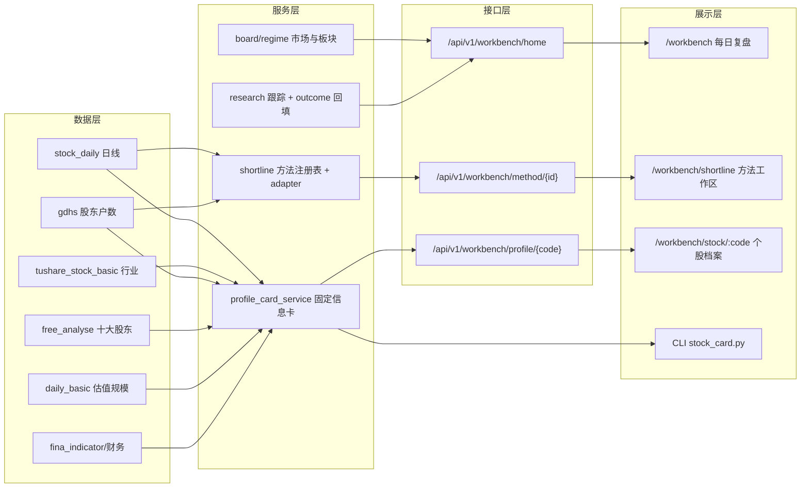

# 工作台实施规划（2026-11-10）

> 对应[重构方案](./个人投研工作台重构方案.md) §0.1 决策与 §8.3 批次，本文把它展开成**可验收的工程计划**。
> 读者视角：每到一批结束，能在本机看到什么具体效果；不写无法验收的"完成度"。

## 1. 目标与交付形态

| 项 | 内容 |
| --- | --- |
| 目标 | 长线＋短线两条主线共用一套档案与证据；短线按**方法**组织；每日首页回答"今天变了什么、昨天强股怎样、我该看哪几只、还等什么" |
| 交付形态 | **dsa-web 正式页面**（`/workbench` 路由 + 子页）＋ **后端 API**（`/api/v1/workbench/*`）＋ **CLI**（同样的数据可直接命令行打印） |
| 不交付 | 新行情源、新调度器、新数据库、新回测引擎；不用前端算准入 |
| 用户端入口 | 浏览器 `http://127.0.0.1:8000/workbench`（现有 dsa-web 服务）；CLI `python scripts/stock_card.py <代码>` |

## 2. 现状盘点：能直接复用的资产

### 2.1 数据（本地已有，P0 立即可用）

| 维度 | 本地来源 | 覆盖 | 现状 |
| --- | --- | --- | --- |
| 基本信息/行业/板块 | `data/cache/reference/tushare_stock_basic_list.csv` | 5,578 只 | ✅ 可用（11-09 更新） |
| 日线（前复权） | `stock_daily`（SQLite） | 5,248 只，至 11-09 | ✅ 可用 |
| 股东户数 | `data/cache/gdfx/gdhs_*.csv`（4 期：2025-09-30 ~ 2026-06-30） | 全市场 | ✅ 可用；字段含本次/上次户数、增减比例、户均持股市值、公告日期 |
| 十大流通股东 | `data/cache/gdfx/free_analyse_*.csv`（7 期：2024-12-31 ~ 2026-06-30） | 全市场 | ✅ 可用；含股东名称与**股东类型**，可聚合基金/社保/QFII |
| 估值/规模/换手 | Tushare `daily_basic`（复用股息线的整市场按日快照 + 本地 CSV 缓存） | 全市场 | ⚠️ 有实现可复用，需按需补当日快照 |
| 财务（营收/扣非/ROE） | Tushare `fina_indicator`（权限未核）→ 备用 AKShare 财务摘要 | 全市场 | ⚠️ 需验证一次权限，失败走 AKShare |
| 板块强度 | 本地日线 + 行业映射 | 全市场 | ✅ 可算（行业 20 日中位、分位、距 120 日高） |

### 2.2 服务与入口（复用，不重写）

| 资产 | 复用方式 |
| --- | --- |
| `dividend_income_service` 的 `_query("daily_basic", trade_date=...)` + 本地缓存 | 直接作为估值/规模数据通道 |
| `scripts/fetch_sub_new_holders.py`（AKShare） | 作为股东户数/十大股东/机构持仓的刷新生产者 |
| `ResearchTrackingService` + `research_tracks`/`research_track_events` + `/api/v1/research-tracks` | 方法跟踪与证据事件复用，不建第二套表 |
| `track_outcome_service`（次日开盘入场 v2 口径） | 方法结果回填复用 |
| `daily_board_service` / `build_today_board.py` | 首页"今日候选/来源健康"复用 |
| dsa-web（React 19 + react-router 7 + recharts） | 新增页面与路由，不动既有页面 |

### 2.3 缺口（必须新建）

1. **固定信息卡服务**：把上面 6 个来源归一成一张带 `as_of`/来源/`pending` 的卡（当前没有任何统一入口）。
2. **短线方法注册表与适配层**：现有 `screen_deep_recovery`、`run_catalyst_digest`、`run_short_term_watch` 各写各的输出，没有统一"方法/进度/确认/失效"语义。
3. **工作台 API**：现有 API 只有 `research-tracks` 与 `screening`，没有"按日期组装首页"的读接口。
4. **工作台页面**：只有静态 HTML 原型。

## 3. 目标架构



原则：**计算只在服务层**；API 只装配与裁剪；页面只渲染与交互。

## 3.1 职责边界（R6/R7 收敛）

| 事项 | 归属 | 说明 |
| --- | --- | --- |
| 方法 universe 过滤（`exclude_industries`、流动性、ST） | **方法定义**（`config/shortline_methods.json`，属规则版本） | 会改变候选集与研究分母，必须在方法版本里登记；被排除的代码与原因保留在方法产物里，不静默丢弃 |
| 页面阅读过滤（行业偏好、数量、折叠） | **前端视图** | 只改可见内容，不改入池、不改验证分母；已有跟踪、昨日冻结队列、风险待办**不因今天改过滤器而消失** |
| 行业分类体系 | `tushare_stock_basic.industry`（单值） | 未知行业按「未分类」处理且不排除；一股多行业/概念不在本版范围，概念板块字段标缺 |
| 方法注册表权威范围 | 只描述**新增研究方法**的适配关系：研究问题、确认/失效规则、producer 引用、评价窗、方法级过滤 | 不替代原有策略目录/冻结登记；producer 启停、冻结与规则版本仍以原配置与冻结登记为唯一真源，注册表只引用其 ID |

## 4. 数据合同（固定信息卡）

| 维度 | 字段（API 键） | 类型/单位 | 来源 | 缺口表现 |
| --- | --- | --- | --- | --- |
| 基本信息 | `code,name,market,list_date,industry,boards[]` | 文本 | stock_basic | `industry=null` → 显示未分类 |
| 规模估值 | `market_cap,float_cap,pe_ttm,pb,turnover` | 亿元/倍/% | daily_basic | 用最近可得日并返回 `as_of` |
| 业绩 | `revenue_yoy,profit_yoy,roe,gross_margin,ocf` | %/亿元 | fina_indicator / AKShare | `report_period` + `pending` |
| 股东户数 | `holders,holders_chg_pct,holders_drop_periods,holders_percentile,holder_asof,holder_ann_date` | 户/%/期 | gdhs | 无披露 → `pending`，不横比 |
| 机构持股 | `fund_count,social_security_count,qfii_count,inst_ratio,inst_chg` | 家/% | free_analyse | 只给已披露报告期，`report_period` 必返 |
| 板块强度 | `industry_ret20,industry_pct,dist_high120` | %/分位 | 日线 + 行业 | 行业样本 < 20 只 → `limited` |

### 4.1 最小字段映射（每项都必须能唯一计算，否则标缺口）

| 字段 | 公式/口径 | 来源与要求 | 缺口分类 |
| --- | --- | --- | --- |
| `market_cap/float_cap` | `total_mv/circ_mv ÷ 10⁴`（元→亿元） | `daily_basic` 当日或最近可得日 | 快照缺失 → `pending` |
| `pe_ttm/pb/turnover` | 直接取 `daily_basic.pe_ttm/pb/turnover_rate` | 同上 | 字段缺失 → `limited` |
| `revenue_yoy/profit_yoy` | **累计同比**（报告期口径），`or_yoy/netprofit_yoy`；AKShare 兜底取「主营业务收入增长率/净利润增长率」 | `fina_indicator` 或 AKShare 财务指标 | 权限失败 → `pending`（原因写权限）；无公告日 → 按报告期+90 天保守判定 |
| `roe/gross_margin` | 直接取 `roe/grossprofit_margin`（%，累计） | 同上 | 同上 |
| `ocf` | Tushare `ocfps`（每股经营现金流）**不换算绝对金额**，页面显示「每股经营性现金流(元)」 | 同上 | 不做元→亿元推算 |
| `inst_ratio` | `Σ机构类持股数量 ÷ 同报告期总股本 × 100` | `free_analyse`（数量）+ `gdhs` 同报告期 `总股本`；分母缺失 → `limited` | 不得用当日股本配历史持仓 |
| `inst_chg_pct` | 相邻两个**同报告期口径**的机构持股数量合计环比 | 同上 | 仅一个报告期 → 无环比（`reason` 标注） |
| `holders_percentile` | 该票在**已披露口径**历史期中的分位（`count(<当前值)/期数`），并列值按 `<` 计 | `gdhs`；期数 < 6 → `limited` | 与「专题 16 季 min/max 位置」是不同指标，不互相替代 |
| `industry_pct` | 行业 20 日收益中位数在**全部行业**中的分位；样本 < 20 只 → `limited` | 本地日线 + `stock_basic.industry` | 未分类行业不参与分位 |
| `dist_high120` | `close ÷ max(high, 近 120 交易日) − 1`（个股自身序列） | 本地日线 | 不足 120 日 → 用可得区间并标注 |
| `list_date/concepts` | **当前不可算**：`stock_basic` 快照只含 ts_code/code/name/industry/area/market | 需另接数据源 | 归「来源未接入」，与 `pending`（等披露）区分 |

统一返回信封：

```json
{
  "code": "600519",
  "as_of": "2026-11-09",
  "generated_at": "2026-11-10T18:20:00",
  "sections": {
    "basic":   {"status": "ok", "data": {...}, "source": "stock_basic"},
    "valuation": {"status": "ok", "as_of": "2026-11-09", "data": {...}},
    "earnings": {"status": "pending", "reason": "报告期未披露/权限不足"},
    "holders": {"status": "ok", "report_period": "2026-06-30", "ann_date": "2026-08-31", "data": {...}},
    "institution": {"status": "ok", "report_period": "2026-06-30", "data": {...}},
    "sector": {"status": "limited", "reason": "行业样本 12 只"}
  },
  "limitations": ["机构权重变化≠主动加减仓"]
}
```

`status ∈ ok | pending | limited | missing`，页面按状态显示灰底/待补/受限，**不猜、不省略**。

## 5. API 契约（新增）

| 方法 | 路径 | 说明 | 关键参数 |
| --- | --- | --- | --- |
| GET | `/api/v1/workbench/home` | 首页 5 区块聚合 | `date`（默认最新交易日） |
| GET | `/api/v1/workbench/profile/{code}` | 固定信息卡 + 该股全部假设/证据时间线 | `as_of` |
| GET | `/api/v1/workbench/methods` | 方法列表与状态（启用/未接入/样本数） | — |
| GET | `/api/v1/workbench/method/{method_id}` | 某方法的候选、跟踪、待确认、失效 | `date`、`status` |
| GET | `/api/v1/workbench/kline/{code}` | 日/周/月 OHLC + 成交量；**必须带截止日** | `period`、`limit`、`as_of`（与首页同一截止日） |

> 历史视角约定：首页/方法/档案/K 线共用同一个 `as_of`；页面链接把 `as_of` 透传下去（`/workbench/stock/600519?as_of=2026-11-02`），K 线按 `date <= as_of` 截断，周/月线只用截止日前已完成的区间；所选日期非交易日时回退到该日前最近交易日并在页面标注。

首页返回结构（`/home`）：

```json
{
  "as_of": "2026-11-09",
  "market": {"regime": "defensive", "evidence": "000300 4250.1 < MA20 4392.4"},
  "sections": {
    "sector_moves": [{"name": "机器人", "change": 0.032, "state": "扩散", "source": "catalyst_digest"}],
    "yesterday_strong": {"total": 46, "continued": 12, "weakened": 28, "missing": 6, "rows": []},
    "shortline": [{"method": "hotspot", "new": 3, "tracking": 8, "confirming": 2, "invalid": 1}],
    "longterm_changes": [{"code": "600519", "change": "半年报扣非 +12%", "hypothesis": "..."}],
    "todos": [{"type": "risk_review", "code": "000001", "due": "2026-11-11"}]
  },
  "limitations": ["资讯源 0 条，热点原因未确认"]
}
```

## 6. 页面信息架构

```
/workbench                 每日复盘（默认首页，5 区块）
/workbench/shortline       短线方法工作区（方法标签 + 列表 + 进度）
/workbench/shortline/:method  单方法详情（最新发现 / 跟踪中 / 待确认 / 失效）
/workbench/longterm        长线研究（公司 → 假设 → 证据变化 → 下次复核）
/workbench/stock/:code     个股档案（固定信息卡 + K线日周月 + 为什么涨 + 研究时间线）
/workbench/validation      方法与验证（方法级评价窗、样本身份、批次）
```

交互约定：日期切换器在顶栏（默认最新交易日）；所有受限数据带灰底标注与原因 tooltip；列表点击下钻个股档案，不弹窗丢上下文。

## 7. 分批实施

### P0 固定信息卡（1 批，可独立验收）

| 项 | 内容 |
| --- | --- |
| 交付 | `src/services/profile_card_service.py`（五维度聚合 + 状态机）、`scripts/stock_card.py`（CLI 打印）、`scripts/fetch_profile_data.py`（按需补 daily_basic / fina_indicator）、`tests/test_profile_card.py` |
| 数据复用 | gdhs/free_analyse/stock_basic/stock_daily 本地直读；daily_basic 走股息线通道；fina_indicator 权限失败自动降级 AKShare |
| 验收 | ① 任意 5 只票（含 1 只金融、1 只次新、1 只停牌）输出完整信封，缺项为 `pending/limited` 且带原因；② 同一代码两次调用结果一致（幂等）；③ 报告期字段与公告日严格来自数据源，不推算 |
| **你能看到** | 命令行一条 `python scripts/stock_card.py 600519` 输出结构化卡片（市值/PE/PB/换手、营收扣非增速、股东户数与连续下降期数、基金/社保家数与合计占比、行业强度与距高点） |
| 不做 | 不全市场抓取；不在 P0 引入新表结构 |

### P1 短线方法骨架（热点、超跌两条端到端）

| 项 | 内容 |
| --- | --- |
| 交付 | `config/shortline_methods.json`（方法定义：问题/输入/确认/失效/评价窗/生产者/adapter/行业过滤开关）、`src/services/shortline/registry.py`、`src/services/shortline/adapters/{hotspot,deep_recovery}.py`、`scripts/run_shortline_methods.py`、`tests/test_shortline_methods.py` |
| 流程 | 发现（生产者输出）→ 归一化事件 → 建 track（复用两表，`branch=measurement_only`）→ 状态推进（观察/待确认/失效）→ 价格测量回填（复用 outcome v2） |
| 生命周期边界 | **价格测量完成 ≠ 研究结束**：方法 track 打 `measurement_only`，v2 只写测量证据、不自动关闭；研究何时结束由方法自己的确认/失效/到期规则决定（见 `config/shortline_methods.json` 的 confirm/invalid 规则） |
| 行业过滤 | 默认排除 银行/保险/证券/多元金融/建筑工程/建筑装饰（配置项 `exclude_industries`，长线方法默认关闭） |
| 验收 | ① 两条方法各自产出候选与状态变化，失败/零项也有明确记录；② 同源同版重跑幂等；③ 缺数据不伪造确认；④ 方法交集未登记时不允许组合 |
| **你能看到** | `data/strategy_review/methods/<method>/<date>.json`＋CLI 表格：今天各方法的新发现、跟踪中、待确认、失效条数与名单 |
| 不做 | 不接股东户数（P3）；不改动旧 5 信号的默认每日开关 |

### P2 页面集成（dsa-web）

| 项 | 内容 |
| --- | --- |
| 交付 | `api/v1/endpoints/workbench.py`（5 个读接口）、`apps/dsa-web/src/pages/WorkbenchPage.tsx`、`ShortlinePage.tsx`、`StockProfilePage.tsx`、`api/workbench.ts`、路由与侧边导航入口、i18n 文案 |
| 验收 | ① `npm run lint && npm run build` 通过；② 首页 5 区块与 CLI 数据一致（同 `as_of` 同数字）；③ 受限数据灰底 + 原因；④ 切日期后所有区块同步；⑤ 点列表进个股档案不丢上下文 |
| **你能看到** | 浏览器打开 `http://127.0.0.1:8000/workbench`：今日板块变化、昨日强股今日结果、我的短线研究（按方法）、长线新变化、待办；点任意票进档案看 K 线（日/周/月）+ 为什么涨（事实/解释/推断分栏）+ 研究时间线 |
| 不做 | 前端不写准入/资格判断；静态 HTML 原型保留但不扩展 |

### P3 方法扩展与收敛（股东户数、交集、旧信号生产者化）

| 项 | 内容 |
| --- | --- |
| 交付 | `shortline/adapters/holders.py`（基于 gdhs 披露跟踪）、方法交集规则（`config/shortline_methods.json#intersections`）、旧 5 信号 adapter（只产事件、不默认每日）、`tests/test_shortline_intersections.py` |
| 验收 | ① 股东户数方法从披露→观察→启动→失效完整可读；② 交集规则单独登记版本并单独分母；③ 旧信号以 producer 身份进入方法区，仍可手动单跑 |
| **你能看到** | 方法列表多出"股东户数"，展示"最近披露户数历史分位 + 收录后价格是否启动"；旧信号出现在方法区且标"非默认每日" |

## 8. 测试与反例映射（对应方案 §8.1）

| 反例 | 覆盖批次 | 测试落点 |
| --- | --- | --- |
| 长线/短线同股多假设并存 | P1 | `test_shortline_methods.py::test_same_code_multiple_hypotheses` |
| 户数统计日早于披露日、历史视图不前视 | P3 | `test_holders_asof_no_lookahead` |
| 不同方法不被统一交集过滤 | P1 | `test_methods_not_intersected_by_default` |
| 昨日强股下跌/停牌仍在队列 | P2 | `test_yesterday_queue_keeps_failures` |
| 同源同版重跑幂等 | P1 | `test_method_rerun_idempotent` |
| 一条收益多次修订只算一个有效样本 | P1（复用 outcome） | 现有 `test_workbench_regressions.py` |
| 截止日不读未来数据 | P0/P1 | `test_profile_asof_isolation` |
| T+1 成熟不等于 T+5 充分 | P1 | `test_window_sufficiency` |
| 晚间信号不模拟当日收盘成交 | P1（复用 v2） | 现有入场协议测试 |
| 价格口径未知时隔离 | P0 | `test_profile_price_basis_unknown` |
| 批次未完成只读受限 | P1 | `test_method_batch_not_ready` |
| 源失败不推进水位 | P1 | `test_source_failure_keeps_watermark` |
| 普通反转不冒充 RE01 | P1 | `test_re01_identity_isolated` |
| 收盘折线不能称 K 线；阳线≠上涨日 | P2 | `test_kline_ohlc_fields`、`test_updown_metrics_distinct` |
| 新方法只补原实现、复用共用页 | P3 | 代码评审检查项 |

## 9. 风险与回退

| 风险 | 影响 | 处置 |
| --- | --- | --- |
| Tushare 配额不足（daily_basic/fina_indicator） | 估值/业绩显示 `pending` | 只对查询票与入围票抓取；AKShare 兜底；缓存优先 |
| 股东户数只有 4 期 | 分位口径弱 | 先出"绝对户数 + 连续变化 + 户均市值"，分位标 `limited`；P3 补历史期 |
| 财务报告期滞后 | 业绩维度空窗 | 显示 `report_period` 与公告日，不推算当期 |
| 方法适配层改动影响旧链路 | 影响默认每日 | 新代码只读旧产物；旧开关不改，回退=删除新入口 |
| 页面重构影响既有 Web | 构建/路由冲突 | 新增路由与页面，不改既有页面；先 lint+build 再合并 |

回退方式：每批独立提交，回退删除新增文件与路由即可，不改数据库结构（P0–P3 均不新建表）。

## 10. 影响面

- **不改**：`main.py`、夜间 cron 脚本、`research_tracks` 表结构、`track_outcome_service` 口径、既有 screening 预设、旧 5 信号的启停。
- **新增**：`profile_card_service`、`shortline/` 包、`/api/v1/workbench/*`、`/workbench` 页面、两个 CLI。
- **文档**：每批结束更新本节与方案 §8.2，并在 `docs/CHANGELOG.md` 记一条。

## 11. 实施状态（2026-11-10 当日落地）

| 批次 | 状态 | 交付文件 | 实测结果 |
| --- | --- | --- | --- |
| P0 固定信息卡 | ✅ 已实现 | `src/services/profile_card_service.py`、`scripts/stock_card.py`、`scripts/fetch_profile_data.py`、`tests/test_profile_card.py`（6 passed） | `stock_card.py 600519` 输出五维度真实数据：市值 18,063 亿 / PE 21.99 / PB 6.66 / 换手 0.20%；业绩报告期 2026-06-30（营收 +1.47%、扣非口径为净利同比 −2.03%、ROE 17.72%）；股东户数 296,404 户、环比 +21.9%、连续下降 0 期（4 期披露→分位标 `limited`）；机构基金 1 家 0.81%；板块白酒相对强度与 19 只同业样本 |
| P0 补数 | ✅ 已跑通 | `data/cache/profile/daily_basic_20261109.csv`（5,573 行）、`fina_indicator_600519/600036/002929/000338.csv` | Tushare `fina_indicator` **无权限** → 自动降级 AKShare；公告日未知时用「报告期+90 天」保守判定并在返回里标注 |
| P1 方法骨架 | ✅ 已实现 | `config/shortline_methods.json`、`src/services/shortline/{registry,base,runner}.py`、`adapters/{hotspot,deep_recovery,holders,legacy}.py`、`scripts/run_shortline_methods.py`、`tests/test_shortline_methods.py`（7 passed） | 11-10 跑通 4 条方法：热点 8 / 超跌 8 / 股东户数 8 / 旧信号 20；热点已按行业 2 只封顶、银行等 10 个行业被方法级排除（42 只银行 0 只入池） |
| P2 页面集成 | ✅ 已实现 | `api/v1/endpoints/workbench.py`（5 个读接口）、`apps/dsa-web/src/api/workbench.ts`、`pages/{WorkbenchPage,ShortlinePage,StockProfilePage}.tsx`、路由 + 侧边栏「投研工作台」+ 中英文案 | `npm run lint` 0 error、`npm run build` 通过；服务重启后 `GET /api/v1/workbench/home` 200，`/workbench` 可访问 |
| P3 方法扩展与收敛 | ✅ 已实现 | `adapters/holders.py`（披露时点隔离 + 连续下降期数）、`intersections`（默认关闭、独立分母）、`adapters/legacy.py`（旧五信号仅归集，`default_daily=false`） | 交集未启用时 `count=0` 且有 `enabled=false`；旧信号出现在方法区并标「非默认每日」 |

### 11.1 当日实测（2026-11-10）

- 首页 API：全市场 20 日收益中位 **−6.9%**、站上 MA20 占比 **40%**；昨日强股队列 30 只 → 今日延续 23 / 走平 6 / 走弱 1；4 个方法产出与 20 条到期待办。
- 结果回填：`evaluate_track_outcomes.py` 前向 `checked=138 written=67`（11-09 方法样本开始有 T+1），`not_due=44` 为当日新样本。
- 已知缺口：①热点方法未接资讯，不解释涨跌原因；②股东户数仅 4 期披露，分位标 `limited`；③长线区当前只列跟踪中的长线假设，财报/机构证据尚未接入首页；④Tushare `fina_indicator` 无权限，业绩长期依赖 AKShare 兜底。

### 11.2 复验入口

```bash
./.venv-linux/bin/python scripts/stock_card.py 600519                 # P0
./.venv-linux/bin/python scripts/run_shortline_methods.py             # P1/P3
curl -s localhost:8000/api/v1/workbench/home | head -c 300            # P2 数据
# 浏览器：http://127.0.0.1:8000/workbench
./.venv-linux/bin/python -m pytest -q tests/test_profile_card.py tests/test_shortline_methods.py
```

### 11.3 评审收敛（2026-11-10，对应 R1–R8）

| 发现 | 处理 | 落点 |
| --- | --- | --- |
| R1 旧信号状态冲突 | 新增方案 §0.2 迁移表：8 个原生 ID 逐项写「当前生产 / 冻结状态 / 目标生产 / 展示 / 消费范围 / 批次」；已冻结 5 个保持冻结，仍默认每日的 3 个本次不动开关 | 方案 §0.1 第 5 项 + §0.2 |
| R2 两套验收路线 | §8.3 声明为**权威施工表**，旧「A1-a 须含百日新高+screening」被替代；补 A0–A4 ↔ P0–P3 映射与「两周试用」位置 | 方案 §8.3 |
| R3 回填当生命周期 | 方法 track 打 `branch=measurement_only`，`track_outcome_service` 只写测量不自动关闭；新增 `measured_only` 计数与 `test_measurement_only_track_not_auto_closed` | 代码 + 本文 P1 表 |
| R4 历史日期未贯穿 K 线 | `getKline` 增加 `asOf`，首页/方法链接透传 `?as_of=`，档案页标题标注「历史视角」；合同写清周/月线截断与非交易日回退 | 代码 + 本文 §5 |
| R5 回退命令丢改动 | 修改记录改为「按本轮 diff 回退」（`git apply -R` / `git restore -p`），明确禁止整文件 `git checkout` | 修改记录 |
| R6 过滤分层 | 新增 §3.1：方法 universe 过滤属规则版本、页面过滤只改阅读；已建跟踪/昨日队列/待办不因过滤器消失 | 本文 §3.1 |
| R7 注册表权威范围 | §3.1 写清注册表只描述新增方法的适配关系，producer 启停/冻结/版本仍以原配置与冻结登记为真源 | 本文 §3.1 |
| R8 字段可算性 | 新增 §4.1 最小字段映射（公式/单位/来源/缺口分类），`list_date`/`concepts` 明确归「来源未接入」，`basic` 段返回 `missing_fields` | 本文 §4.1 + 代码 |

### 11.4 本轮追加交付（评审后）

- **夜间链路接入**：`scripts/run_workbench_postprocess.sh` 增加 `methods` 步骤（`run_shortline_methods.py --date <board_date>`），失败不阻断后续统计。
- **长线区补证据**：`/api/v1/workbench/home` 的 `longterm_changes` 现在为「长线跟踪 + `config/workbench_longterm.json` 关注池」逐票补业绩（报告期/营收/净利/ROE）、机构（基金家数/占比/环比）、户数（披露日/连续下降期数），并带 `limitation` 与逐段 `status`。

## 12. 每日复盘模块（2026-11-10 当晚追加）

### 12.1 为什么加

首页原来三块信息（方法候选行业分布、昨日强股今日表现、方法计数）被判定为"任何行情 App 都能看到且没有方法含义"。
复盘模块改成回答三个具体问题：**今天谁封住了、谁炸了、板块是怎么走的**，每个数字都带来源与口径。

### 12.2 数据与口径

| 区块 | 来源 | 口径/限制 |
| --- | --- | --- |
| 涨停/炸板/跌停家数 | 东财 `stock_zt_pool_em` / `stock_zt_pool_zbgc_em` / `stock_zt_pool_dtgc_em` | 收盘后完整；盘中为实时快照 |
| 封板率 | 涨停 ÷ (涨停 + 炸板) | 不分首板/连板；不区分是否回封 |
| 连板梯队 | 涨停池 `连板数` 分桶 | `boards<=1` 归首板 |
| 封单合计 | 涨停池 `封板资金` 求和 | 近似资金强度，不代表可成交 |
| 板块涨停分布 | 涨停池 `所属行业` | 行业名是截断版（如「汽车零部」） |
| 板块涨幅/涨跌家数/领涨股 | 东财 `stock_board_industry_name_em` | 仅**最新交易日**可取，历史日期不回填；按行业名最长前缀匹配 |
| 降级路径 | 本地日线近似 | 收涨 ≥9.5%/19.5% 记涨停、最高价触涨停但收盘未封记炸板；标 `status=limited`，不落缓存、不输出封单 |

### 12.3 与行情 App 的差异（明确边界）

- 我们**不追求盘中逐笔**：没有分笔、封单变化、龙虎榜席位、资讯推送，这些 App 更强。
- 我们独有的是**可回溯与可验证**：每个交易日的复盘快照落盘（`data/cache/market_review/<date>.json`），
  可以回看任意日、对照方法候选当日是否出现在涨停池、后续 T+1/T+3/T+5 超额如何。
- 复盘与方法层共享同一 `as_of` 语义：复盘用最新交易日，方法用最近完整日线日，页面显式标两个日期。

### 12.4 双日期口径（重要）

当日日线在收盘后尚未全量同步时（例如只写进来 179/5210 只），横截面与「当日涨幅」会大面积失真。
`/home` 返回 `review_as_of`（最新交易日，用于涨停/炸板复盘）与 `as_of`（覆盖 ≥60% 的最近交易日，用于横截面/方法/长线），
并在 `limitations` 里写明覆盖数；`ret1` 不再用 ffill 价格，未成交日返回空而不是 0。

## 13. 炸板后跟踪（2026-11-10 晚定稿）

### 13.1 为什么按"炸板事件"而不是按股票

需求是「前天炸板的票，昨天和今天怎么样；炸板时是有人用大单接，还是大单出货、散户接盘」。
按股票聚合会把不同日期的炸板混在一起，看不出"炸板之后发生了什么"，所以改成 **股票 × 炸板日** 的事件行。

### 13.2 字段与口径

| 字段 | 来源 | 说明 |
| --- | --- | --- |
| 炸板日 / 炸板次数 | 东财炸板池（`stock_zt_pool_zbgc_em`，按日缓存） | 每日按成交额取前 `per_day` 只，避免一次列出上百行 |
| 成交额 / 换手率 | 同上 | 成交额 ≥5 亿在界面加粗（成交额越大越可能有自救资金） |
| 炸板日 主力 / 超大单 / 大单 / 中单 / 小单 净额 | 东财个股资金流历史（`stock_individual_fund_flow`） | 逐票按 `as_of` 缓存；主力=超大+大单，散户=中+小单 |
| T+1 / T+2 / 至今 涨跌 | 同上（含每日收盘价） | 以炸板日收盘为基准 |
| 状态：已站稳 / 冲高回落 / 未修复 / 待观察 | 计算 | 已站稳=最新收盘≥炸板日收盘；冲高回落=期间最高收盘曾≥炸板日收盘；待观察=炸板后还没有交易日 |
| 判定标签 | 计算 | 资金侧（大单承接 / 大单出货 / 多空混合）× 价格侧（四态），只描述事实 |
| 当日逐笔买/卖笔数 | `tick_flow_service` | 只有炸板日=最近交易日时才有 |

### 13.3 实测样本（2026-11-10 收盘，per_day=6）

| 炸板日 | 观察 | 结果 |
| --- | --- | --- |
| 11-09 | 6 只全部「大单承接」（主力 +0.28~+6.26 亿、小单净流出） | T+1 全部收正（+1.7%~+6.6%），全部「已站稳」 |
| 11-05 | 5 只「大单承接」 | T+1 多为负（-2.4%~-4.5%），「未修复」——承接不等于立刻修复 |
| 11-06 | 桂林三金 主力 -0.24 亿、散户净买 | 「大单出货·未修复」，T+1 -5.8% |

这说明"大单承接"是必要条件而非充分条件：还要结合成交额量级与次日是否放量站回。

### 13.4 关于 L2

- 东财 App 的 Level-2（十档/逐笔委托）是付费授权数据，没有公开导出；不抓 App 私有接口。
- 目前用的公开数据：炸板池、个股资金流历史（每日分档净额）、分笔明细（当日买/卖方向与单笔大小）。
- 若拿到授权逐笔/十档源，可在 `tick_flow_service` 旁加 provider，输出同一份 `buckets` 结构即可复用页面。

### 13.5 打分（2026-11-10 量化收敛）

研究见 `炸板跟踪量化-20261110.md`，实现见 `src/services/broken_score.py`：

- 特征：log 量比、主力净占比、散户净占比、炸板次数、换手率、当日涨跌幅；
- 权重来自逻辑回归（n=387，AUC 0.628），其中 **log 量比 -0.383 是主项**；
- 输出 0~100 分与等级（≥42% 重点观察、36%~42% 观察、<36% 不跟），组内按分数降序；
- 分数只是排序工具：最高十分位胜率 41% 仅略高于基准 37.7%，不可当买入信号。
### 13.6 炸板时段口径（2026-11-11 更正，schema=2）

- `moment_amount/moment_ratio`（**炸板瞬间**）：首次跌破涨停价后 **5 分钟**内的成交额及其占全天比例
  —— 页面列名「炸板瞬间5m」。
- `open_amount/open_ratio`（旧口径）：开板至收盘累计，仅悬停展示、**不参与打分**。
- `super_net/big_net`：开板后（价格低于涨停价期间）超大单 / 大单净额；历史日期无方向，
  打分时退回当日资金流分档（`funds.super/big`），页面该列显示 `—`。
- 取数：当日 `stock_intraday_em` → 失败降级 `stock_zh_a_tick_tx_js`（腾讯，无分档阈值差异，按单笔金额分档）；
  历史用 5 分钟线（`stock_zh_a_hist_min_em`）。
- 缓存：`data/cache/break_window/<code>_<date>.json`，`SCHEMA=2`；口径变化必须 bump，否则旧缓存会继续返回错值。
- 打分硬规则（覆盖模型）：大单+超大单净卖且资金净流出 → 封顶 30（不跟）；仅大单净卖 → 40；
  缺分档 → 45；换手 ≥30% → 50。`log炸板占比` 系数置 0（只展示不计分）。
- 历史结论更正见 `炸板跟踪量化-20261110.md` §7：旧 §6 的占比分桶与 +0.188 系数因口径错误作废。
